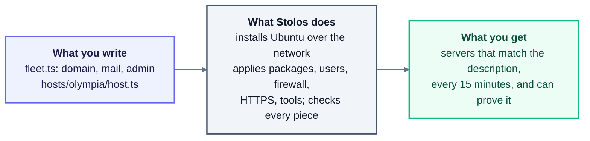
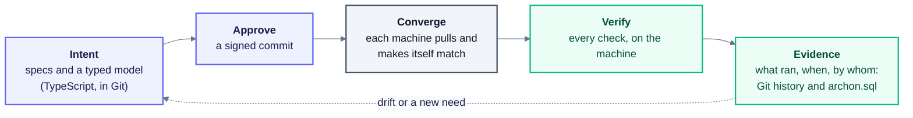
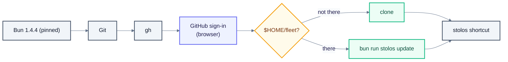
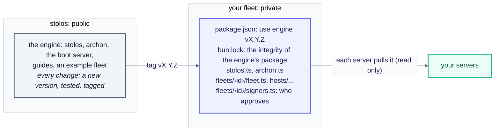
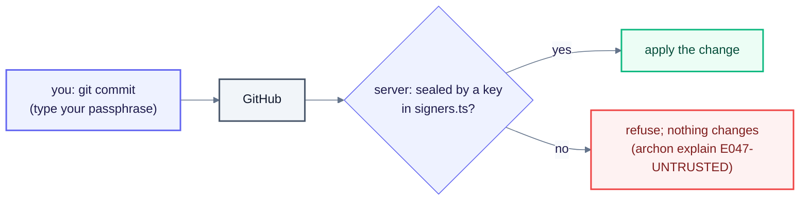
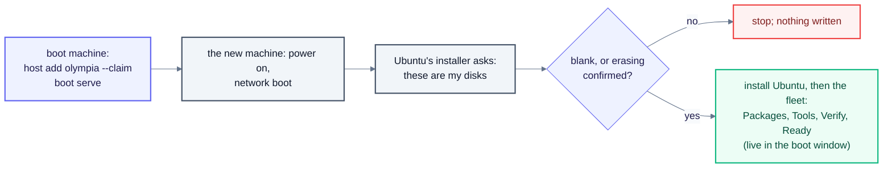

# Stolos

Stolos turns bare machines into Ubuntu servers that set themselves up, keep themselves right, and
can prove it. You describe your machines in a few TypeScript files; its two commands do the rest:
`stolos` on your PC, for the fleet, and `archon` on each machine, for itself.



Ubuntu decides; Stolos only adds (see the [constitution](.specify/memory/constitution.md)).

## Why Stolos, and where it fits

Infrastructure as code is a crowded field, and each tool covers part of the job:

| Tool                    | What it does well                          | What it leaves to you                                        |
| ----------------------- | ------------------------------------------ | ------------------------------------------------------------ |
| Ansible                 | runs steps on machines over SSH (YAML)     | the order of steps, drift between runs, installing the OS    |
| Terraform, OpenTofu     | creates cloud resources from a plan        | what happens inside each machine                             |
| Puppet, Chef, Salt      | an agent keeps a machine converged (a DSL) | a server or master to run, the OS install, a second language |
| cloud-init, autoinstall | sets up a machine on its first boot        | everything after the first boot                              |
| NixOS                   | a fully declared system                    | a different distribution from the one you run elsewhere      |

Shahid Shah created Stolos because he wanted **one unified experience** from bare metal to a
verified server: state the intent once, then let every machine converge to it and prove that it did.
No control server, no agent to install, no second language: two commands (`stolos` on your PC,
`archon` on each machine) run by **Bun**, a single binary, and **GitHub** as the only state, fully
versioned. Every change is a signed commit, so the history of each server is the history of its
repository.



**Why Ubuntu 26.04, for now.** Stolos is built for an **AI-native era**: people decide what their
servers and workspaces should be, and AI agents carry out most of the operations. An agent that
works from loose notes drifts, so the intent has to be precise and checkable: specs (Spec Kit, in
`specs/`), a constitution, and a typed ontology of fleets, hosts, capabilities, and checks. Doing
that well for one operating system matters more than doing it loosely for many, so Stolos targets
Ubuntu 26.04 LTS servers (and Ubuntu on WSL as a workstation), and Ubuntu decides everything it does
not need to add. Agents reach servers only through `archon`'s MCP server, limited by each server,
and can never approve a change: only a signature can.

**Compliance as code.** Because the intent and the infrastructure (physical machines, VMs,
containers, workstations) are all type-safe TypeScript, they can be read as data, not just run. The
same model that installs a server says what it should be, its checks say whether it is, and the
signed history says who approved each change and when. That is the raw material of SOC 2, HIPAA, and
similar audits; Stolos is designed so that their controls and evidence can be generated from code
rather than written by hand. (Generating those reports is the direction, not yet a command.)

## What you need

`stolos` runs on **Windows, macOS, or Linux**. All it needs is **[Bun](https://bun.sh)** at the
version the engine pins (1.4.4; Node 26 runs the same code where Bun cannot), a single program with
no other dependencies, plus Git and `gh` (GitHub's command line) to work with your fleet repository.
Servers need nothing installed by you: Stolos puts the pinned Bun and `archon` on each one as it
installs it.

### Bootstrap your PC in one line

The PC you run `stolos` on is the fleet's **controller**. One line makes a PC one. It installs the
pinned Bun (its SHA-256 checked before it is unpacked), Git and `gh`, signs you in to GitHub in the browser, clones your fleet repository into
**`$HOME/fleet`** (on Windows, `C:\Users\<you>\fleet`), and adds the `stolos` shortcut. Replace
`<owner>/<fleet-repo>` with your fleet repository:

| System                                  | Run                                                                                                                                                              |
| --------------------------------------- | ---------------------------------------------------------------------------------------------------------------------------------------------------------------- |
| Windows (PowerShell, not Administrator) | `& ([scriptblock]::Create((irm https://raw.githubusercontent.com/intellectual-frontiers/stolos/v0.59.0/bin/bootstrap.windows.ps1))) --repo <owner>/<fleet-repo>` |
| macOS or Linux (Terminal)               | `bash <(curl -fsSL https://raw.githubusercontent.com/intellectual-frontiers/stolos/v0.59.0/bin/bootstrap.sh) --repo <owner>/<fleet-repo>`                        |



Each step checks first and skips what is already done, so running it again is always safe: on a PC
that already has the fleet, it brings it up to date (`bun run stolos update`). Options, the same
on every system:

| Option                | What it does                                                                                                                                                                     |
| --------------------- | -------------------------------------------------------------------------------------------------------------------------------------------------------------------------------- |
| `--repo <owner/name>` | the fleet repository (required here; a fleet's own copy in its `bin` knows it)                                                                                                   |
| `--in <folder>`       | where the fleet goes (default `$HOME/fleet`)                                                                                                                                     |
| `--destroy-existing`  | remove that folder first, then clone it fresh. Only a checkout of the same repository; edits or commits not on GitHub yet are listed, and you type the folder's name to go ahead |
| `--no-shortcut`       | do not add the `stolos` shortcut                                                                                                                                                 |
| `--dry-run`           | say what each step would do; change nothing                                                                                                                                      |

**How it works, line by line.** [`bin/bootstrap.sh`](bin/bootstrap.sh) (Linux and macOS; it tells
them apart itself) and [`bin/bootstrap.windows.ps1`](bin/bootstrap.windows.ps1) are written to be
read: each step says what it does and why. They prefer the system's own packages (Ubuntu's `gh`
before GitHub's), never need Administrator on Windows (Bun goes into your own folder; `winget` asks
if it must), and use `sudo` on Linux only to install Git or `gh` when they are missing.

**Your fleet's own copy.** `bun run stolos fleet init` writes `bin/bootstrap.sh` and
`bin/bootstrap.windows.ps1` into the fleet repository with its name filled in (so `--repo` is not
needed), and `bun run stolos fleet upgrade` keeps them in step with the engine. A private fleet
repository's files cannot be downloaded before you sign in, so a new PC starts from the engine's
public bootstrap above; the fleet's copy is for running again later, from `$HOME/fleet`.

<details>
<summary><b>By hand instead</b>: the same installs, one system at a time</summary>

<details>
<summary><b>Windows</b> (PowerShell)</summary>

```powershell
powershell -c "& {$(irm https://bun.sh/install.ps1)} -Version 1.4.4"
winget install --id Git.Git
winget install --id GitHub.cli
```

Open a new PowerShell window, then check: `bun --version` (1.4.4) and `gh auth login`.
Windows is the usual **boot machine** (the PC that installs new servers); see
[The boot machine](https://intellectual-frontiers.github.io/stolos/latest/archon-boot/mod.ts/index.html)
for its firewall and network settings.

</details>

<details>
<summary><b>macOS</b> (Terminal)</summary>

```sh
brew install git gh                                   # with Homebrew (https://brew.sh)
curl -fsSL https://bun.sh/install | bash -s "bun-v1.4.4"  # Bun, into ~/.bun/bin
```

Then `bun --version` (1.4.4) and `gh auth login`.

</details>

<details>
<summary><b>Linux</b> (Ubuntu, or Ubuntu on WSL)</summary>

```sh
sudo apt install -y git gh unzip
curl -fsSL https://bun.sh/install | bash -s "bun-v1.4.4"  # Bun, into ~/.bun/bin
```

Open a new terminal, then `bun --version` (1.4.4) and `gh auth login`. Servers need nothing
installed by you: Stolos puts the pinned Bun and `archon` on each one as it installs it.

</details>

</details>

## Two commands: `stolos` and `archon`

| Where                                 | Command                                            | For                                                                                   |
| ------------------------------------- | -------------------------------------------------- | ------------------------------------------------------------------------------------- |
| your PC, in the fleet repository      | `bun run stolos ...` (or just `stolos ...`, below) | the fleet: keys, adding and installing machines (`stolos boot ...`), backups, updates |
| each server or workstation (over SSH) | `archon ...`                                       | that machine: its state, `verify`, `update`, `reboot`, PostgreSQL, data               |

Each points at the other: `archon keys setup` on a server says to run `bun run stolos keys setup`
on your PC, and `stolos apply` says to run `archon apply` on the machine. With no arguments,
`stolos` shows where you are and the next step; `archon` shows the machine's state.

**A shortcut: `stolos` instead of `bun run stolos`.** It works in the fleet folder (where
`package.json` is), and runs the engine version pinned there. The bootstrap adds it for you (unless
`--no-shortcut`); by hand:

<details>
<summary><b>Windows</b> (PowerShell)</summary>

```powershell
if (!(Test-Path $PROFILE)) { New-Item -Force $PROFILE | Out-Null }
Add-Content $PROFILE 'function stolos { bun run stolos @args }'
. $PROFILE
```

If PowerShell says "running scripts is disabled on this system", allow your own profile once:
`Set-ExecutionPolicy -Scope CurrentUser RemoteSigned`, then open a new window.

</details>

<details>
<summary><b>macOS and Linux</b></summary>

zsh (macOS's default): `echo 'stolos() { bun run stolos "$@"; }' >> ~/.zshrc`; bash:
`echo 'stolos() { bun run stolos "$@"; }' >> ~/.bashrc`; then open a new terminal. In fish (the
fleet's workstations): `function stolos; bun run stolos $argv; end; funcsave stolos`.

</details>

The rest of this README writes `bun run stolos`, which always works.

## Two kinds of repository

This repository is the **engine**: public, with no real machines in it. Each fleet lives in a
**fleet repository** of its own, private, that uses the engine by version.



A fleet repository holds descriptions only. Its passwords and keys stay on one PC (the **boot
machine**, which also installs new machines); what each machine records about itself stays on that
machine, where `archon` asks it.

## Why changes are signed

Your servers take their instructions from the fleet repository on GitHub. If anyone or anything that
can push to it could change your servers (a stolen GitHub password, a leaked token, an automated
tool, an AI agent), that would be the weak point. So every change must be **signed**.

Signing uses a **key pair**: two files made together.

- The **private key** is yours alone. It stays on your PC, locked with a passphrase you type each
  time. Like a wax seal: only you hold it.
- The **public key** (the same file name with `.pub`) can be shared with anyone. Like a picture of
  the seal: anyone can check that a letter was sealed by you, but no one can seal with it.

Git seals each commit with your private key. The fleet lists the public keys it trusts in
`signers.ts`. Each server checks every new commit: sealed by a listed key, and following on from the
commit it already runs (no going back). Otherwise it refuses, and nothing changes.



The engine's integrity in `bun.lock` makes your seal cover the engine's code too: a server installs
exactly the engine package you approved (`bun install --frozen-lockfile`), or stops.

## Set up a fleet repository

1. Create an empty private repository on GitHub, then bootstrap this PC with it (above:
   `--repo <owner>/<new-repo>`). It clones the empty repository into `$HOME/fleet`; `cd` into it.
2. Start the fleet with the engine's latest version (it writes `package.json`, `bun.lock`,
   `stolos.ts`, `archon.ts`, `.gitignore`, and `fleets/<id>/fleet.ts` from your GitHub account):

   ```sh
   bun add https://github.com/intellectual-frontiers/stolos/releases/download/v<version>/intellectual-frontiers-stolos-<version>.tgz
   bun node_modules/@intellectual-frontiers/stolos/dist/stolos/main.js fleet init <id>
   ```

3. Set up your signing keys. One command does it all, and is safe to run again at any time: it makes
   your daily key and a recovery key (`ssh-keygen` asks for each passphrase; neither is ever
   stored), tells Git to sign every commit in this repository, lists both keys in `signers.ts`,
   installs a check that runs before every push, and makes a test signature:

   ```sh
   bun run stolos keys setup
   ```

   The recovery key lives in this PC's key store (`%APPDATA%\stolos\keys`; Linux and macOS:
   `~/.config/stolos/keys`), and every backup (`bun run stolos vault backup`) holds both keys with
   every secret: one ZIP is everything a disaster needs. `bun run stolos keys` checks everything
   later.

4. Commit and push (Git signs it; type your passphrase):

   ```sh
   bun run stolos apply -m "<id>: the fleet"
   ```

5. From here, `bun run stolos` shows where you are and the one command to run next: tokens, your
   first server (`bun run stolos host add <name> --claim`), and installing it
   (`bun run stolos boot serve`).
6. Back up: `bun run stolos vault backup` writes one ZIP with every secret and your signing key;
   move it somewhere safe and encrypted.

The full walk-through:
[The fleet repository](https://intellectual-frontiers.github.io/stolos/latest/archon/fleet/mod.ts/index.html)
and
[The boot machine](https://intellectual-frontiers.github.io/stolos/latest/archon-boot/mod.ts/index.html).

## How a machine becomes a server



Nothing on a disk is erased unless the disk is blank or you confirm it (`--confirm-destroy <host>`,
typed by a person).

## Every day

Open a terminal in your fleet repository (`cd ~/fleet`; on Windows, in PowerShell,
`cd $HOME\fleet`), then:

```sh
bun run stolos update           # instead of git pull: pulls, checks signatures, moves to a newer
                                  # engine release, repairs keys, and runs the doctor
bun run stolos                  # where you are, and the one command to run next
bun run stolos fleet status     # every server, how it is
```

Then, after changing anything in the fleet repository, one command sends it to every machine:

```sh
bun run stolos apply -m "what changed"   # (or: bun run stolos push)
```

It checks your keys and the model, catches up with GitHub, builds, makes **one** signed commit (your
passphrase, once), checks that the servers will trust it, and pushes. With nothing new, it says so
and does nothing; `--check` shows what it would do. Every machine applies it within 15 minutes.

## Common tasks, step by step

The examples use `server-hostname` for a server and `my-fleet` for the fleet: put your own names in
their place. Every change you push is signed (Git asks for your passphrase); every server applies it
within 15 minutes.

<details>
<summary><b>Add a server</b></summary>

1. Describe it and get it ready to install. `--claim` means "the next unknown machine that boots
   from the network becomes this server" (within 30 minutes):

   ```sh
   bun run stolos host add server-hostname --claim
   ```

   If you know its network card's MAC address, use that instead, so only that machine can take the
   name: `--mac-address 1c:83:41:30:25:f2`.

2. Start the boot server on the boot machine, and leave it running:

   ```sh
   bun run stolos boot serve
   ```

3. Power the new machine on and make it boot from the network (the boot menu key at power-on: F7,
   F12, or F11, then the "UEFI PXE IPv4" entry for its wired port).
4. Watch the boot server's window: the installer reports each step, then `server-hostname: ✓ Ready`.
   About 15 to 30 minutes.
5. Save what the machine reported about itself (its MAC address), signed:

   ```sh
   bun run stolos apply -m "my-fleet: server-hostname installed"
   ```

6. Log in: `ssh server-hostname`. On the server, `archon` (no arguments) shows its state and
   `archon verify` checks every piece.

**If the disk is not blank**, the install stops before writing anything and the boot window says
what it found (`archon explain E051-DISK-NOT-BLANK`). When you are sure it may be erased, say so,
yourself (never an agent), for this one install, then boot it again:

```sh
bun run stolos boot arm server-hostname --claim --confirm-destroy server-hostname
```

**If it has less than 8 GB of RAM**, a network install stalls. Install Ubuntu 26.04 Server from a
USB stick instead, then: `bun run stolos host bootstrap server-hostname --ssh you@<its address>`.

</details>

<details>
<summary><b>Add a workstation (your PC's Ubuntu on WSL)</b></summary>

In PowerShell: `wsl --install -d Ubuntu-26.04`, open Ubuntu, create your account, then in Ubuntu:

```sh
sudo apt update && sudo apt install -y git gh unzip
gh auth login --web --git-protocol https && gh auth setup-git
sudo mkdir -p /srv/archon && sudo chown "$USER": /srv/archon
git clone https://github.com/<you>/<fleet repository>.git /srv/archon
curl -fsSL https://bun.sh/install | bash -s "bun-v1.4.4" && exec bash
cd /srv/archon && bun install --frozen-lockfile && bun run stolos workstation add
bun run stolos apply -m "my-fleet: add workstation"
```

Open a new Ubuntu tab: the fleet's tools, prompt, and Claude Code are ready. Details:
[Your PC's Ubuntu (WSL) as a workstation](https://intellectual-frontiers.github.io/stolos/latest/archon/install/workstation-guide.ts/index.html).

</details>

<details>
<summary><b>Change something on a server</b></summary>

Edit its file, `fleets/my-fleet/hosts/server-hostname/host.ts` (or `fleets/my-fleet/fleet.ts` for
every server), then:

```sh
bun run stolos apply -m "my-fleet: what changed"   # checks, builds, signs, pushes
bun run stolos fleet status     # within 15 minutes, each server has applied it
```

In a hurry: `ssh -t server-hostname archon update` applies it now (it asks for your password).

</details>

<details>
<summary><b>Turn on PostgreSQL (or S3, SMB): durable or ephemeral data</b></summary>

Anything that holds people's data must be marked, when you turn it on, as one of:

- **durable**: it exists nowhere else. The server is backed up every night, and nothing reinstalls
  or wipes it unless you type `--confirm-destroy server-hostname`.
- **ephemeral**: losing it is harmless (test data, a cache). Reinstalls go ahead without asking.

There is no default: you choose.

```sh
bun run stolos decide pg on --durable --host server-hostname
bun run stolos apply -m "my-fleet: PostgreSQL on server-hostname"
```

Check later: `ssh server-hostname archon data` lists each source of data and its choice. Going from
ephemeral to durable is always allowed. Going from durable to ephemeral removes the protection, so
it needs the confirmation:

```sh
bun run stolos decide pg on --ephemeral --host server-hostname --confirm-destroy server-hostname
```

</details>

<details>
<summary><b>Reinstall a server</b></summary>

Everything comes back from the repository and the boot machine (the same SSH identity, so
`ssh server-hostname` still works); anything only on the server is lost. With `boot serve` running:

```sh
bun run stolos boot reinstall server-hostname
```

A durable server (or one that cannot be asked) is reinstalled only with
`--confirm-destroy server-hostname`. Copy off anything you need first.

</details>

<details>
<summary><b>Restart or turn off a server</b></summary>

On the server: `archon reboot` or `archon poweroff` (they ask for your password). Both wait for any
update in progress to finish first. Never pull the power during an update: it can damage the package
database.

</details>

<details>
<summary><b>Retire a server for good</b></summary>

```sh
bun run stolos boot retire server-hostname                                     # only shows what it holds
bun run stolos boot retire server-hostname --confirm-destroy server-hostname   # removes it from the fleet
```

Its DNS names, deploy key, secrets, and files leave the fleet; the machine itself is not touched.

</details>

<details>
<summary><b>Keys: a new PC, a lost key, a yearly change</b></summary>

| Situation                                 | Run                                                                |
| ----------------------------------------- | ------------------------------------------------------------------ |
| check everything                          | `bun run stolos keys`                                              |
| a new PC, or anything is wrong            | `bun run stolos keys setup` (safe to run again)                    |
| a planned change of key                   | `bun run stolos keys rotate`, then `bun run stolos apply`          |
| the daily key is lost                     | `bun run stolos keys lost`, then push                              |
| the laptop was stolen (key may be copied) | the same, with `--stolen`                                          |
| a new recovery key (yearly)               | `bun run stolos keys rotate-recovery`, then `bun run stolos apply` |
| twice a year                              | `bun run stolos keys check-recovery`                               |

</details>

<details>
<summary><b>Back up the boot machine</b></summary>

After anything that made a secret (a new server, a new token, a new key):

```sh
bun run stolos vault backup
```

It writes one ZIP and tells you where. Move it somewhere safe and encrypted (a password manager, an
encrypted USB drive, OneDrive's Personal Vault).

On a new PC, after cloning the fleet repository, one command puts it all back (every secret, both
keys, Git's signing):

```sh
bun run stolos vault restore <path to the ZIP>
```

</details>

<details>
<summary><b>Adopt a newer engine</b></summary>

`bun run stolos update` does it when a newer release is out: it checks the new version against
your fleet, makes one signed commit, and tells you to run `bun run stolos apply`; your servers
pick it up within 15 minutes. To choose a version yourself:
`bun run stolos fleet upgrade v<version>`, then `bun run stolos apply`.

</details>

## When something goes wrong

Most messages end with `explain: archon explain <code>`: run it for what it means and how to fix it.
`bun run stolos boot doctor` checks the boot machine; `archon doctor` checks a server.

| You see                                               | What to do                                                                                                                                                                              |
| ----------------------------------------------------- | --------------------------------------------------------------------------------------------------------------------------------------------------------------------------------------- |
| `no fleet chosen in ...`                              | the repository holds several fleets: `bun run stolos fleet use my-fleet` (once per checkout; remembered)                                                                                |
| `push refused here: ... is not signed`                | `git commit --amend --no-edit -S`, then `bun run stolos apply` again. `bun run stolos keys` shows what is missing                                                                       |
| a server does not pick up your change                 | `bun run stolos fleet status`; on the server, `journalctl -t archon-approval` says why it refused (usually `E047-UNSIGNED`)                                                             |
| the boot window shows nothing when the machine boots  | `bun run stolos boot doctor` (the firewall, and the router's network boot setting); is the machine booting from the network (F7/F12)?                                                   |
| `disk is not blank` in the boot window                | it protected the disk. If it may be erased: `bun run stolos boot arm server-hostname --claim --confirm-destroy server-hostname`                                                         |
| the install stops after `installer image`             | the machine has less than 8 GB of RAM: install from USB, then `host bootstrap` (above)                                                                                                  |
| `ssh server-hostname` warns that the host key changed | stop: do not accept it. `bun run stolos boot doctor`, then `archon explain E047-HOST-KEY`                                                                                               |
| you forgot your daily key's passphrase                | it cannot be recovered: `bun run stolos keys lost`                                                                                                                                      |
| `integrity check failed` or `lockfile is out of date` | stop: never regenerate `bun.lock` to make it go away. See [The fleet repository](https://intellectual-frontiers.github.io/stolos/latest/archon/fleet/mod.ts/index.html#troubleshooting) |
| `the repository has uncommitted changes`              | commit (or `git stash`) your other change first                                                                                                                                         |

## Documentation

Everything is documented in the code, so it changes with the code: each guide is the documentation
of the module beside the code it explains, rendered with its diagrams by `tools/docs.ts`
(<https://intellectual-frontiers.github.io/stolos/latest/>, or `bun run docs` here), and read
offline, at your engine's version, with `bun run stolos docs <name>` (or `archon docs <name>` on a
server). Tests keep every command a guide names, and every link between guides, real.

| Guide                                                                                                                                            | For                                                                   | Offline                         |
| ------------------------------------------------------------------------------------------------------------------------------------------------ | --------------------------------------------------------------------- | ------------------------------- |
| [Your Archon server: a guide for newcomers](https://intellectual-frontiers.github.io/stolos/latest/archon/guide/mod.ts/index.html)               | What is on a server, and how to use it.                               | `stolos docs guide`             |
| [The fleet repository](https://intellectual-frontiers.github.io/stolos/latest/archon/fleet/mod.ts/index.html)                                    | Versions, upgrading, signing, troubleshooting.                        | `stolos docs fleet-repository`  |
| [The boot machine](https://intellectual-frontiers.github.io/stolos/latest/archon-boot/mod.ts/index.html)                                         | Tools, firewall, router, mail, the secrets vault.                     | `stolos docs boot-machine`      |
| [Hosts](https://intellectual-frontiers.github.io/stolos/latest/archon/model/mod.ts/index.html)                                                   | Adding, installing, re-installing, and retiring machines.             | `stolos docs hosts`             |
| [What happens during an install](https://intellectual-frontiers.github.io/stolos/latest/archon/install/mod.ts/index.html)                        | The eleven steps, and where to look when one fails.                   | `stolos docs install-timeline`  |
| [Working on a host](https://intellectual-frontiers.github.io/stolos/latest/archon/commands/mod.ts/index.html)                                    | Commands, observing, updates.                                         | `stolos docs daily-use`         |
| [Your PC's Ubuntu (WSL) as a workstation](https://intellectual-frontiers.github.io/stolos/latest/archon/install/workstation-guide.ts/index.html) | A managed workstation beside Windows.                                 | `stolos docs workstation`       |
| [The Stolos Console](https://intellectual-frontiers.github.io/stolos/latest/archon/console/mod.ts/index.html)                                    | The fleet in your browser, on your PC.                                | `stolos docs console`           |
| [Adopted machines, devices, and clouds](https://intellectual-frontiers.github.io/stolos/latest/archon/adopt/mod.ts/index.html)                   | Laptops, printers, and cloud accounts: observed, never changed.       | `stolos docs adopted`           |
| [Compliance](https://intellectual-frontiers.github.io/stolos/latest/archon/compliance/mod.ts/index.html)                                         | SCF controls, and what they mean for HIPAA, PCI DSS, CMMC, and SOC 2. | `stolos docs compliance`        |
| [HTTPS on every server](https://intellectual-frontiers.github.io/stolos/latest/archon/web/mod.ts/index.html)                                     | Publishing services, certificates, the Archon Console.                | `stolos docs web`               |
| [Telemetry](https://intellectual-frontiers.github.io/stolos/latest/archon/telemetry/mod.ts/index.html)                                           | Where logs, metrics, and traces go.                                   | `stolos docs telemetry`         |
| [The agent layer](https://intellectual-frontiers.github.io/stolos/latest/archon/mcp/mod.ts/index.html)                                           | AI agents and other MCP clients, limited by each server.              | `stolos docs agent`             |
| [PostgreSQL databases](https://intellectual-frontiers.github.io/stolos/latest/archon/pg/mod.ts/index.html)                                       | Instances, connections, backups.                                      | `stolos docs pg`                |
| [S3 object storage](https://intellectual-frontiers.github.io/stolos/latest/archon/s3/mod.ts/index.html)                                          | Buckets on a server.                                                  | `stolos docs s3`                |
| [File shares (SMB)](https://intellectual-frontiers.github.io/stolos/latest/archon/smb/mod.ts/index.html)                                         | Windows, macOS, and Linux file sharing.                               | `stolos docs smb`               |
| [SQL over your infrastructure](https://intellectual-frontiers.github.io/stolos/latest/archon/state/mod.ts/index.html)                            | osquery and DuckDB, on one machine or every one.                      | `stolos docs sql`               |
| [Dotfiles](https://intellectual-frontiers.github.io/stolos/latest/archon/dotfiles/mod.ts/index.html)                                             | How they work, and how to change them.                                | `stolos docs dotfiles`          |
| [Disaster recovery](https://intellectual-frontiers.github.io/stolos/latest/archon/vault/mod.ts/index.html)                                       | Losing the boot machine, a key, a server.                             | `stolos docs disaster-recovery` |
| [Troubleshooting](https://intellectual-frontiers.github.io/stolos/latest/archon/doctor/mod.ts/index.html)                                        | Symptoms, causes, and fixes.                                          | `stolos docs troubleshooting`   |
| [Changing and releasing the engine](https://intellectual-frontiers.github.io/stolos/latest/releasing.ts/index.html)                              | For the engine's own developers.                                      | `stolos docs releasing`         |

Changing the engine itself:
[Changing and releasing the engine](https://intellectual-frontiers.github.io/stolos/latest/releasing.ts/index.html)
and [AGENTS.md](AGENTS.md).

## Try it

```sh
bun run stolos validate     # the example fleet, examples/fleets/lab
bun run stolos build        # renders its machines into examples/out/lab/
bun run test
```

Every change to this repository is a new version ([`src/archon/version.ts`](src/archon/version.ts)),
tested (including a full install of a virtual machine), and tagged `v<version>`.

## License

Source-available under the [Business Source License 1.1](LICENSE): free to read, change, test,
evaluate, and learn from; production use needs a commercial license. Each version becomes open
source (Apache License 2.0) four years after its release. v0.89.0 and earlier stay under the Apache
License 2.0. In plain words: [LICENSING.md](LICENSING.md).
