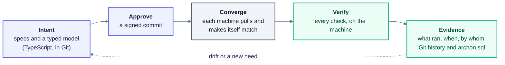
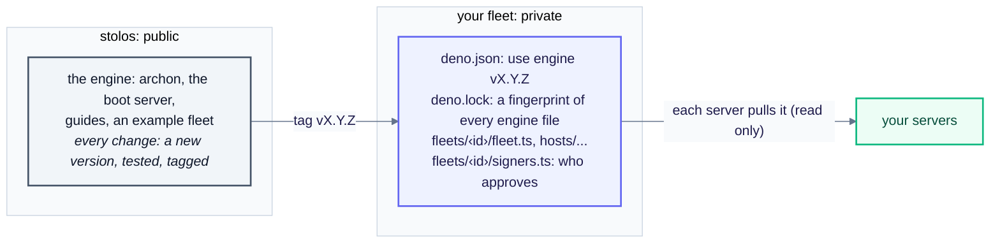
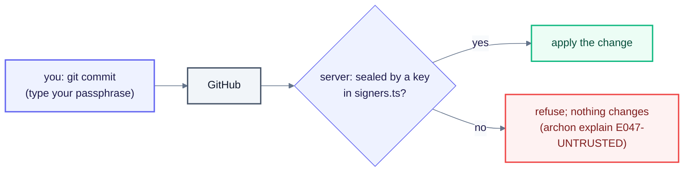
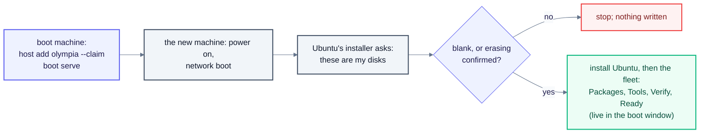

# Stolos

Stolos turns bare machines into Ubuntu servers that set themselves up, keep themselves right, and
can prove it. You describe your machines in a few TypeScript files; its command, `archon`, does the
rest.


Ubuntu decides; Stolos only adds (see the [constitution](.specify/memory/constitution.md)).

## Why Stolos, and where it fits

Infrastructure as code is a crowded field, and each tool covers part of the job:

| Tool                    | What it does well                          | What it leaves to you                                        |
| ----------------------- | ------------------------------------------ | ------------------------------------------------------------ |
| Ansible                 | runs steps on machines over SSH (YAML)     | the order of steps, drift between runs, installing the OS    |
| Terraform, OpenTofu     | creates cloud resources from a plan        | what happens inside each machine                             |
| Puppet, Chef, Salt      | an agent keeps a machine converged (a DSL) | a server or master to run, the OS install, a second language |
| cloud-init, autoinstall | sets up a machine on its first boot        | everything after the first boot                              |
| NixOS                   | a fully declared system                    | a different distribution from the one you run elsewhere      |

Shahid Shah created Stolos because he wanted **one unified experience** from bare metal to a
verified server: state the intent once, then let every machine converge to it and prove that it did.
No control server, no agent to install, no second language: one command (`archon`) run by **Deno**,
a single binary, and **GitHub** as the only state, fully versioned. Every change is a signed commit,
so the history of each server is the history of its repository.



**Why Ubuntu 26.04, for now.** Stolos is built for an **AI-native era**: people decide what their
servers and workspaces should be, and AI agents carry out most of the operations. An agent that
works from loose notes drifts, so the intent has to be precise and checkable: specs (Spec Kit, in
`specs/`), a constitution, and a typed ontology of fleets, hosts, capabilities, and checks. Doing
that well for one operating system matters more than doing it loosely for many, so Stolos targets
Ubuntu 26.04 LTS servers (and Ubuntu on WSL as a workstation), and Ubuntu decides everything it does
not need to add. Agents reach servers only through `archon`'s MCP server, limited by each server,
and can never approve a change: only a signature can.

**Compliance as code.** Because the intent and the infrastructure (physical machines, VMs,
containers, workstations) are all type-safe TypeScript, they can be read as data, not just run. The
same model that installs a server says what it should be, its checks say whether it is, and the
signed history says who approved each change and when. That is the raw material of SOC 2, HIPAA, and
similar audits; Stolos is designed so that their controls and evidence can be generated from code
rather than written by hand. (Generating those reports is the direction, not yet a command.)

## What you need

`archon` runs on **Windows, macOS, or Linux**. All it needs is **[Deno](https://deno.com) 2.9.6 or
newer** (2.x), a single program with no other dependencies, plus Git and `gh` (GitHub's command
line) to work with your fleet repository. Installers and binaries for every system:
[docs.deno.com, installation](https://docs.deno.com/runtime/getting_started/installation/) and
[Deno's releases](https://github.com/denoland/deno/releases).

<details>
<summary><b>Windows</b> (PowerShell)</summary>

```powershell
winget install --id DenoLand.Deno      # or: irm https://deno.land/install.ps1 | iex
winget install --id Git.Git
winget install --id GitHub.cli
```

Open a new PowerShell window, then check: `deno --version` (2.9.6 or newer) and `gh auth login`.
Windows is the usual **boot machine** (the PC that installs new servers); see
[docs/boot-machine.md](docs/boot-machine.md) for its firewall and network settings.

</details>

<details>
<summary><b>macOS</b> (Terminal)</summary>

```sh
brew install deno git gh               # with Homebrew (https://brew.sh)
# or Deno alone: curl -fsSL https://deno.land/install.sh | sh
```

Then `deno --version` (2.9.6 or newer) and `gh auth login`.

</details>

<details>
<summary><b>Linux</b> (Ubuntu, or Ubuntu on WSL)</summary>

```sh
curl -fsSL https://deno.land/install.sh | sh      # Deno, into ~/.deno/bin
sudo apt install -y git gh unzip
```

Open a new terminal, then `deno --version` (2.9.6 or newer) and `gh auth login`. Servers need
nothing installed by you: Stolos puts Deno and `archon` on each one as it installs it.

</details>

## Two kinds of repository

This repository is the **engine**: public, with no real machines in it. Each fleet lives in a
**fleet repository** of its own, private, that uses the engine by version.



A fleet repository holds descriptions only. Its passwords and keys stay on one PC (the **boot
machine**, which also installs new machines); what each machine records about itself stays on that
machine, where `archon` asks it.

## Why changes are signed

Your servers take their instructions from the fleet repository on GitHub. If anyone or anything that
can push to it could change your servers (a stolen GitHub password, a leaked token, an automated
tool, an AI agent), that would be the weak point. So every change must be **signed**.

Signing uses a **key pair**: two files made together.

- The **private key** is yours alone. It stays on your PC, locked with a passphrase you type each
  time. Like a wax seal: only you hold it.
- The **public key** (the same file name with `.pub`) can be shared with anyone. Like a picture of
  the seal: anyone can check that a letter was sealed by you, but no one can seal with it.

Git seals each commit with your private key. The fleet lists the public keys it trusts in
`signers.ts`. Each server checks every new commit: sealed by a listed key, and following on from the
commit it already runs (no going back). Otherwise it refuses, and nothing changes.



The fingerprints in `deno.lock` make your seal cover the engine's code too: a server runs exactly
the engine files you approved.

## Set up a fleet repository

With Deno, Git, and `gh` installed (above) and `gh auth login` done:

1. Create an empty private repository on GitHub and clone it.
2. Make your signing key, and tell Git to use it for every commit (the passphrase is never stored).
   On Windows, write `$HOME\.ssh\fleet-signing` for `~/.ssh/fleet-signing`:

   ```sh
   ssh-keygen -t ed25519 -f ~/.ssh/fleet-signing -C "<your name> fleet signing"
   git config --global gpg.format ssh
   git config --global user.signingkey ~/.ssh/fleet-signing
   git config --global commit.gpgsign true
   ```

   Make a second, **recovery** key the same way and keep it somewhere safe and apart (an encrypted
   vault): it replaces the first if your PC is lost.
3. Start the fleet with the engine's latest version (it writes `deno.json`, `deno.lock`, and
   `fleets/<id>/fleet.ts` from your GitHub account):

   ```sh
   deno run -A https://raw.githubusercontent.com/intellectual-frontiers/stolos/v<version>/src/archon/main.ts fleet init <id>
   ```

4. List your keys as the fleet's signers, then commit and push (signed):

   ```sh
   deno task archon signers add <you> --role daily --key ~/.ssh/fleet-signing.pub
   deno task archon signers add <you>-recovery --role recovery --key <recovery>.pub
   git add -A && git commit -m "<id>: the fleet" && git push
   ```

5. From here, `deno task archon` shows where you are and the one command to run next: tokens, your
   first server (`deno task archon host add <name> --claim`), and installing it
   (`deno task boot serve`).
6. Back up: `deno task boot vault backup` writes one ZIP with every secret and your signing key;
   move it somewhere safe and encrypted.

The full walk-through: [docs/fleet-repository.md](docs/fleet-repository.md) and
[docs/boot-machine.md](docs/boot-machine.md).

## How a machine becomes a server



Nothing on a disk is erased unless the disk is blank or you confirm it (`--confirm-destroy <host>`,
typed by a person).

## Every day

- `deno task archon`: where you are, and what to do next.
- Change a file under `fleets/<id>/`, `deno task archon build`, then commit (signed) and push: every
  server applies it within 15 minutes.
- `deno task archon fleet status`: every server, how it is.
- `archon explain <code>`: what a problem means and how to fix it.
- `deno task archon fleet upgrade v<version>`: adopt a newer engine.
- `deno task boot vault backup` after anything that made a secret; move the ZIP somewhere safe.

## Documentation

- **Reference**, from the code, with diagrams:
  <https://intellectual-frontiers.github.io/stolos/latest/> (or `deno task docs` here).
- **Guides**, in [`docs/`](docs/):

| Read                                                                           | For                                                                  |
| ------------------------------------------------------------------------------ | -------------------------------------------------------------------- |
| [docs/fleet-repository.md](docs/fleet-repository.md)                           | Your fleet repository: versions, upgrading, signing, troubleshooting |
| [docs/boot-machine.md](docs/boot-machine.md)                                   | The boot machine: tools, firewall, router, mail, the secrets vault   |
| [docs/hosts.md](docs/hosts.md)                                                 | Adding, installing, re-installing, and retiring machines             |
| [docs/install-timeline.md](docs/install-timeline.md)                           | What happens during an install, in order                             |
| [docs/daily-use.md](docs/daily-use.md)                                         | Working on a server: commands, observing, updates                    |
| [docs/workstation.md](docs/workstation.md)                                     | Your PC's Ubuntu (WSL) as a workstation                              |
| [docs/web.md](docs/web.md)                                                     | HTTPS on every server, publishing services                           |
| [docs/telemetry.md](docs/telemetry.md)                                         | Logs, metrics, traces, and the optional web UI                       |
| [docs/agent.md](docs/agent.md)                                                 | AI agents and other MCP clients, limited by each server              |
| [docs/pg.md](docs/pg.md), [docs/s3.md](docs/s3.md), [docs/smb.md](docs/smb.md) | PostgreSQL, S3, SMB                                                  |
| [docs/sql.md](docs/sql.md)                                                     | SQL over the fleet: osquery, DuckDB                                  |
| [docs/disaster-recovery.md](docs/disaster-recovery.md)                         | Losing the boot machine                                              |
| [docs/troubleshooting.md](docs/troubleshooting.md)                             | Symptoms, causes, and fixes                                          |
| [docs/releasing.md](docs/releasing.md), [AGENTS.md](AGENTS.md)                 | Changing the engine itself                                           |

## Try it

```sh
deno task archon validate     # the example fleet, examples/fleets/lab
deno task archon build        # renders its machines into examples/out/lab/
deno task test
```

Every change to this repository is a new version ([`src/archon/version.ts`](src/archon/version.ts)),
tested (including a full install of a virtual machine), and tagged `v<version>`.
