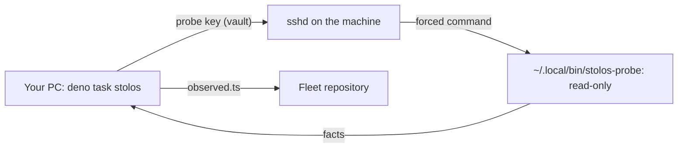

# Adopted machines

Stolos manages the servers it installs. Every other machine you are responsible for (your laptop, a
colleague's desktop, a WSL distribution, a server someone else installed) can be **adopted**: Stolos
observes it and checks it, and never changes it (spec 067).



## Adopt a machine

```bash
deno task stolos host adopt alice-mbp --ssh alice@alice-mbp.local --owner alice
```

It shows the machine's host key (compare it with `ssh-keygen -lf /etc/ssh/ssh_host_ed25519_key.pub`
on the machine), makes a probe key in the vault, installs the probe over your own SSH (it may ask
your password once), and records what it found.

The probe key can do one thing: run the probe. Its line in `~/.ssh/authorized_keys` forces the
command and forbids a shell, a terminal, and forwarding. The probe needs no root and listens on
nothing.

## Every day

| Question                     | Command                                                                      |
| ---------------------------- | ---------------------------------------------------------------------------- |
| What is it now?              | `deno task stolos host observe alice-mbp`                                    |
| Does it meet the policies?   | `deno task stolos host check` (`--json` for evidence)                        |
| Which Macs run which Chrome? | `deno task stolos fleet query "select name, bundle_short_version from apps"` |
| How did it change?           | `git log -p fleets/<fleet>/adopted/alice-mbp/observed.ts`                    |
| Stop observing it            | `deno task stolos host release alice-mbp`                                    |

`fleet query` needs osquery on the machine (`brew install --cask osquery` on a Mac); the policies do
not.

## The policies

Each policy names the Secure Controls Framework (SCF) controls it gives evidence for: the disk is
encrypted (CRY-05), the firewall is on (END-05, NET-01), security updates install by themselves
(VPM-05), the OS is supported (TDA-17), SSH takes keys only (IAC-10), at most three administrators
(IAC-21), observed in the last week (AST-02, MON-01). This is a starter mapping: check it against
the SCF catalog before an audit relies on it.
