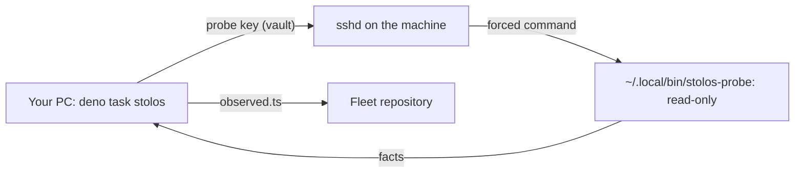
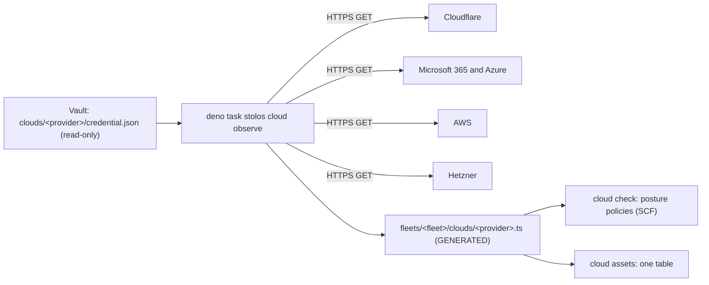

# Adopted machines

Stolos manages the servers it installs. Every other machine you are responsible for (your laptop, a
colleague's desktop, a WSL distribution, a server someone else installed) can be **adopted**: Stolos
observes it and checks it, and never changes it (spec 067).



## Adopt a machine

```bash
deno task stolos host adopt alice-mbp --ssh alice@alice-mbp.local --owner alice
```

It shows the machine's host key (compare it with `ssh-keygen -lf /etc/ssh/ssh_host_ed25519_key.pub`
on the machine), makes a probe key in the vault, installs the probe over your own SSH (it may ask
your password once), and records what it found.

The probe key can do one thing: run the probe. Its line in `~/.ssh/authorized_keys` forces the
command and forbids a shell, a terminal, and forwarding. The probe needs no root and listens on
nothing.

## Every day

| Question                     | Command                                                                      |
| ---------------------------- | ---------------------------------------------------------------------------- |
| What is it now?              | `deno task stolos host observe alice-mbp`                                    |
| Does it meet the policies?   | `deno task stolos host check` (`--json` for evidence)                        |
| Which Macs run which Chrome? | `deno task stolos fleet query "select name, bundle_short_version from apps"` |
| How did it change?           | `git log -p fleets/<fleet>/adopted/alice-mbp/observed.ts`                    |
| Stop observing it            | `deno task stolos host release alice-mbp`                                    |

`fleet query` needs osquery on the machine (`brew install --cask osquery` on a Mac); the policies do
not.

## Discovered machines

`deno task stolos discover` lists the machines this PC has seen on its network (its neighbor table)
and the cloud servers no fleet machine owns. It scans nothing and records nothing; adopt the ones
you are responsible for.

## The policies

Each policy names the Secure Controls Framework (SCF) controls it gives evidence for: the disk is
encrypted (CRY-05), the firewall is on (END-05, NET-01), security updates install by themselves
(VPM-05), the OS is supported (TDA-17), SSH takes keys only (IAC-10), at most three administrators
(IAC-21), observed in the last week (AST-02, MON-01). This is a starter mapping: check it against
the SCF catalog before an audit relies on it.

## Cloud accounts

Stolos can also see what the fleet keeps in its clouds, read-only: it never creates, changes, or
deletes anything there (managing a cloud stays in that cloud's own console).



| Provider                | What Stolos reads                                                             | Posture policies                                                    |
| ----------------------- | ----------------------------------------------------------------------------- | ------------------------------------------------------------------- |
| Cloudflare              | accounts, zones, DNS records, Workers, Pages, R2 buckets, tunnels             | Full (strict) TLS, HTTPS only, TLS 1.2 or later, DNSSEC             |
| Microsoft 365 and Azure | tenant, domains, users, licenses, Global Administrators, MFA, Azure resources | MFA enforced, every member registered for MFA, 2 to 4 Global Admins |
| AWS                     | account, IAM users, S3 buckets, EC2 instances in every enabled region         | root MFA, no root keys, S3 blocks public access, IMDSv2             |
| Hetzner Cloud           | servers, volumes, firewalls, primary IPs, load balancers                      | backups, a firewall on every server, deletion protection            |

```bash
deno task stolos cloud connect cloudflare
```

`connect` shows how to make a read-only credential in the provider's console, asks for it here
(nothing you type is shown), keeps it in the vault, and observes once. Then:

- `deno task stolos cloud observe` reads every connected account again (daily is plenty);
- `deno task stolos cloud check` reports the posture (`--json` for an auditor);
- `deno task stolos cloud assets --kind dns-record` lists every DNS record and the machine it points
  at;
- `git log -p fleets/<fleet>/clouds/cloudflare.ts` shows what changed, and when;
- `deno task stolos cloud disconnect cloudflare` forgets the credential (revoke it in Cloudflare
  too).

A part the credential may not read (Workers, say) is listed as not readable, not as a failure.
