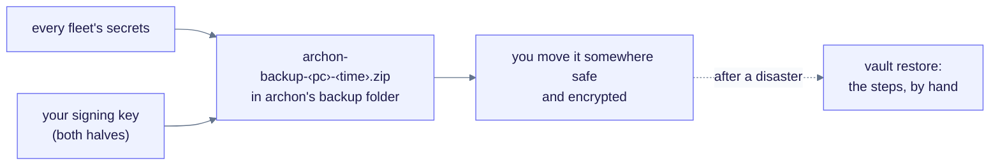

# The boot machine

The boot machine is your Windows PC (a Linux PC works too). It holds the fleet's secrets, serves
installs, and is where you add and re-install hosts. Nothing on it needs to run except while a host
installs.

## Install the tools (once)

In PowerShell:

```powershell
winget install --id DenoLand.Deno
winget install --id Git.Git
winget install --id GitHub.cli
```

Open a new PowerShell window (so the new commands are on PATH), then:

```powershell
gh auth login --web --git-protocol https
git clone https://github.com/example/fleet.git C:\archon
cd C:\archon
```

Uninstall (or stop) Tftpd64 if you used it before: the boot server is its own TFTP server and needs
UDP port 69. netboot.xyz is not needed either.

## Allow the boot server through the firewall (once)

Servers reach this PC on TCP 8080 (HTTP: the installer image, each host's config, progress) and UDP
69 (TFTP: PXE). In PowerShell as Administrator:

```powershell
New-NetFirewallRule -DisplayName "Archon boot (HTTP)" -Direction Inbound -Protocol TCP -LocalPort 8080 -Profile Any -Action Allow
New-NetFirewallRule -DisplayName "Archon boot (TFTP)" -Direction Inbound -Protocol UDP -LocalPort 69 -Profile Any -Action Allow
```

If Windows once asked whether to allow Deno on public networks and you declined, it added a rule
that blocks Deno and overrides these. Remove it:

```powershell
Get-NetFirewallRule -Direction Inbound -Action Block | Where-Object { ($_ | Get-NetFirewallApplicationFilter).Program -like "*deno*" } | Remove-NetFirewallRule
```

`boot serve` and `boot doctor` check all of this and print the exact command when something would
block a server.

## Give this PC a fixed address (once)

Your router points network boots at this PC, so its address must not change. In UniFi: **Client
Devices** → this PC → **Settings** → **Fixed IP Address**.

## Point network boots at this PC (UniFi)

Servers network-boot with PXE: the router's DHCP tells them which server to ask (next-server) and
which file to load (boot file). In the UniFi Network app (web or mobile):

1. **Settings → Networks**, and open the network the servers get their addresses from (each network
   or VLAN has its own DHCP settings).
2. If the DHCP settings are hidden, turn off **Auto-Scale Network** (the subnet stays as it is).
3. Under **DHCP Service Management** (the advanced, _Manual_, section), turn on **Network Boot**:
   - **Server:** this PC's address, for example `10.0.1.157`
   - **Filename:** `bootx64.efi`
4. **Apply Changes.**

UniFi sends these as DHCP options 66 and 67. Ordinary devices ignore them, and a machine only
network-boots when its firmware is told to, so this is safe to leave on. The labels can move between
UniFi Network versions: look for _Network Boot_ in the network's DHCP settings. Replace any old
value (a netboot.xyz file name, for example); the boot server serves Ubuntu's boot loader anyway and
logs `serving bootx64.efi instead`.

**Servers in a different zone from this PC** (for example the Servers VLAN, 10.0.30.0/24, in its own
zone and this PC on Default, 10.0.1.0/24) can't reach it until the router allows it: UniFi's
zone-based firewall with custom zones blocks connections from the servers' zone into Default. Add
two allow policies from the servers' zone to this PC's address, IPv4:

| Policy                        | Protocol | Port | For                                                       |
| ----------------------------- | -------- | ---- | --------------------------------------------------------- |
| Servers to boot machine, TFTP | UDP      | 69   | the boot loader, GRUB, kernel, installer (PXE)            |
| Servers to boot machine, HTTP | TCP      | 8080 | the installer image, each host's config, install progress |

Without the TCP 8080 policy the network boot gets through TFTP but the installer stops at
`(initramfs)` with `wget: can't connect to remote host ... Connection timed out`
([troubleshooting](troubleshooting.md#network-boot)).

**Another router:** set _next-server_ (option 66, _TFTP server_) to this PC and the _boot file name_
(option 67) to `bootx64.efi`.

## Describe your fleet (once)

```powershell
deno task archon fleet init
git add -A; git commit -m "003-identity: fleet init"; git push
```

`fleet init` reads your GitHub identity with `gh` (login, ID, name, noreply commit address, public
SSH keys), asks for your Unix account name and an admin password (typed twice, shown as `*`; only
its hash is kept, on this PC), and writes `fleets/<fleet>/fleet.ts`. If your GitHub account has no
SSH key, it offers to use this PC's key (or create one) and add it to GitHub with `gh`. It also sets
this checkout's git name and address to your GitHub name and noreply address.

## The agent (optional)

No agent runs on the servers (spec 030). To manage them with Claude Code, run it on this PC in the
checkout; it reaches each server through MCP over SSH. See [agent.md](agent.md).

## HTTPS certificates (once, recommended)

Every server answers HTTPS as `<host>.lab.example.net` with a Let's Encrypt certificate, through
Cloudflare's DNS challenge (spec 032). Create a Cloudflare token with Zone > DNS > Edit and Zone >
Zone > Read on `example.net`, then `deno task boot web-setup`. Servers get it at install, or now
with `deno task boot web-push <host>`. See [web.md](web.md).

## Email (once, recommended)

Every server sends mail through Cloudflare Email Service (spec 027): archon's own notifications
([what is sent](daily-use.md#notifications)) and anything a program on it sends (cron, apps,
unattended-upgrades). Messages come from `<user>+<host>.lab@example.net` (for example
`root+alpha.lab@example.net`, or `alice+bootpc.lab@example.net` from this PC): one onboarded domain
for the whole fleet, the machine in the subaddress, signed with DKIM for example.net; and mail for
`root` and `ops` goes to the fleet's mailbox (`mail` in `fleets/<fleet>/fleet.ts`, here
fleet@example.net). It needs the Workers Paid plan, which includes 3,000 messages a month.

**In the Cloudflare dashboard**, once, in the account that holds example.net:

1. **Compute > Email Service > Email Sending > Onboard Domain:** `example.net` (`mail.domain`), then
   **Done**. Cloudflare adds its records itself: MX, SPF, and DKIM on `cf-bounce.example.net`, DMARC
   (`p=reject`) on `_dmarc.example.net`; **Email Sending > Settings** shows each one. New servers
   need nothing more. DMARC `p=reject` applies to everything that claims to be from example.net:
   anything else that sends as example.net must pass SPF or DKIM too.
2. **Create an API token** with the permission **Account, Email Sending, Edit** for this account:
   either an account token (**Manage Account > Account API Tokens**, `cfat_...`, recommended because
   it outlives any one person's login) or a user token (**My Profile > API Tokens**, `cfut_...`).
   Name it `archon mail`. Cloudflare shows it once.

**On this PC:**

```powershell
deno task boot mail-setup           # paste the token (hidden); then this PC mails its check results
deno task boot mail-push alpha     # give a running server the token; it mails its check results
deno task boot doctor --send        # check again, and mail the email findings
```

The token is stored in this PC's secrets folder (`mail.json`), never in git; servers get it at their
next install (and mail their check results from the first boot), or now with `mail-push`, and keep
it in `/etc/postfix/sasl_passwd` (root only). Anyone holding it can send mail as the onboarded
domain. To revoke it: **Manage Account > Account API Tokens**, `archon mail`, **Delete**; then
create a new one, `mail-setup`, and `mail-push` each server. `deno task boot doctor` and
`archon doctor` check the domain's records, the token, and (on servers) Postfix.

## Run the boot server

```powershell
cd C:\archon
git pull
deno task boot serve
```

Leave it running while hosts install. It:

- downloads Ubuntu 26.04's signed boot files and installer image from `releases.ubuntu.com` once,
  checks each against the SHA-256 pinned in `src/archon-boot/pins.ts` (nothing is served on a
  mismatch), and caches them under `%LOCALAPPDATA%\archon\boot`;
- serves TFTP (PXE) on UDP 69 and HTTP on TCP 8080;
- shows every machine that boots from it and each install's progress, ending with
  `alpha: ✓ Ready: ...`;
- writes the same lines to `%LOCALAPPDATA%\archon\boot\boot.log` (send that file when asking for
  help);
- warns, with the command to run, when this PC's firewall would block servers.

Options:

| Option                                       | When                                                                                                         |
| -------------------------------------------- | ------------------------------------------------------------------------------------------------------------ |
| `--address 10.0.1.157`                       | this PC has several adapters (WSL, Hyper-V, VPN) and the wrong address shows                                 |
| `--proxy http://proxy:3128`                  | the site reaches the internet through a proxy (installer and first boot use it, with Ubuntu's HTTPS mirrors) |
| `--ca-file proxy-ca.pem`                     | that proxy inspects TLS                                                                                      |
| `--port 8080`, `--tftp-port 69`, `--no-tftp` | other ports, or HTTP Boot only                                                                               |

## The boot server's own telemetry

The boot server records itself with OpenTelemetry, and keeps it on this PC only (spec 023):
`%LOCALAPPDATA%\archon\boot\telemetry\otlp-<date>.jsonl`, in OpenTelemetry's own file format, kept
30 days and 256 MB at most. Each install is one trace, with a span per step.

```powershell
deno task boot observe          # recent installs: each step and how long it took, what failed
deno task boot observe --last 20
```

To watch it live, run [otel-tui](https://github.com/ymtdzzz/otel-tui) on this PC while `boot serve`
runs; the boot server hands it everything it records. This PC itself is not observed.

## Back up the secrets (specs 029 and 056)

This PC holds the only copies of the fleet's secrets: the admin password hash, each host's deploy
key and SSH host keys, the Cloudflare DNS token, and the mail token. A backup is one ZIP file that
you keep somewhere safe (constitution Article 13):

```powershell
deno task boot vault status     # every secret: changed when, backed up when (⚠ = not backed up)
deno task boot vault backup     # writes the ZIP, reads it back, and says where it is
deno task boot vault restore    # how to restore a ZIP by hand (prints the steps; changes nothing)
deno task boot vault list       # the ZIPs not yet moved out of the backup folder
```



`vault backup` writes `archon-backup-<pc>-<time>.zip` into archon's backup folder
(`%LOCALAPPDATA%\archon\backup`; Linux and macOS: `~/.local/share/archon/backup`), readable by you
only. It holds:

- `secrets/<fleet>/...`: every fleet's secrets on this PC, as they are (not the install tokens,
  which are made again when needed);
- `signing/...`: your signing key, both halves, from `git config user.signingkey` (the private half
  is still locked by its passphrase, which is not in the ZIP);
- `manifest.json`: every file's name, size, and SHA-256 (never a value);
- `RESTORE.txt`: the restore steps, the same as `vault restore` prints.

It reads the ZIP back and checks every file before saying it worked. Then **move it** wherever you
keep important things safe, for example your OneDrive Personal Vault, a password manager, or an
encrypted USB drive, and keep an older one too. The ZIP is not encrypted itself: treat it like the
keys to your servers. Keep your **recovery** signing key somewhere else, apart from it.

A restore is never done by a command: Archon only explains it (`vault restore`), and you copy the
files back by hand. See [disaster recovery](disaster-recovery.md).

Until a changed secret is backed up, Archon says so: a panel at the end of the command that changed
it and at the start of `boot serve` and `boot status`, a warning in `boot doctor`, a reminder before
each `git push`, `🔐 backup` in the prompt, and an email after a day (then weekly). If this PC is
lost, see [disaster recovery](disaster-recovery.md).

To show `🔐 backup` in PowerShell with oh-my-posh and this theme, add to your profile:

```powershell
function Set-ArchonStatus { $env:ARCHON_STATUS = (Get-Content "$env:LOCALAPPDATA\archon\status\prompt-vault" -ErrorAction SilentlyContinue) }
New-Alias -Name 'Set-PoshContext' -Value 'Set-ArchonStatus' -Scope Global -Force
```

## The network reference (spec 028)

The UniFi network is modeled in `fleets/<fleet>/site.ts`: networks, zones and policies, DNS, the
mDNS proxy, Wi-Fi, WireGuard, the boot server, and fixed addresses (names only, never passwords).
The router is the authority (constitution Article 21): change UniFi first, then the model to match.
`archon build` checks it (for example that a network booting from this PC has its two policies) and
renders the reference, `out/site/network-reference.html`. To send a network change log to the shared
mailbox:

```powershell
deno task archon build
deno task boot notify --subject "Lab Network Runbook Change Log 2026-11-12" --body-file changes.txt --attach out\site\network-reference.html
```

If this PC's address changes, set `site.bootServer.address`: `archon build` then lists every UniFi
setting that still points at the old one.

## Check the boot machine

```powershell
deno task boot doctor
```

Read-only. It checks the checkout (uncommitted or unpushed host changes, which hosts would not see),
the model, the secrets, Ubuntu's files, the network address, the ports, the firewall, and email (the
sending domain's records, and whether Cloudflare accepts the token; nothing is sent), and prints the
fix for each problem.

## Commands

| Command                                                                                 | Does                                                                                                                               |
| --------------------------------------------------------------------------------------- | ---------------------------------------------------------------------------------------------------------------------------------- |
| `deno task boot serve`                                                                  | serve installs (leave it running)                                                                                                  |
| `deno task boot doctor [--send]`                                                        | check this machine (and its email), with fixes; `--send` mails the email findings                                                  |
| `deno task boot observe [--last 5]`                                                     | recent installs from the boot server's telemetry                                                                                   |
| `deno task boot status`                                                                 | hosts, armed or not, MACs learned, Boot URIs                                                                                       |
| `deno task archon fleet status`                                                         | every server and workstation: last install, and how to reach and observe it                                                        |
| `deno task boot arm <host> [--claim] [--confirm-destroy <host>]`                        | allow one install of a host (`--claim`: the next unknown machine becomes it; a host recorded as durable needs `--confirm-destroy`) |
| `deno task boot retire <host> --confirm-destroy <host>`                                 | a server leaves the fleet: its DNS, deploy key, identity, model, and records ([hosts](hosts.md#retire-a-host))                     |
| `deno task boot reinstall <host> [--force] [--confirm-destroy <host>]`                  | re-install a running host, nobody at the console; a durable host needs `--confirm-destroy` ([hosts](hosts.md#re-install))          |
| `deno task boot vault status [--lost]`                                                  | every secret, and whether the last backup has it                                                                                   |
| `deno task boot vault backup` · `restore` · `list`                                      | the backup ZIP: write it; how to restore it (steps only); the ZIPs not yet moved (spec 056)                                        |
| `deno task boot web-setup`                                                              | store the Cloudflare DNS token for HTTPS certificates and server records (once)                                                    |
| `deno task boot web-push <host>`                                                        | give a running server that token                                                                                                   |
| `deno task boot mail-setup`                                                             | store the Cloudflare token for mail (once)                                                                                         |
| `deno task boot mail-push <host>`                                                       | give a running server the token, then test its mail                                                                                |
| `deno task boot notify --subject <s> [--body <t> \| --body-file <f>] [--attach <f>]...` | email the mailbox from this PC (also `notify test`, `notify status`)                                                               |
| `deno task archon fleet init`                                                           | create the fleet (once)                                                                                                            |
| `deno task archon host add <name> --claim \| --mac-address <mac>`                       | add a host                                                                                                                         |
| `deno task archon host bootstrap <name> --ssh user@address`                             | finish a host whose Ubuntu was installed by hand                                                                                   |

## What is kept where

| What                                                                                                                                       | Where                                                              | In git? |
| ------------------------------------------------------------------------------------------------------------------------------------------ | ------------------------------------------------------------------ | ------- |
| admin password hash, each host's deploy key and SSH host keys, install tokens, Cloudflare DNS token (`web.json`), mail token (`mail.json`) | `%APPDATA%\archon\secrets` (Linux: `~/.config/archon/secrets`)     | never   |
| Ubuntu's boot files and installer image, `boot.log`, `telemetry\`; `notify\` (messages waiting to send) is beside it                       | `%LOCALAPPDATA%\archon\boot` (Linux: `~/.local/share/archon/boot`) | no      |
| hosts' SSH host keys as this PC trusts them                                                                                                | `%USERPROFILE%\.ssh\known_hosts`                                   | no      |
| fleet, hosts, specs, dotfiles, what hosts recorded                                                                                         | `C:\archon`                                                        | yes     |

Back up the secrets folder (`deno task boot vault backup`): without it, a re-installed host gets new
SSH host keys and a new deploy key (`host add <name> --force`).
