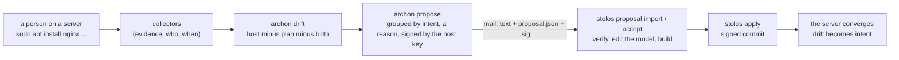

# 095: Proposals: changes made on a server become model changes

Issue intellectual-frontiers/stolos#1.

## Why

Operators sometimes change a server directly (`sudo apt install ...`, an edit under `/etc`,
`systemctl enable ...`). Until now such a change was either undone by the reconcile timer or stayed
as unexplained drift. Servers never push to GitHub and run no agent (Article 17), so a change made
on a server had no path into the fleet repository.

A **proposal** is that path. The server collects evidence of what changed outside Stolos, adds the
exact model change that would adopt it, signs the result with its SSH host key, and mails it to the
fleet's mailbox. On the PC, `stolos proposal` verifies it against the host key already in Git and
turns it into a model change, which goes through the normal loop: build, `stolos apply` (a signed
commit), and the servers converge.

## Decisions (the owner's)

1. **Reconcile hold.** Archon holds an item a person changed under sudo for up to 7 days, or until
   its proposal is decided; the model in Git still wins in the end.
2. **Transport.** Save the mail (or its attachments) and run `stolos proposal import`. No IMAP, and
   no new credential on the PC.
3. **Who may propose.** Anyone with sudo on the server (not only the `ops` group).

## Decisions made in this spec (for review)

- **Native first (Article 2).** Modified package files are found with `debsums -c` when debsums is
  installed, else with dpkg's own `dpkg --verify`; debsums is not added to the plan.
- **No JSON in the fleet (Article 4).** Imported proposals (the signed JSON and its signature) are
  kept in the PC user's state folder, outside Git; only the operators' decisions are committed, as
  TypeScript (`fleets/<fleet>/hosts/<host>/proposals.ts`), so the host can read them.
- **One capability per accepted proposal.** An acceptance adds `adopted({...})` (a capability in
  `src/archon/capabilities/adopted.ts`) to the host's `capabilities`, with the proposal's id and the
  draft spec's id, so every adopted item names its spec.
- **Managed items are not overridden.** A hand change to something the plan already manages (a file
  or a unit a capability sets) cannot be adopted by an override: two capabilities would define the
  same item. `accept` names it as a conflict, with the spec that manages it; the person edits that
  capability by hand, or skips the item (`--skip`).
- **`local` is only for unmanaged items**: the model wins over a managed item, so it is either
  adopted or reverted.
- **`revert` of an unmanaged item** is recorded, and a person undoes it (with the command the
  proposal names): Archon never removes packages, accounts, or files on its own (Article 11).
- **A late birth snapshot.** A host installed before this spec takes its birth snapshot at its first
  collection, leaving out what apt's history and sudo's journal show a person did; `archon drift`
  says so.
- **The signature survives the mail.** Everything in `proposal.json` passes through notify's
  redaction before it is signed, so the mail's redaction cannot change a byte; if the signature
  itself would be changed by it (a rare pattern in base64), a `nonce` is added and it is signed
  again.

## Requirements

### Phase 1: collectors, observations, the birth snapshot, `archon drift`

- **FR-001** Collectors (`src/archon/proposal/parse.ts`, `collect.ts`) write **observations** (what,
  who, when, source, and the evidence, redacted) into the host's own `archon.sql` (kind
  `observation`, view `archon_observation`): sudo's journal entries (command, user, time; archon's
  own runs left out); apt's `history.log` (`Commandline`, `Requested-By`; upgrades and automatic
  installs left out) and `dpkg.log` (what apt did not do: a `dpkg -i`); etckeeper's git log (per
  file, author; archon's own commits and Ubuntu's apt runs as root left out); osquery snapshots
  (`deb_packages`, `users`, `sudoers`, `listening_ports`, `kernel_modules`) compared with the
  previous one; `systemctl list-unit-files` (state and vendor preset) against the plan;
  `snap
changes` and podman containers; `dpkg -S` on `/usr/local` and `/opt` (files no package
  owns: an Article 5 flag); `debsums -c` or `dpkg --verify` (a modified package file: a **security
  alert**, mailed at once, never a proposal).
- **FR-002** The **birth snapshot** (kind `birth`), taken once at first boot:
  `apt-mark
showmanual`, snaps, unit files and their states, login accounts, listening ports, and
  `/etc` at the first etckeeper commit.
- **FR-003** Drift = what the host has, minus the plan, minus the birth snapshot. A unit new since
  birth is drift only when its state differs from its package's preset; an `/etc` file is drift when
  a person (not Ubuntu) changed it and no package owns it, or it is a package's modified
  configuration file. A file the plan writes whose content differs is a **managed** item.
- **FR-004** Each drift item carries who and when (from the observations that explain it), the
  structured edit that would adopt it (`packages.add`, `units.enable|disable|mask`, `ports.open`,
  `files.override`), or what a person does by hand instead.
- **FR-005** `archon drift` (tier read, so also an MCP tool): the items not proposed yet; `--all`
  also proposed, local, and rejected ones; `--collect` (mutate) collects first. Alerts first, exit 1
  while any is open. The daily report collects and includes the same text.

### Phase 2: change sessions, `archon propose`, the signed JSON, the mail

- **FR-006** Observations are grouped into **intents**: sudo commands of one user, each within 30
  minutes of the previous, form a session; an item belongs to the session whose command names it,
  else to the session of its own user and time, else to its day. A recording (FR-016) wins.
- **FR-007** `archon propose` (tier mutate; anyone with sudo, decision 3): `--all`,
  `--intent
<id>`, or `--item <key>` (repeatable); `--action adopt|revert|local` for all,
  `--revert <key>` and `--local <key>` per item, `--until <day>` for local (default 30 days);
  `--reason` required (a recording's reason counts). The proposer is the person behind sudo
  (`SUDO_USER`). `--dry-run` prints `proposal.json` and sends nothing.
- **FR-008** `proposal.json` (format `stolos-proposal/1`): id, host, fleet, base (the model commit
  the host runs), engine version, time, proposer, reason, intents, items (each with its action, its
  edits, its evidence ids, and for a file its hash and, when allowed, content and diff), and the
  observations. **No secrets (Article 13):** a path in the secret inventory or secret on every host,
  and content that looks like a key, are sent as a SHA-256 hash only; content only for text files of
  at most 16 KB.
- **FR-009** Signed with the host's SSH host key:
  `ssh-keygen -Y sign -f
/etc/ssh/ssh_host_ed25519_key -n stolos-proposal`, as
  `proposal.json.sig`.
- **FR-010** Mailed to the fleet's mailbox through archon notify: a text summary, with
  `proposal.json` and `proposal.json.sig` attached; a copy stays in
  `/var/lib/archon/proposals/<id>/`; the proposal is recorded (kind `proposal`, view
  `archon_proposal`).

### Phase 3: on the PC: `stolos proposal import`, `list`, `show`, `accept`, `reject`

- **FR-011** `stolos proposal import <file|folder>`: a `.eml` (its attachments, base64 or
  quoted-printable, gzipped or not), or `proposal.json` (`.gz`) with its `.sig` beside it; a folder
  is searched for both. Each is verified: the format, the host is in the fleet, and the signature is
  made by one of the host's SSH host keys in `registration.ts` (namespace `stolos-proposal`). A
  forged or altered proposal is refused, with the reason. Kept in the user's state folder.
- **FR-012** `stolos proposal list`: id, host, time, proposer, items, and the decision (waiting,
  accepted, rejected). `stolos proposal show <id>`: the reason, each item with its action and
  evidence, and the model diff an acceptance makes, with named conflicts.
- **FR-013** `stolos proposal accept <id>`: verifies it again, names conflicts (the model already
  defines the item otherwise, or the host's file cannot be edited) and changes nothing while any
  remains (`--skip <key>` leaves an item out); adds `adopted({...})` to the host's `capabilities`
  with bare keys (`tsLiteral`) and the import; writes a draft spec
  `fleets/<fleet>/specs/NNN-<host>-<slug>/spec.md` from the reason and the evidence; records the
  decision in `proposals.ts`; and runs `build`. The person reviews it and runs `stolos apply`.
- **FR-014** `stolos proposal reject <id> [--reason]`: records the rejection in `proposals.ts`.
  After the push, the host ends the proposal's holds, so the next update reverts managed items;
  anything else stays flagged.

### Phase 4: `archon record`, the reconcile hold, reminders

- **FR-015** **The hold** (decision 1): before each apply, archon reads sudo's journal; a managed
  file or unit that differs from the plan and that a person's sudo command named is held (kind
  `hold`): apply leaves it as it is, for up to 7 days, or until its proposal is decided in Git
  (accepted or rejected), whichever comes first. Then the model wins. `revert` ends the hold at
  once.
- **FR-016** `archon record "reason"`, the work, `archon record done`: everything observed in
  between is one intent with that reason; `archon record` alone shows the recording.
- **FR-017** **Reminders**: the daily report and `archon doctor` count drift not proposed and
  proposals sent but not decided; when either is older than 3 days, the daily report mails a
  reminder (at most once every 3 days).

## Tests

`tests/proposals095.test.ts`: each parser on fixtures (journald, apt history, dpkg.log, etckeeper,
osquery snapshots, unit files, snap changes, dpkg -S, debsums and dpkg --verify); drift minus plan
minus birth; a modified package binary raises an alert and is never proposed; secret redaction
(inventory paths, keys in content); grouping by sudo session; signing and verifying with a throwaway
ed25519 host key, refusing an altered or foreign one; importing a `.eml`; `accept` editing a fixture
`host.ts` (bare keys) and naming a conflict; `reject`; a hold expiring after 7 days and ending when
its proposal is decided; recordings.
