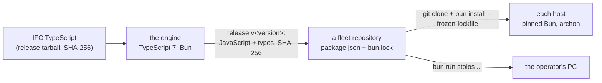

# 096: The engine on Bun and IFC TypeScript

Issue intellectual-frontiers/stolos#32; tracking issue intellectual-frontiers/.github#7.

## Why

Deno is going away. The engine was written for Deno: its runtime calls (`Deno.*`), its task runner,
its lockfile as the security control of a fleet, its built-in telemetry, its test runner, its
documentation tool, and the way a fleet loaded the engine (raw GitHub URLs pinned in `deno.json`).
Intellectual Frontiers Commons now gives the same ground in one place: IFC TypeScript
(`@intellectual-frontiers/ifc-ts`, commons specs 0005 to 0008), a pure kernel and a host runtime on
web standards and `node:` builtins. The runtime keeps the names of the Deno calls it replaces, and
the code runs unchanged on Bun, on Node 26 and on Deno. It is OpenTelemetry-native, it holds the
primitives of GRC engineering, and it records every test run as compliance evidence.

This spec moves the engine onto it as fresh code. Nothing is migrated, and no old form is kept for
an old caller: the engine, its fleets and its hosts start over on the new ground.

## Decisions (the owner's)

1. **Bun is the runtime** of record, everywhere: the operator's PC, the boot server and every host.
   **Node 26 is the backup**: the same code runs on it, so the engine is never stuck on one runtime.
2. **TypeScript 7 is the type checker.** IFC TypeScript is the shared kernel and runtime, depended
   on by its release tarball.
3. **No Deno anywhere**: no `Deno.*`, no `deno.json`, no `deno.lock`, no `deno task`, no
   `deno doc`, no Deno OpenTelemetry. No migration and no backward compatibility.
4. **One tool binary.** Bun installs, formats, lints, tests, packs and compiles. Lint uses IFC
   TypeScript's plugin.
5. **PAM stays in the engine on `bun:ffi`**, in its one file, behind the console's `Authenticator`.
   On Node, the console's password sign-in is refused as not supported, and signing in with a key
   still works.

## Decisions made in this spec (for review)

- **The engine is a package.** Each release `v<version>` (raised on every push to `main`, as before)
  is built by `tsc` into JavaScript with declarations, packed by Bun, and attached to the GitHub
  release with its SHA-256: `intellectual-frontiers-stolos-<version>.tgz`. A fleet repository
  depends on that URL in `package.json`, and `bun.lock` holds its integrity. JavaScript, not
  TypeScript, because Node does not strip types under `node_modules`.
- **The lock is still the control.** `bun install --frozen-lockfile` replaces `--frozen`: an
  integrity error stops the run. The engine's text assets (constitution, specs, guides, dotfiles)
  travel inside the package, as before through `assets.auto.ts`.
- **A fleet repository holds** `package.json` (the engine's tarball URL, the scripts `stolos` and
  `archon`), `bun.lock`, `stolos.ts`, `archon.ts`, `.gitignore` and `fleets/`. `engine.ts` is gone:
  the package is installed whole. `stolos fleet upgrade <tag>` rewrites the URL and runs
  `bun install`.
- **Hosts run Bun.** The bootstrap installs the pinned Bun (its version and SHA-256 per platform,
  kept in the engine), clones the fleet repository, runs `bun install --frozen-lockfile`, and the
  launcher runs `bun archon.ts`. Where Bun cannot run, `node archon.ts` does the same with Node 26.
- **Telemetry is IFC TypeScript's**: `runtime/otel`, configured from OpenTelemetry's own variables,
  in-process. The boot server no longer starts again to turn telemetry on.
- **Tests run through `ifc test`.** Each test is a `proves([...])` naming the requirements it proves
  (`096-bun-runtime FR-001`). The record and its TAP, JUnit, CTRF, SARIF, OSCAL and completion
  reports are CI artifacts, every run goes into the evidence ledger, and every requirement of every
  spec is proven or declared reviewed.
- **The documentation is ours.** `tools/docs.ts` reads each module's `@module` block and every
  export's JSDoc itself (the code is formatted, so a declaration starts its line), renders the same
  HTML pages with their Mermaid diagrams, and compiles every `@example` with `tsc`. The lint ratchet
  becomes a hard rule: every export has JSDoc.
- **The engine keeps no copy** of what IFC TypeScript gives: `Result`, decoders, files, processes,
  locks, the terminal, downloads, the server, OpenTelemetry, OCSF, OSCAL, in-toto and DSSE, CMS, the
  evidence ledger, waivers, risk, archives, YAML, TOML, JSON5, CSV and XML. What it lacks is added
  to commons first, then used here. GRC types move onto commons' `0007-grc`, and the catalog content
  (SCF, NIST, FedRAMP) stays here.
- **Dependencies:** `fflate` is replaced by the kernel's archives. `ajv` stays (JSON Schema 2020-12
  validation of third-party documents), pinned in `package.json` with its reason.
  `@opentelemetry/api` is replaced by IFC TypeScript's signals.
- **How a fleet imports the engine.** The package's `exports` maps `./*` to the module of that
  path under `src/`, without its extension: `@intellectual-frontiers/stolos/archon/model/types`,
  `@intellectual-frontiers/stolos/archon/capabilities/mod`, `@intellectual-frontiers/stolos/stolos/main`
  (was `@stolos/archon/model/types.ts`). In this repository the name refers to the package itself
  (`"./*": "./src/*.ts"`), so `examples/` load the sources on Bun and on Node with no build; the
  release's `package.json` maps the same paths to `dist/*.js` and `dist/*.d.ts` (`tsc` with
  `rootDir` `src`, so a module keeps its place three folders under the package's root).
- **No `modules.auto.ts`.** It named every module so that `deno.lock` pinned each one; the package is
  installed whole and `bun.lock` holds the integrity of its tarball, so it is gone, and
  `bun run gen` writes only `assets.auto.ts`.
- **The version** stays in `src/archon/version.ts`; `bun run version` keeps `package.json`'s
  `version` equal to it (`bump` writes both, `check` fails where they differ).
- **The linter** is a pinned Bun canary (`bun x bun@1.4.4-canary.20261115.1 lint`), as commons
  runs it, until a Bun release has `bun lint`; then the pin moves to that release.
- **Tests are `*.test.ts`**, and `tools/test.ts` feeds `ifc test`: the requirements are every
  `- **FR-NNN**` line of every `specs/*/spec.md`, as `<spec folder> FR-NNN`; a requirement proven by
  review is listed, with its reason, in its spec's `reviewed.tsv`; a requirement a test names that
  no spec has stops the run before it starts. A test proves the requirements its assertions check,
  never a whole spec by its number.
- **The engine's own process contract stays**: `core/exec.ts`'s `run` gives exit code 127 for a
  program that is not installed instead of throwing, and runs as another account through runuser.
  `core/ui.ts` is the one module of `src/` that writes for a person to the terminal.
- **Span names are kinds**: a run is one `archon.run` span (its command in `archon.command`) and each
  phase an `archon.phase` span (its name in `archon.phase`), as IFC TypeScript's registry needs
  names declared once.
- The conversion of every module, call and import is in [`mapping.md`](mapping.md).

## Requirements

- **FR-001** No file of the engine (`src/`, `tools/`, `tests/`, `examples/`) names `Deno`, imports
  `npm:`, `jsr:` or a URL, or is configured by `deno.json` or `deno.lock`. The one file that names a
  runtime's API is the PAM binding, which imports `bun:ffi`, as the lint plugin's allow list says.
- **FR-002** `package.json` pins the development dependencies exactly (TypeScript 7, `@types/node`)
  and the run-time ones (IFC TypeScript by its release URL, `ajv`), with `bun.lock` beside it;
  `bun install --frozen-lockfile` installs them.
- **FR-003** `tsc` 7 type-checks every file with IFC TypeScript's strict configuration.
  `bun fmt --check` and `bun lint --type-aware --max-warnings 0` (with IFC TypeScript's plugin)
  pass.
- **FR-004** The suite runs through `ifc test` on Bun and on Node 26, on Linux, and the parts that
  apply on macOS and Windows. Every requirement of every spec is proven by a test or declared
  reviewed with its reason, and CI keeps the record, its reports and the ledger.
- **FR-005** Every push to `main` raises `src/archon/version.ts`. CI tags the commit `v<version>`,
  builds the package with `tsc`, packs it, installs it into an empty project and runs it on Bun and
  on Node, then attaches the tarball and its SHA-256 to the GitHub release of that tag.
- **FR-006** `stolos fleet init` writes a fleet repository of `package.json`, `bun.lock`,
  `stolos.ts`, `archon.ts` and `.gitignore`. `stolos fleet upgrade <tag>` moves it to another
  release, and `bun run stolos ...` and `bun run archon ...` are its commands.
- **FR-007** The bootstraps (`bin/bootstrap.sh`, `bin/bootstrap.windows.ps1`) and the host install
  fetch the pinned Bun, check its SHA-256 before unpacking, and run the engine with it. The launcher
  runs `archon.ts` with Bun, and with Node 26 where Bun is not installed.
- **FR-008** Telemetry is IFC TypeScript's (`runtime/otel`, commons 0006-signals): every command is
  a trace, the console renders the same signals, and nothing reads `OTEL_DENO`.
- **FR-009** `tools/docs.ts` renders the engine's documentation from its JSDoc to `out/docs/` with
  no Deno, checks that every module and every export is documented, and compiles every `@example`.
- **FR-010** The console's PAM sign-in runs on Bun through `bun:ffi`. On Node it is refused as not
  supported.

## Tests

- `tests/bun096.test.ts`:
  - no `Deno`, `npm:`, `jsr:` or URL import in the engine;
  - `package.json` pinned exactly and matching `bun.lock`;
  - the packed package installs into an empty project and runs `archon --version` on Bun and on
    Node;
  - `fleet init` writes the new layout;
  - the Bun pin has a checksum for each platform;
  - the docs tool finds an undocumented export and a broken example.
- The suite itself, under `ifc test`, on both runtimes.
