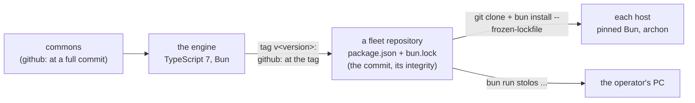

# 096: The engine on Bun and IFC TypeScript

Issue intellectual-frontiers/stolos#32; tracking issue intellectual-frontiers/.github#7.

## Why

The engine runs on Bun, the default TypeScript 7 runtime of Intellectual Frontiers, with Node 26 as
the backup. Its ground is IFC TypeScript (commons specs 0005 to 0008, in commons' package
`@intellectual-frontiers/commons`): a pure kernel and a host runtime on web standards and `node:`
builtins, so the same code runs on Bun and on Node 26. It is OpenTelemetry-native, it holds the
primitives of GRC engineering, and it records every test run as compliance evidence. A fleet loads
the engine as a Git dependency pinned by `bun.lock`, and Bun installs, formats, lints and tests.

## Decisions (the owner's)

1. **Bun is the runtime** of record, everywhere: the operator's PC, the boot server and every host.
   **Node 26 is the backup**: the same code runs on it, so the engine is never stuck on one runtime.
2. **TypeScript 7 is the type checker.** IFC TypeScript is the shared kernel and runtime, depended
   on as commons' package by Git, pinned by a full commit.
3. **Bun and Node 26 only**: no other runtime's API, configuration file, lockfile, task runner,
   documentation tool or telemetry is used anywhere (the guard in `tests/bun096.test.ts` holds it).
4. **One tool binary.** Bun installs, formats, lints, tests and compiles. Lint uses IFC
   TypeScript's plugin.
5. **PAM stays in the engine on `bun:ffi`**, in its one file, behind the console's `Authenticator`.
   On Node, the console's password sign-in is refused as not supported, and signing in with a key
   still works.
6. **No release artifacts.** "If bun supports modules directly from GitHub in package.json then
   releases should not be required ... so we're not creating and polluting GitHub releases for no
   reason." Bun installs a package from GitHub by a commit or a tag, and `bun.lock` pins the
   commit, so there is no GitHub release, no tarball and no build: of the engine, or of commons.

## Decisions made in this spec (for review)

- **The engine is a Git dependency.** A release of the engine is its tag `v<version>` alone (the
  version raised on every push to `main`, as before; CI tags the commit once every job passed). There
  is no GitHub release, no tarball, no SHA-256 asset, no `tsc` build and no `dist/`. A fleet
  repository depends on `"@intellectual-frontiers/stolos": "github:intellectual-frontiers/stolos#v<version>"`
  in `package.json`, and `bun.lock` pins the commit the tag named and the integrity (SHA-512) of
  that commit's archive. The package's entry points are its `.ts` sources. Bun runs them from
  `node_modules`; Node 26 refuses to strip types under `node_modules`, so on Node every entry runs
  with commons' hook first: `node --import @intellectual-frontiers/commons/ts/node archon.ts`
  (commons 0005-typescript-runtime FR-070).
- **The engine depends on commons the same way**, by Git at a full commit:
  `"@intellectual-frontiers/commons": "github:intellectual-frontiers/.github#<full commit>"`
  (commons 0005-typescript-runtime FR-029), imported as `@intellectual-frontiers/commons/ts/kernel`, `.../ts/runtime`, `.../ts/runtime/test`
  and `.../ts/runtime/test-run`; the lint plugin is `commons/ts/lint/plugin.ts` of the installed
  package. A fleet repository gets commons through the engine, installed beside it.
- **The lock is still the control.** `bun install --frozen-lockfile` replaces `--frozen`: a commit
  or integrity that differs from the lock stops the run. The engine's text assets (constitution,
  specs, guides, dotfiles) travel inside the package, as before through `assets.auto.ts`.
- **A fleet repository holds** `package.json` (the engine's `github:` dependency at a tag, the
  scripts `stolos` and `archon`), `bun.lock`, `stolos.ts`, `archon.ts`, `.gitignore` and `fleets/`.
  `engine.ts` is gone: the package is installed whole. `stolos fleet upgrade <tag>` rewrites the tag
  and runs `bun install`.
- **Hosts run Bun.** The bootstrap installs the pinned Bun (its version and SHA-256 per platform,
  kept in the engine), clones the fleet repository, runs `bun install --frozen-lockfile`, and the
  launcher runs `bun archon.ts`. Where Bun cannot run, Node 26 does the same with commons' hook
  (`node --import <hook> archon.ts`; the host launcher names the hook's file in `/srv/archon`, since
  Node resolves `--import` from the working folder).
- **Telemetry is IFC TypeScript's**: `runtime/otel`, configured from OpenTelemetry's own variables,
  in-process. The boot server no longer starts again to turn telemetry on.
- **Tests run through `ifc test`.** Each test is a `proves([...])` naming the requirements it proves
  (`096-bun-runtime FR-001`). The record and its TAP, JUnit, CTRF, SARIF, OSCAL and completion
  reports are CI artifacts, every run goes into the evidence ledger, and every requirement of every
  spec is proven or declared reviewed.
- **The documentation is commons'.** IFC Docs (commons 0011-documentation, the command `ifc-docs`
  of commons' package) renders the engine's site from its TypeScript and its spec kit, configured by
  `docs.config.ts` (a `DocsConfig`: the engine has no `about.ts`, so its areas are given there, one
  for each folder of `src/` and one for each guide, so that every guide is an area's overview).
  `ifc-docs check` fails on an export of an area with no TSDoc, a citation of an unknown
  specification or requirement, an unknown `{@link}`, and a link or anchor that leads nowhere. IFC
  Docs does not compile examples, so `tools/doc-examples.ts` keeps that one check: every
  `@example` compiles with `tsc`. Every module's `@module` block is the lint rule
  `ifc/module-doc`. Every requirement is `FR-NNN` (a letter after the number where one was
  inserted), which is what IFC Docs anchors.
- **The engine keeps no copy** of what IFC TypeScript gives: `Result`, decoders, files, processes,
  locks, the terminal, downloads, the server, OpenTelemetry, OCSF, OSCAL, in-toto and DSSE, CMS, the
  evidence ledger, waivers, risk, archives, YAML, TOML, JSON5, CSV and XML. What it lacks is added
  to commons first, then used here. GRC types move onto commons' `0007-grc`, and the catalog content
  (SCF, NIST, FedRAMP) stays here.
- **Dependencies:** `fflate` is replaced by the kernel's archives. `ajv` stays (JSON Schema 2020-12
  validation of third-party documents), pinned in `package.json` with its reason.
  `@opentelemetry/api` is replaced by IFC TypeScript's signals.
- **How a fleet imports the engine.** The package's `exports` maps `./*` to the module of that
  path under `src/`, without its extension: `@intellectual-frontiers/stolos/archon/model/types`,
  `@intellectual-frontiers/stolos/archon/capabilities/mod`, `@intellectual-frontiers/stolos/stolos/main`
  (was `@stolos/archon/model/types.ts`). In this repository the name refers to the package itself
  (`"./*": "./src/*.ts"`), so `examples/` load the sources on Bun and on Node with no build, and a
  fleet's `node_modules` holds the same sources, from the same `package.json`.
- **The package is installed whole:** `bun.lock` pins its commit and that commit's integrity, and
  `bun run gen` writes only the generated files (`assets.auto.ts`, the ontology's).
- **The version** stays in `src/archon/version.ts`; `bun run version` keeps `package.json`'s
  `version` equal to it (`bump` writes both, `check` fails where they differ).
- **The linter** is a pinned Bun canary (`bun x bun@1.4.4-canary.20261115.1 lint`), as commons
  runs it, until a Bun release has `bun lint`; then the pin moves to that release.
- **Tests are `*.test.ts`**, and `tools/test.ts` feeds `ifc test`: the requirements are every
  `- **FR-NNN**` line of every `specs/*/spec.md`, as `<spec folder> FR-NNN`; a requirement proven by
  review is listed, with its reason, in its spec's `reviewed.tsv`; a requirement a test names that
  no spec has stops the run before it starts. A test proves the requirements its assertions check,
  never a whole spec by its number.
- **The engine's own process contract stays**: `core/exec.ts`'s `run` gives exit code 127 for a
  program that is not installed instead of throwing, and runs as another account through runuser.
  `core/ui.ts` is the one module of `src/` that writes for a person to the terminal.
- **Span names are kinds**: a run is one `archon.run` span (its command in `archon.command`) and each
  phase an `archon.phase` span (its name in `archon.phase`), as IFC TypeScript's registry needs
  names declared once.

## Requirements

- **FR-001** No file of the engine (`src/`, `tools/`, `tests/`, `examples/`) and none of its
  documentation (the specs, the constitution, AGENTS.md, README.md, `docs/`) names a TypeScript
  runtime other than Bun and Node, imports `npm:`, `jsr:` or a URL, or is configured by another
  runtime's file; vendored third-party files keep their publishers' text. The one file that names a
  runtime's API is the PAM binding, which imports `bun:ffi`, as the lint plugin's allow list says.
- **FR-002** `package.json` pins the development dependencies exactly (TypeScript 7, `@types/node`)
  and the run-time ones (commons by `github:intellectual-frontiers/.github#<full commit>`, `@intellectual-frontiers/core`, `crypto`, `formats`, `rdf` and `terminal` from npm, `ajv`),
  with `bun.lock` beside it, which pins commons' commit and its integrity;
  `bun install --frozen-lockfile` installs them.
- **FR-003** `tsc` 7 type-checks every file with IFC TypeScript's strict configuration.
  `bun fmt --check` and `bun lint --type-aware --max-warnings 0` (with IFC TypeScript's plugin)
  pass.
- **FR-004** The suite runs through `ifc test` on Bun and on Node 26, on Linux, and the parts that
  apply on macOS and Windows. Every requirement of every spec is proven by a test or declared
  reviewed with its reason, and CI keeps the record, its reports and the ledger.
- **FR-005** Every push to `main` raises `src/archon/version.ts`. Once every job passed, CI installs
  the commit it checked as a Git dependency (a `git+file:` URL of the checkout, at the commit) into
  an empty project and runs `archon --version` and `stolos --version` there on Bun and on Node 26
  with commons' hook (`bun tools/smoke.ts`), then tags the commit `v<version>`. The tag is the
  release: no GitHub release, no tarball, no SHA-256 asset, no build.
- **FR-006** `stolos fleet init` writes a fleet repository of `package.json` (with
  `"@intellectual-frontiers/stolos": "github:intellectual-frontiers/stolos#v<version>"`), `bun.lock`
  (pinning the commit and its integrity), `stolos.ts`, `archon.ts` and `.gitignore`.
  `stolos fleet upgrade <tag>` rewrites that dependency to the tag and runs `bun install`, and
  `bun run stolos ...` and `bun run archon ...` are its commands.
- **FR-007** The bootstraps (`bin/bootstrap.sh`, `bin/bootstrap.windows.ps1`) and the host install
  fetch the pinned Bun, check its SHA-256 before unpacking, and run the engine with it. The launcher
  runs `archon.ts` with Bun, and with Node 26 where Bun is not installed; on Node the launcher, the
  bootstraps and the engine's own child processes run the fleet's entry files with
  `--import @intellectual-frontiers/commons/ts/node` (the hook's file, where the working folder is
  not the fleet repository).
- **FR-008** Telemetry is IFC TypeScript's (`runtime/otel`, commons 0006-signals): every command is
  a trace, and nothing reads another runtime's telemetry switch. The boot server records each event as an OpenTelemetry log
  record; its terminal window and `boot.log` are renderings of the same event, and the Stolos
  Console's Installs page reads `boot.log` (not the OTLP journal).
- **FR-009** `ifc-docs` (commons 0011-documentation), configured by `docs.config.ts`, renders the
  engine's documentation from its TSDoc and its spec kit to `out/docs/` (`bun run docs`),
  and `bun run docs:lint` runs `ifc-docs check` (every export of every area documented, every
  citation, link and anchor known) and `tools/doc-examples.ts` (every `@example` compiles).
- **FR-010** The console's PAM sign-in runs on Bun through `bun:ffi`. On Node it is refused as not
  supported.

## Tests

- `tests/bun096.test.ts`:
  - no other runtime named, and no `npm:`, `jsr:` or URL import, in the engine or its documentation;
  - `package.json` pinned exactly (commons by `github:` at a full commit) and matching `bun.lock`;
  - this checkout, committed in a throwaway clone, installs as a Git dependency (`git+file:`) into
    an empty project and runs `archon --version` and `stolos --version` on Bun and on Node 26 with
    commons' hook (`tools/smoke.ts`);
  - the Bun pin has a checksum for each platform.
- `tests/scaffold.test.ts` and `tests/upgrade.test.ts`: `fleet init` writes the `github:`
  dependency at the tag; `fleet upgrade` rewrites it, installs it from a local Git repository and
  locks its commit.
- `tests/docs055.test.ts`: `docs.config.ts` gives an area to every guide, `ifc-docs check` passes on
  the engine, and `tools/doc-examples.ts` finds a broken example.
- The suite itself, under `ifc test`, on both runtimes.
