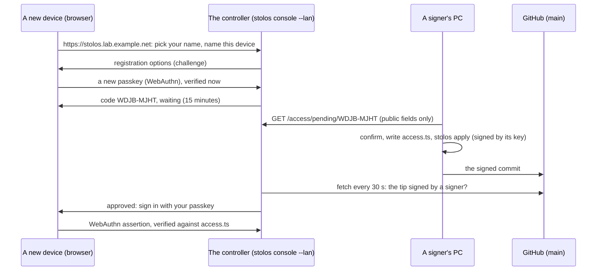

# 100: Remote access to the Stolos Console

Issue intellectual-frontiers/stolos#36.

## Why

The Stolos Console (spec 066) answers on 127.0.0.1 only: to look at the fleet, or to approve a
change, the owner has to sit at the controller PC. The owner asked for the console from any device
on the site's network (a phone, a laptop in another room), with a real certificate, without a
password, and without weakening what makes a change trusted: a commit signed by a fleet signer's
own key. Device login is the model (spec 098): the new device shows a short code, and a person who
is already trusted approves it, here with a signed commit, so who may sign in is in Git's history
like every other decision.

## Requirements

- **FR-001** Names. `fleet.ts` may carry `stolos: { console: { name?, primary?, lan? } }` (typed
  in `model/types.ts` as `StolosFleetDef`, validated: `name` a DNS label, default `stolos`;
  `primary` a controller's name; `lan` a boolean). With `web.domain`, `stolos.<domain>` names the
  primary controller and `<pc>.stolos.<domain>` each controller (`<pc>` is `controllerName()`).
  `stolos console --lan` (and `fleet init` when the fleet has `web.domain`) proposes the names,
  asks to confirm (non-interactive: the defaults, and it says so), and writes them into `fleet.ts`
  (a person's file: it then says `bun run stolos apply`). Settings already there are kept.
- **FR-002** DNS and certificate. With the Cloudflare token of `boot web-setup` (`web.json`), the
  console keeps an A record (this PC's LAN address, not proxied) for `<pc>.stolos.<domain>` and,
  on the primary, `stolos.<domain>`; and a TXT record `_stolos-console.stolos.<domain>` =
  `"<pc> <ISO time>"`, refreshed every 5 minutes while it serves. Its certificate comes from ACME
  (commons' `acme.issue`, Let's Encrypt, the DNS challenge through Cloudflare) for
  `<pc>.stolos.<domain>`, `*.stolos.<domain>` and, on the primary, `stolos.<domain>` (a wildcard
  does not cover its parent). The certificate, its key and the ACME account live in the vault
  (`console/tls.json`, owner only, so every backup holds them) and are renewed when 30 days or
  fewer remain, at start and daily while serving. The DNS provider, the ACME directory and `fetch`
  are injected, so tests run against fakes.
- **FR-003** Listener. `stolos console --lan` serves HTTPS on this PC's LAN address, port 443, else
  8443, beside the 127.0.0.1 listener and its launch link (unchanged). The Host check accepts the
  two names. Constitution Article 28: only a private or mesh address (RFC 1918, 100.64.0.0/10) is
  ever bound; with none, it refuses and says why. The doctor checks the firewall (Private and
  Domain profiles only) and shows the exact command as ⚡.
- **FR-004** Registration. An unknown browser on an HTTPS name picks its signer (from
  `signers.ts`), names the device (the default from its User-Agent), and creates a passkey at once
  (WebAuthn, relying party ID `web.domain`, the challenge kept on the server). The server verifies
  it and keeps a pending registration: an 8-character code (spec 098's alphabet), the signer, the
  device's name, the credential (public key only), the address and User-Agent, for 15 minutes. The
  page shows the code and waits.
- **FR-005** Approval. Any signer approves a code: on the controller's Remote Access page (a
  session that may sign here, FR-009), **Approve** runs `bun run stolos devices approve <code>`
  (the passphrase asked on the page, spec 099); from any signer's PC,
  `bun run stolos devices approve <code> [--controller https://stolos.<domain>]` fetches the pending
  registration's public fields (`GET /access/pending/<code>`), shows them, asks, writes the device
  into `fleets/<fleet>/access.ts` with `approvedBy` = their own signer name, and runs
  `stolos apply -m "100-remote-access: approve <device> for <signer>"` (their key signs). Deny
  drops a pending code and is recorded.
- **FR-006** The controller honours `access.ts` only from a tip of the fleet's branch on GitHub
  signed by a key in the signers this checkout trusts (`checkTip`), and never from an older tip than
  the one it last read (no rollback). It fetches every 30 seconds while a code is pending, else every
  5 minutes. Then the waiting page offers **Sign in with your passkey**.
- **FR-007** Sign-in. WebAuthn authentication against `access.ts`'s credentials; the signature
  counter and the last sign-in (when, from where) are kept in local state (not Git). The session
  cookie is `Secure; HttpOnly; SameSite=Strict`. Five failed sign-ins in a minute pause an address.
- **FR-008** Revoke and list. **Revoke** on the Remote Access page, or
  `bun run stolos devices revoke <id>`, removes the device from `access.ts` and applies (signed);
  the device is refused once the controller reads that signed tip. `bun run stolos devices` lists
  the devices (from `access.ts` and the local last-use record), read-only.
- **FR-009** Privileges. A signed-in signer whose daily or recovery key is on this controller may
  run every command the console offers; any other signer sees every page and runs read-only
  commands, and a command that changes the repository answers "This would be signed by <owner>'s
  key: run it from your PC: bun run stolos <command>". The local launch-link session is this PC's
  owner.
- **FR-010** The Remote Access page (`/access`, in the menu): the addresses and certificate (names,
  expiry, issuer), whether the LAN listener is on, whether this controller is the primary, and
  another controller's live heartbeat (⚡ "also open on <pc>"); who can sign in (every signer: role,
  may sign here or look only, devices, last sign-in); each device (signer, name, synced or
  device-bound passkey, registered, approved by, from which address and User-Agent, last sign-in,
  Revoke); pending codes with Approve and Deny; recent sign-ins, failures and refusals with a CSV
  download; a ⚡ for a device unused for 90 days; and a diagram of the flow. Revoke, Approve and Deny
  are shown only to a session that may sign here. The Overview's Needs attention links to it when a
  code waits or a device is due for review.
- **FR-011** Audit mail. At once (the fleet's mail, send-only, best effort, never blocking): a
  device registered (pending), approved, denied, revoked, and five failed sign-ins from one address
  in a minute. Daily, while the console serves: a digest of sign-ins and commands from remote
  sessions (who, device, from, when); the last digest's time is kept in local state, so a restart
  does not send it again. Every event is also an activity record (kind `access`). No secret in any
  of them.
- **FR-012** Doctor and policy. `boot doctor` shows remote access: the LAN listener on or off, the
  certificate's expiry (⚡ under 14 days), devices unused for 90 days (⚡), and the firewall rule
  (⚡). The controller's policy pack (spec 097) adds "remote access: HTTPS with a valid certificate,
  devices reviewed within 90 days".
- **FR-013** Compliance. The access evidence is labelled with SCF controls already in the catalog:
  CRY-05 (TLS), IAC-14 (passkeys, per person), IAC-12 (devices reviewed), IAC-30 (least privilege:
  look only unless your key is here), CHG-03 (approval is a signed commit).

## Success criteria

- **SC-001** `tests/access100.test.ts`: the names and their validation; writing `fleet.ts`; DNS
  records, the heartbeat and the certificate against a fake Cloudflare and a fake ACME; the
  addresses Article 28 allows; a passkey registration and sign-in made with WebCrypto, verified by
  commons' WebAuthn; the code flow end to end in-process (pending, `devices approve` writing
  `access.ts` in a sandbox fleet and applying it signed, the controller honouring the signed tip
  and refusing an unsigned one, sign-in, revoke); the privilege rule; the Remote Access page; the
  mail events and the digest; the doctor's ⚡ lines and the controller policy.

## Decisions

- **The relying party is `web.domain`**, so a passkey made here is good for the Archon Consoles of
  the same fleet later (one passkey per device, not per console).
- **`access.ts` is a decision, not a record.** Stolos writes it, but only when a signer approves
  or revokes, and that command sends it at once (signed). It is not in the records `stolos update`
  sends by itself (spec 099 FR-006): left uncommitted (a failed apply), it is shown by name ("who may
  sign in to the console") among your changes, and update asks before sending it.
- **Approval refuses other uncommitted changes**: an approval commit holds the approval only.
- **Pending registrations live in the console's memory**: a restart drops them (the device starts
  again); nothing is written before a signer approves.
- **The HTTPS listener is the engine's own** (`node:https`), because commons' `serve` has no TLS
  yet; it keeps the same handler and the certificate is replaced in place on renewal.
