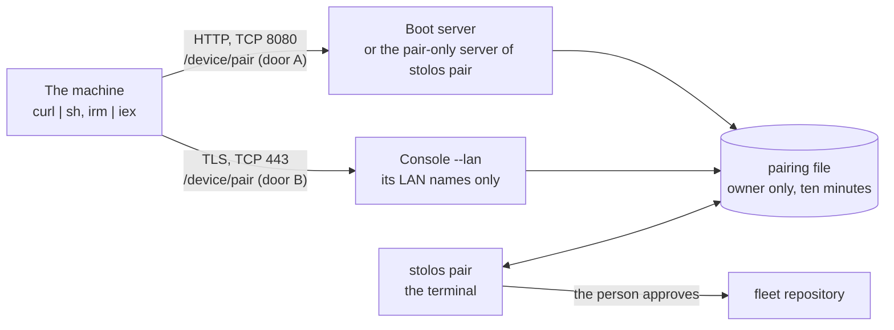

# 103: The controller opens three ports

Issue intellectual-frontiers/stolos (the owner's goal: the controller PC opens only three inbound ports for Stolos).

## Why

The controller PC grew a port for each thing it serves: the boot server's TFTP (UDP 69) and HTTP (TCP 8080), the console's
HTTPS (TCP 443, or 8443 when 443 was busy, spec 100), and the pairing's own TCP 7457 (spec 098). Every port is a firewall
rule to write, a thing to explain, and a listener to defend. The owner's rule is now Article 29: **UDP 69 and TCP 8080** (the
boot server, because firmware speaks only plain TFTP and HTTP) and **TCP 443** (the console over TLS), and nothing else; every
other exchange is a route on one of them or is loopback-only. Pairing moves to `/device/pair` and is reachable by two doors that
serve one handler over one short-lived record; the console's automatic fallback to a second port goes.

## Ontology

The terms this spec uses, defined in `ontology/stolos/` with this spec as their source where it is theirs: `stolos:Listener`
(the code list of `stolos:listener-boot-tftp` UDP 69, `stolos:listener-boot-http` TCP 8080 and `stolos:listener-console-https`
TCP 443, each with its `stolos:protocol` and `stolos:port`), `stolos:Door` (`stolos:door-lan-http`, `stolos:door-tls`, each
`stolos:onListener` one of those), `stolos:DevicePath` (`stolos:devicepath-pair`, whose `stolos:pathPrefix` is `/device/pair`),
and, from earlier specs, `stolos:Controller`, `stolos:PairingCode`, `stolos:TrustedNetwork`, `stolos:ConsoleName`,
`stolos:AdoptedMachine`. `bun run gen` writes them as `LISTENERS`, `PAIRING_DOORS`, `DOOR_LISTENERS`, `DEVICE_PATHS` and
`DEVICE_PAIR_PATH` in `src/archon/ontology.auto.ts`.

## Requirements

- **FR-001** The controller PC opens inbound only UDP 69 and TCP 8080 (the boot server) and TCP 443 (the console over TLS)
  (constitution Article 29). Every other exchange (pairing, the REST API, the passphrase helper) is a route on one of them or
  is loopback-only; nothing is opened to the internet (Article 28). A port other than these three is an explicit `--port` choice
  of the command that opens it, which says it is outside the three standard ports and prints its own firewall rule. TFTP data
  transfers use a per-transfer ephemeral UDP port, as TFTP requires, and the firewall tracks the replies: that is not a rule to
  open.
- **FR-002** The three ports are facts of the ontology (`stolos:Listener`: `boot-tftp` UDP 69, `boot-http` TCP 8080,
  `console-https` TCP 443). `src/archon/core/listeners.ts` is the one place the code reads them (`standardPort(kind)`,
  `choosePort(kind, explicit)`, `firewallRule`): no listener's default port is written as a number anywhere else.
- **FR-003** Pairing's routes live under `/device/pair` (the ontology's device path; `/device/` is reserved for
  device-specific endpoints, pairing being the first), relative to the base `<origin>/device/pair`: `GET <base>` (the POSIX
  script), `GET <base>/w` (the Windows loader), `GET <base>/w.ps1`, `GET <base>/bin/stolos-probe.sh` and `.ps1`, `POST
  <base>/hello`, `POST <base>/checkin`. The integrate scripts take `--pair <base-url>` and build every URL from it, so the base
  `http://<pc>:8080/device/pair` or `https://<name>/device/pair` needs no change to them. No route of the boot server collides
  with `/device/pair`.
- **FR-004** Two doors, one handler, shared state. Door A is the boot server's plain HTTP on TCP 8080 (the same trust as PXE,
  Article 28) and, when boot serve is not running, `stolos pair` serving only the `/device/pair` routes on 8080 itself (no TFTP,
  no Ubuntu downloads). Door B is the console's TLS listener on TCP 443 while `stolos console --lan` serves, for the console's
  LAN names only (`stolos.<web domain>` on the primary, `<pc>.stolos.<web domain>`), never on the 127.0.0.1 listener, and
  with the console's Host check intact. Both mount the same handler over the same record; the routes need no session and are
  exempt from the console's session and passkey machinery.
- **FR-005** While no pairing is waiting (no record, or it ended), every pairing route answers 404 on every door; a late
  `POST` to an ended or expired pairing answers `no` with why.
- **FR-006** The hand-off is a short-lived file in the secrets folder (the pattern of armed installs: the command writes, the
  servers read per request, no new port): owner only, ephemeral (never backed up, listed in the secret inventory), holding the
  code, fleet, expiry (10 minutes), the name, owner and title hints, the count of wrong tries, the machine's hello (hostname,
  name, probe key), the signed check-in waiting for the person, and the decision. It is changed under a lock file, read fresh
  inside it, and written atomically (a temporary file renamed over it), so two processes cannot lose each other's tries. Wrong
  tries are counted in the file (the limit of 5 is shared by both doors and every process), one machine is allowed per code, the
  probe key is made at hello, and `/checkin` stores the check-in and holds the request until the person decides or the code
  expires. `stolos pair` removes the file in a `finally`, whatever ended the pairing.
- **FR-007** The protocol's state is pluggable: `PairSession` (the code, HMAC signatures, nonce and signed answers, script
  generation, byte for byte what the shell and PowerShell scripts compute) works over a `PairStore`, in memory (tests, one
  process) or in the file (FR-006).
- **FR-008** `stolos pair` shows one line per door that is up, HTTPS first (`curl -fsSL <base> | sh`; Windows as administrator
  `irm <base>/w | iex`), then the code and its 10-minute expiry. Door A is its own pair-only server when it binds TCP 8080,
  else the boot server that holds the port (it says so, after checking that it serves `/device/pair`). Door B is shown only when
  the console's name resolves to one of this PC's LAN addresses and the console answers there; otherwise one plain line says how
  to get it. The person approves in the terminal (who asked: name, OS, account, address, MAC, SSH fingerprint, osquery). The
  firewall is checked (read-only) for TCP 8080 and 443 as actions with the exact command. `--address` and `--port` remain; the
  default port is 8080; TCP 7457 is gone.
- **FR-009** The console's LAN listener is TCP 443 and no other automatic port (no 8443 fallback). Where 443 cannot be bound, it
  refuses to listen with a plain message that names what holds it when that is cheap to find (Windows: `Get-NetTCPConnection`
  and the owning process; Linux: `ss -ltnp`; macOS: `lsof`; a failed lookup never fails the command), the fix, and
  `stolos console --lan --lan-port <n>` as the explicit choice, which says it is outside the three standard ports and prints its
  own firewall rule. `boot doctor`'s Remote access phase reports the same.
- **FR-010** The boot server keeps `--port` and `--tftp-port` as explicit choices; its defaults are the ontology's, and a
  value other than them is said to be outside the three standard ports, with its own firewall rule.
- **FR-011** A test keeps it true: it scans `src/` for socket-opening calls and fails on any file not on an allow-list that
  carries a reason (loopback-only listeners; the servers' own web front, behind Traefik and loopback; the per-transfer TFTP
  sockets; the doctor's bind-and-release probes); a file that opens a non-loopback listener must take its default from
  `core/listeners.ts`.
- **FR-012** The guides that name ports or pairing (boot machine, adopted machines, remote access, the command help) say what is
  true now: three ports, two doors, `/device/pair`.

## Success criteria

- **SC-001** `tests/ports103.test.ts`: the ports come from the ontology; the guard fails on a fake new listener; two
  `PairSession`s over one file count tries together and allow one machine; the file is owner only, expires and is removed by
  `stolos pair`; every route answers 404 with no pairing; the handler mounted on the boot server's handler and on the console's
  completes a full pairing with the real `bin/integrate.sh` against `/device/pair`; no boot route collides; the pair-only
  server binds the ontology's port; the console does not fall back and names the holder; `stolos pair`'s door lines.
- **SC-002** `bun run check:ontology`, `check:trace` and `check:layers` pass with baselines no larger than before.

## Decisions

- **The file, not a port, is the hand-off.** The doors are other processes than the terminal, so the state is shared by a
  short-lived file, as the armed installs are; a lock file and an atomic rename keep two processes from losing a try.
- **Pairing is `/device/pair`, not `/pair`.** The namespace `/device/` is reserved for device-specific endpoints.
- **`--lan-port`, not `--port`, for the console's explicit HTTPS port.** `stolos console --port` already names the 127.0.0.1
  listener; the HTTPS listener's explicit port is `--lan-port`.
- **Approval stays in the terminal.** The console's Remote Access page does not approve a waiting machine (see `tasks.md`).
