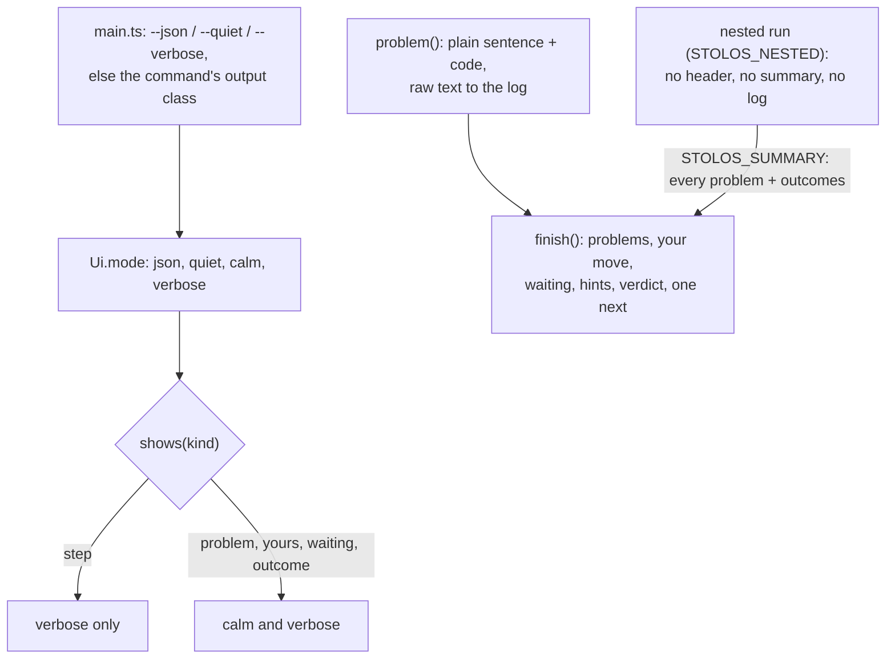

# Plan: Calm output

**Spec**: `specs/105-calm-output/spec.md`. Constitution Article 19 (6.2.0).

## Rungs touched, in order

0. **Ontology**: `OutputClass`, `Verbosity`, `LineKind` (`ontology/stolos/vocabulary.ts`, `codes.ts`, listed in `mod.ts`); `bun run gen`
   writes `OUTPUT_CLASSES`, `VERBOSITIES`, `LINE_KINDS` and their unions in `src/archon/ontology.auto.ts`.
1. **Specification**: this folder.
2. **Infrastructure** (`src/archon/core/`): `ui.ts` is the one renderer. `explain.ts` holds the new codes and the raw-error patterns.
   `registry-types.ts` has `output` on `Command`, `--quiet` among the global options.
3. **Business rules**: `fleet/signing.ts` (the signing line, the three tries, the waiting upgrade's message), `fleet/upgrade.ts`
   (`waitingUpgrade`), `fleet/whatsnew.ts`, `fleet/apply.ts`, `update/operator.ts`, `vault/panel.ts` (`secretsInWords`),
   `access/doctor.ts` (a hint), `archon-boot/doctor.ts`.
4. **Application**: `commands/registry.ts` (every command's class, `log`), `main.ts` (modes, `-q`, muting), `archon-boot/main.ts`.
5. **Tests and docs**: `tests/calm105.test.ts`, the legitimately changed expectations of `019-output`, `052`, `058`, `060`, `100`.

## Design

- **Modes.** `Ui.mode` is the ontology's `Verbosity`. A report defaults to `verbose`, an action to `calm`; `--verbose` and `--quiet` and
  `--json` override. `Ui.verbose` (the dimmed items) stays the explicit flag only, so a report's default output is what it was.
  `Ui.shows(kind)` is the one table that says what each `LineKind` does in each mode.
- **Nested runs.** `stolos([...])` in `update/operator.ts` starts a child with `STOLOS_NESTED=<parent mode>`, `STOLOS_SUMMARY`,
  `ARCHON_LOG` and `ARCHON_UI_START`. The child draws nothing (except `Ui.live` lines, said right before a prompt) and writes every
  problem and outcome to the summary file; the parent merges them with `Phase.merge` and never adds a failure of its own for them.
- **Failure once.** A calm run does not print problems where they happen. The closing block lists warnings and your-move items; the
  first failure is the verdict itself (cause first), and its fix command is the one `next:` line.
- **Raw errors.** `Ui.problem` recognizes a raw message (`explain.ts` patterns), shows the code's title, keeps the raw text in the log
  and in `Problem.raw` (shown with `--verbose`). A problem without a code gets `E105-FAILED`, `E105-WARNING`, `E105-YOURS` or `P105-WAITING`.
- **Hints.** `Ui.hint(id, message, command)`; shown at finish if not shown within 7 days (`hints.json` in the program's state folder,
  ids and times only; `STOLOS_HINT_NOW` is the test clock), always in verbose, never in quiet.
- **Signing.** `commitSigned` runs `git commit` with the terminal for stdin and pipes stderr; a message that says the passphrase was
  wrong gets "(N left)" and another try (3 in all); the raw text goes to the log. Nothing reads or stores the passphrase.
- **Resumable upgrade.** `waitingUpgrade` is true when `package.json` pins another tag than HEAD and every changed file is one of an
  upgrade's (pin, lock, workflows, bootstrap scripts, `.gitattributes`). `apply` names its commit `stolos vX: adopt the engine vX`;
  `update` sends it through `apply` and the doctor does not count it as "yours".
- **New engine.** After an upgrade, `update` starts `stolos update --no-upgrade` as a nested run so Install, Keys and Doctor run on the
  engine that was just adopted. The engine's releases are listed from the pin's own source (`github:` or a `git+` mirror).
- **What's new.** `GET ${ARCHON_GITHUB_API ?? https://api.github.com}/repos/intellectual-frontiers/stolos/compare/<old>...<new>`, five
  newest subjects, deduplicated; `Operator action:` lines become ⚡ items (`E105-OPERATOR`).
- **`--quiet`.** `main.ts` holds back what a command writes itself (`muteOutput`) and prints the verdict through the Ui's own screen writer.

## Decisions where the brief was open

- A report in verbose mode still prints a problem where it happens and in the closing block (as before); calm prints it once.
- The verdict of a failure is the cause; there is no "failed" or "finished" wording anywhere. The default verdict word is "Up to date"
  (an action) or "Checked" (a report); `update` says "Updated" or "Updated to vX.Y.Z".
- `ui.next` (free lines under the verdict) is no longer printed: `next:` is derived from the problems.
- Commands that do not draw phases (most registry commands without `operation`) get `--quiet` as muted output plus one line
  ("<command>: up to date" or "did not finish (exit code N)").
- A fix text is split by `splitFix`: the command goes on a `fix:`/`run:`/`next:` line, any words on a line of their own.
