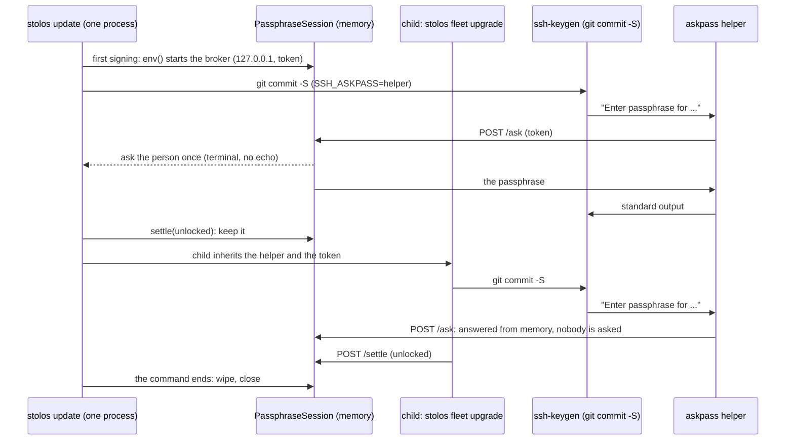

# Plan: One passphrase per command, and a quick one

**Spec**: `specs/106-one-passphrase-speed/spec.md`. Constitution Article 13 (a passphrase is typed, never stored) holds as written:
what is kept is in memory for one command and is never stored.

## Rungs touched, in order

0. **Ontology**: `PassphraseSession`, `ProbeCache`, `PhaseTiming` (classes) and `SigningOutcome` with its codes (`ontology/stolos/`);
   `bun run gen` writes `SIGNING_OUTCOMES` and `SigningOutcome` in `src/archon/ontology.auto.ts`.
1. **Specification**: this folder; spec 057-keys FR-007 and spec 105's wave 2 are corrected.
2. **Infrastructure** (`src/archon/core/`): `passphrase.ts` (the session, the loopback broker, the terminal prompt),
   `askpass-helper.ts` (the program OpenSSH runs), `probe-cache.ts` (the TTL file and the once-per-run memo), `nested.ts` (the
   hook that runs a nested command in process), `run-memo.ts` (the fetch and the model, once per run); `ui.ts` (the nested scope,
   the timing lines, the state folder).
3. **Business rules**: `fleet/signing.ts` (`commitSigned` asks the session, settles the attempt), `update/operator.ts` (nested runs
   in process; a child only after the pin moved), `fleet/apply.ts` (the shared fetch), `people/commands.ts`, `risk/review.ts` (they sign
   through the session too).
4. **Application**: `main.ts` and `archon-boot/main.ts` (register the in-process runner; wipe the session at the end), `commands/registry.ts`
   and `core/registry-types.ts` (`--fresh`), `archon-boot/firewall.ts` and `doctor.ts` (the cache, the shared probe, in parallel).
5. **Tests**: `tests/passphrase106.test.ts`, `tests/speed106.test.ts`, `tests/lab-fleet.ts` (the sandbox fleet `calm105` had inline).

## Design

- **The session.** One per process, made when first needed. `answer(prompt)` serves the kept value for that prompt (the key's path
  is in OpenSSH's prompt, so two keys are two values); else asks the person (terminal, else the askpass the environment names)
  and holds the answer as a candidate. `settle(outcome)` after each attempt promotes the candidates served in it
  (`signing-unlocked`), or throws them away and marks the key to be asked again (`signing-refused`, which leaves a kept value in
  place until a new one unlocks), or throws them away (`signing-failed`). `wipe()` zeroes every buffer, closes the broker and removes
  the helper's folder.
- **The broker.** `serve` on 127.0.0.1, port 0, answering only `POST /ask` and `POST /settle` with the token in a header, compared in
  constant time; the body of an answer is bytes. It starts when `env()` is first called (a signing command, or before a child that
  may sign is started) and stops at `wipe()`. A process that inherited the helper's variables (a child) is a client: it holds
  nothing, asks the parent and tells it the outcome.
- **The helper.** A script in a temp folder (`.cmd` on Windows) that runs `core/askpass-helper.ts` with the engine's runtime. It holds
  no secret; it reads the url and the token from its environment (set only for the processes the command starts for signing).
- **Retry.** `commitSigned` tries up to three times (spec 105 FR-013): attempt, `settle`, and a message. A kept value that the key
  refuses (a rotated key) is asked again on the next try.
- **In process.** `core/nested.ts` holds a hook the application registers (`main.ts`): `runNested(argv)` finds the registry command, runs
  it under `ui.nestedRun()`, which saves and restores the Ui's problems, outcomes, phases and hints, sets `nested`, and returns the
  summary the child process would have written to `STOLOS_SUMMARY`. A command that needs `sudo`, has a precheck, or is not in the
  registry is run as a child, as before. The boot doctor is reached the same way (`boot doctor` is the boot server's own command
  line, registered by `src/stolos/main.ts`). After `fleet upgrade` the pin differs from what this process loaded, so its steps are
  children (a module the process has not loaded yet would come from the new engine on disk).
- **Probe cache.** `probe-cache.ts` reads and writes `firewall.json` (needs and system as the key, the warnings and a time as the
  value); `ui.mode === "verbose"` (every report, and `--verbose`) or `--fresh` bypasses it; an exception in the check is not
  kept; one in-flight probe of Windows' rules is shared in a process.
- **Once per run.** `run-memo.ts`: `fetchOnce(repo)` and a memo of `fleet.ts` and signers keyed by their files' size and time.
- **Timing.** `Ui.endPhase` writes `TIME <phase> <ms>ms` to the log; `finish` writes `TIME total`.

## Decisions where the brief was open

- The passphrase channel is a loopback broker and a per-run askpass helper (the shape spec 099 FR-005 already uses for the console),
  not an inherited pipe: a pipe is read once and cannot serve a second signing; a descriptor cannot be inherited portably on
  Windows from Bun. The token is in the environment of the processes the command starts to sign; the passphrase never is.
- The cache's time to live is five minutes: long enough that `update` and `apply` run one after the other share it, short enough that
  a changed rule is never hidden for long; a person who just changed a rule runs a report or `--fresh`.
- A child process is kept for `fleet upgrade`, the publish and the rest after an upgrade (three starts on the one path that
  upgrades the engine); the typical update starts none.
- A nested run's hints are not shown by its parent (as before: only a run of its own shows them).
