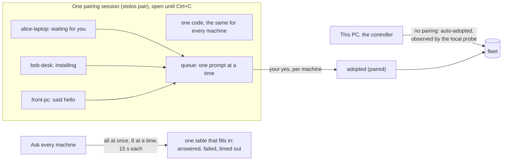

# 107: Pairing many machines, the controller as auto-adopted, and asking every machine at once

Issue intellectual-frontiers/stolos#39.

## Why

Three things the owner found in use.

1. **Pairing paired one machine, then ended.** `stolos pair` (spec 098) gave a code good for one machine and 10 minutes; a second
   machine meant a second run, a new code, a new line. Someone setting up an office wants to run one command and then walk from
   machine to machine.
2. **The controller PC is a machine of the fleet** (spec 097) but nothing in the consoles said how it got there. It is not paired and
   not integrated: the fleet adopts it by itself. A person looking for it in the machines list, or wondering whether to pair it, had
   no answer.
3. **Ask every machine was a plain table that appeared when the slowest machine answered**, or never, when one hung. Today the
   adopted machines are asked together, then the managed servers together, one group after the other, with no limit on how long a
   machine may take and no cap on how many are asked at once; the console runs the command and waits for all of it.

## Ontology

The terms this spec uses, defined in `ontology/stolos/` with this spec as their source: `stolos:PairingSession`,
`stolos:AddressBlock`, `stolos:MachineTable`, and the code lists `stolos:WayOfJoining` (`stolos:joined-auto-adopted`,
`stolos:joined-paired`, `stolos:joined-integrated`, `stolos:joined-managed`, `stolos:joined-cloud`), `stolos:PairingStage`
(`stolos:stage-hello`, `stolos:stage-installing`, `stolos:stage-waiting`, `stolos:stage-adopted`, `stolos:stage-refused`) and
`stolos:AnswerState` (`stolos:answer-asking`, `stolos:answer-answered`, `stolos:answer-failed`, `stolos:answer-timed-out`); and,
from earlier specs, `stolos:PairingCode`, `stolos:Controller`, `stolos:AdoptedMachine`, `stolos:Door`, `stolos:MachineKind`.
`bun run gen` writes the code lists as `WayOfJoining`, `PairingStage` and `AnswerState` (and their arrays) in
`src/archon/ontology.auto.ts`; the code imports the unions.

## Requirements

### Pairing many machines (replaces spec 098's FR-002 expiry and FR-007 one machine per code)

- **FR-001** One `stolos pair` session pairs **many machines**, at the same time or one after another, with one code that every machine
  uses. The session has **no expiry, no join window, no install allowance and no configurable timeout**: it stays open until the
  person who started it stops it with Ctrl+C. (A stop button in the Stolos Console is not built: see `tasks.md`, L001.) A new
  `stolos pair` replaces a session left behind by a killed one.
- **FR-002** Each machine has **its own approval prompt** on the terminal (its name, OS, account and address, MAC, the SSH host key's
  fingerprint, osquery), asked **one after another** in the order the machines arrived: a prompt is never interrupted by another
  machine's. Nothing is written to the fleet repository for a machine before its yes, and adoption is per machine, as `host adopt
--check-in` does it (host keys pinned from the signed check-in, observed over SSH with its probe key, policies reported). A
  machine that is refused, or whose approval fails, does not stop the others.
- **FR-003** The terminal shows **the live state of every machine** (`stolos:PairingStage`: said hello, installing, waiting for you,
  adopted, refused), a line each time one changes, and a status line. It says plainly **"Session is open: Ctrl+C closes it"**, that
  **an open session is less safe than a short one** (anyone on the network who has the code can ask to join, so close it when the
  machines you expect have joined), and that **nothing is adopted without your yes**. A machine is "installing" once it has fetched
  its probe. **Ctrl+C closes the session cleanly**: the doors' listeners are closed, machines still waiting are told the session
  ended, the record is removed, and a closing line says how many were adopted, refused and not decided (nothing is written for
  those).
- **FR-004** **Brute-force protection**, as bounded as before and now per client address (`stolos:AddressBlock`): wrong signatures are
  counted **per client address**, over both doors and every process together. After **5** wrong signatures from an address, that
  address is **refused for the rest of the session** on every route, and the terminal says so ("10.0.0.9 sent 5 wrong codes: it
  is refused for the rest of this session"); other addresses are not affected, and a machine that has the code is never blocked
  by another's mistakes. The record is bounded so that a flood cannot grow it: at most **256** client addresses are counted (a
  wrong signature from a new address beyond that is refused without being counted) and at most **64** machines are kept (a
  hello from another is refused with why).
- **FR-005** The hand-off is one record (format 2) in the owner-only, ephemeral file in the secrets folder (spec 103-three-ports
  FR-006): the code, the fleet, the hints, the wrong signatures by address, and **every machine's** hello, check-in and decision,
  by lowercase hostname. The processes that serve door A (boot HTTP, TCP 8080) and door B (the console's TLS, TCP 443) and
  `stolos pair` itself share it, changed under the lock file, read fresh inside it, and written atomically. The record has no
  expiry field. A machine that says hello again (a retry) keeps its place; a second machine with the same hostname is refused while
  the first is pairing; one that was adopted or refused may pair again.
- **FR-006** Names: each machine is named by its hostname as a DNS label (spec 098); `--name` names **the first** machine of the
  session, and `--owner` and `--title` apply to every machine. A name that is a managed server's, or not a DNS label, is refused
  before anything is installed (spec 098 FR-007's second sentence), and so is a name another machine of the session already has, each
  with what to do. The machine's check-in is matched to its hello by the hostname it carries, else by its address.

### The controller as auto-adopted

- **FR-007** A machine's **way of joining** is one of `auto-adopted`, `paired`, `integrated`, `managed`, `cloud`
  (`stolos:WayOfJoining`), derived by `wayOfJoining` in `src/archon/adopt/joining.ts`: the controller (spec 097) is auto-adopted; a
  machine adopted through `stolos pair` is paired (`machine.ts` records `joined: "paired"`); one adopted by hand (a check-in code,
  `host adopt`, an older declaration with nothing recorded) or a device read over SNMP is integrated; a server or workstation Stolos
  installs is managed; a cloud account's machine is cloud; a machine only discovered has not joined.
- **FR-008** In the Stolos Console: the machines table has a **How it joined** column and a filter for it; **the controller PC is
  pinned first, in a "This PC" group, with an "Auto-adopted, controller" badge**; its page says it needs no pairing and is observed by
  the local probe; and its **Release and Remove actions are disabled, with the reason beside them** (the console also refuses `host
release` of a controller it is asked to run). The machines CSV carries the way of joining.
- **FR-009** On the command line, `fleet status` and `discover` show the same mark for the controller ("auto-adopted (the controller:
  needs no pairing, observed by the local probe)"), and `fleet status` marks each server and workstation managed. The Remote Access
  page says the controller needs no pairing.

### Asking every machine

- **FR-010** `fleet query` and the console's Ask every machine ask **every machine at the same time**: the managed servers over
  their MCP servers and the adopted machines, this PC's controller included, through their probes, in one pool of **at most 8 at a
  time** (not group after group). Each machine has a **time limit of its own, 15 seconds by default**, set with `fleet query
--timeout <seconds>`; the machine's work is stopped when the limit passes.
- **FR-011** Answers are handed on **as they arrive** and the console's table fills in as they come (server-sent events, through
  the console's Datastar mechanism): a row per machine appears at once ("asking"), and each is replaced by its answer's rows. **A machine
  that fails or times out still has a row with its reason**, and a line says **"N of M answered"** (on the page, and as the command's
  last line). `--json` keeps the array of answers, each now with its `state` (`stolos:AnswerState`) and how long it took.
- **FR-012** The table is **AG Grid Community** (MIT): paging, sorting, column filters and a quick filter, column resizing and
  pinning, keyboard access, and CSV export. It is **vendored** (`vendor/ag-grid/`: the published `dist` build of
  `ag-grid-community@36.3.0`, unchanged, with its licence file and a README with the package's integrity), **pinned by SHA-256**
  in `src/archon/console/assets.ts` (`AG_GRID`), **served by the console itself** like Mermaid, and **never loaded from a CDN or any
  other site**: the console's content security policy has `script-src 'self'`.
- **FR-013** A thin wrapper, `src/archon/console/table.ts` (`stolos:MachineTable`), knows nothing of machines: it makes the grid, takes
  rows and columns from the page's own events, and gives commons something it can take later. CI's console-browser job
  (`tests/console/stolos-browser.cjs`) checks the grid at desktop and phone width: rows appear as machines answer, a failing
  machine's row has its reason, sorting works, paging works, a filter narrows, and the CSV downloads.

### Everywhere

- **FR-014** Windows and macOS are not diminished: paths are built with `path.join`, temporary files are in temporary folders, and the
  Windows loader (`irm <base>/w | iex`) and `integrate.windows.ps1 --pair` work against the session as before
  (`tests/integrate/windows-check.ps1` and `tests/integrate/pair-server.ts` use it: the server approves every check-in and the
  program exits after the first, the session itself never ending). The wire protocol (the routes, the signatures, the answers'
  first words) is unchanged; a wrong code is still "that code is wrong (N tries left)".
- **FR-015** Specs 098, 103-three-ports, 097-controller, 066-stolos-console and 106-one-passphrase-speed say what is true now, and the
  guides (`src/archon/adopt/mod.ts`, `src/archon/console/mod.ts`, the command help) say the same.

## Success criteria

- **SC-001** `tests/pair098.test.ts` and `tests/ports103.test.ts`: the session over memory and file stores, many machines at once and
  one after another through both doors, the queue, per-address blocking and its bounds, no expiry, the terminal's lines, and a real
  `integrate.sh` pairing two machines in one session.
- **SC-002** `tests/query107.test.ts`: the pool (all at once, the cap of 8, the limit, a row for every machine), the console's streamed
  table, the machines page (This PC first, the column and filter, the disabled actions), the way-of-joining marks, the pinned
  vendored file and its licence, no CDN in the page.
- **SC-003** `tests/console/stolos-browser.cjs` in CI's console-browser job: the grid at desktop and phone width.
- **SC-004** `bun run check:ontology`, `check:trace` and `check:layers` pass with baselines no larger than before.

## Decisions

- **No expiry, and the cost is said aloud.** The owner's decision: a session is as long as the person at the terminal wants it. The
  protection moves to what stays true however long it is open: the code signs every message, an address that gets it wrong 5 times is
  refused, the record is bounded, nothing is adopted without a yes, and the terminal says plainly that an open session is less safe.
- **Per address, not per session.** One mistyped code on one machine must not stop the others, so wrong signatures are counted by the
  address they came from (as the door sees it, IPv4-mapped IPv6 written as IPv4). Machines that share one address (behind NAT) share
  their tries.
- **One approval at a time.** The prompts are queued in the terminal in the order machines arrive, so a person answers one after
  another and never two at once; lines about other machines wait until the prompt is answered.
- **The stage "installing" is read from the probe's download**, not reported by the machine: the PC sees a machine that said hello
  fetch its probe from the same address, so the scripts did not change.
- **AG Grid Community, the published build.** Never built from source, never from a CDN; fetched once, checked against the registry's
  integrity, pinned by SHA-256, served by the console.
- **The controller's Release and Remove are off in the console only.** The command `host release` of a controller still removes just
  its model (spec 097 FR-006).
