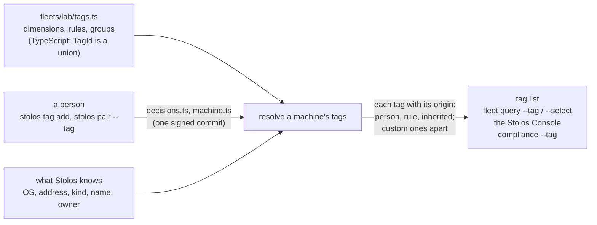

# 108: Tags: the labels a fleet gives its machines, and choosing machines by them

Issue intellectual-frontiers/stolos#40.

## Why

A fleet of a few machines is a list. A fleet of a few dozen needs to be asked in groups: which machines are production, which hold
regulated data, which are the NAS boxes, which belong to the office. Until now a machine had a name, a kind, an owner and a way of
joining, and nothing else to choose by: `fleet query` asked everyone, the machines table could only be searched for words, and the
compliance view was one number for the whole fleet.

The owner's decisions, final: machines can be **tagged** (managed servers and workstations, adopted machines, the controller PC);
tags are **predefined per fleet in TypeScript** (`fleets/<fleet>/tags.ts`), each with an id, a label, a colour and a description, in
a **dimension** that is one-of (a machine holds at most one value, an environment) or many-of (its roles); a tag the fleet does not
define is a **type error** at `stolos build`; a **starter kit** of dimensions comes with a new fleet; **free-form** tags are allowed
too but are always shown apart, as custom; tags are given at pairing, with `stolos tag`, by **rules** over what Stolos knows of a
machine, and by **inheritance** from a group; and they are used to choose machines for `fleet query` and the Ask page, to filter and
group the console, and to scope compliance evidence.

## Ontology

The terms this spec uses, defined in `ontology/stolos/` with this spec as their source: `stolos:Tag`, `stolos:TagDimension`,
`stolos:TagRule`, `stolos:TagGroup`, `stolos:TagSelection`, and the code lists `stolos:TagColour` (`stolos:colour-grey`,
`stolos:colour-red`, `stolos:colour-orange`, `stolos:colour-yellow`, `stolos:colour-green`, `stolos:colour-teal`, `stolos:colour-blue`,
`stolos:colour-violet`, `stolos:colour-pink`), `stolos:TagCardinality` (`stolos:cardinality-one-of`, `stolos:cardinality-many-of`)
and `stolos:TagOrigin` (`stolos:origin-person`, `stolos:origin-rule`, `stolos:origin-inherited`); and, from earlier specs,
`stolos:AdoptedMachine`, `stolos:Controller`, `stolos:MachineKind`, `stolos:WayOfJoining`, `stolos:PairingCode`.
`bun run gen` writes the code lists as `TagColour`, `TagCardinality` and `TagOrigin` (and their arrays) in
`src/archon/ontology.auto.ts`; the code imports the unions.

## Requirements

Requirement words follow RFC 2119 as RFC 8174 clarifies it: they are requirements only where written in capitals.

**Standards considered.** RFC 2119 and RFC 8174 (requirement words); NIST SP 800-53 Rev 5 CM-8 (system component inventory, and CM-8(4)
accountability information) and RA-2 (security categorization); NIST SP 800-128 (security-focused configuration management: baselines
are chosen by what a component is); NIST SP 800-60 Vol. 1 Rev 1 and FIPS 199 (information types and the low, moderate and high impact
levels, which the `criticality` and `data` dimensions follow); ISO/IEC 27001:2022 Annex A 5.9 (inventory of information and other
associated assets), 5.12 (classification of information) and 5.13 (labelling of information); CIS Critical Security Controls v8
control 1 (inventory and control of enterprise assets); and the SCF asset-management controls AST-04 (Asset Inventories), AST-05.1
(criticality ratings), AST-07.1 (ownership assignment), AST-15 (Asset Categorization) and DCH-04 (Data & Asset Classification), whose
ids and names `tests/tags108.test.ts` checks against the pinned SCF workbook.

### Definitions

- **FR-001** A fleet MUST define its tags in `fleets/<fleet>/tags.ts`, as `export const tags = defineTags({...})`. Each **dimension**
  has an id, a label, a description and a cardinality (`stolos:TagCardinality`: `one-of` or `many-of`), and holds one or more tags;
  each tag has a value (its id is `<dimension>:<value>`, for example `env:prod`), a label, a colour that is one of the ontology's
  `stolos:TagColour` names (never a raw colour) and a description. `defineTags` MUST refuse a definition that is malformed (an id that
  is not lowercase letters, digits and `-`, a missing label or description, a colour or cardinality not in the ontology, a dimension
  with no tag, a rule or group that gives a tag that is not defined) and MUST say each problem with its fix.
- **FR-002** The ids of the tags a fleet defines MUST be a TypeScript union inferred from its own `tags.ts` (`TagIdOf`, exported by the
  fleet as `TagId`), so that a tag written in a typed file (`decisions.ts`, `machine.ts`) or in a rule or a group and not defined there
  is a type error. `stolos build` and `stolos validate` MUST also report it, with where it is and its fix, for a file that is not type
  checked, and MUST report a `tags.ts` that does not load, and tags held by a machine in a fleet that has no `tags.ts`.
- **FR-003** A new fleet (`stolos fleet init`) MUST come with a `tags.ts` holding the **starter kit** (`STARTER_DIMENSIONS`): the
  dimensions `env` (one-of: `prod`, `staging`, `lab`), `role` (many-of), `site` (one-of), `owner` (one-of), `criticality` (one-of:
  `low`, `moderate`, `high`, FIPS 199's impact levels) and `data` (one-of: `public`, `internal`, `confidential`, `regulated`, the most
  sensitive class of data the machine holds). The file MUST be ordinary TypeScript the owner edits freely. The example lab fleet
  (`examples/fleets/lab/`) MUST use the starter kit, with its dimensions unchanged.

### Giving tags

- **FR-004** A managed server or workstation, an adopted machine and the controller PC MAY hold tags. A person's **defined** tags are
  written in the machine's own file in the fleet repository: `tags` in `decisions.ts` of a managed host (read by `loadHosts` into
  `HostDef.tags`), `tags` in `machine.ts` of an adopted machine. A one-of dimension MUST hold at most one value of a machine, a
  many-of dimension MAY hold any number. These files MUST keep the form the engine writes (`stolos build` reports a file that is
  not), and a tag a person gave MUST survive a re-adoption.
- **FR-005** A **free-form** tag is a lowercase word (`pilot`: letters, digits, `.`, `_`, `-`, at most 39 characters, no colon, and not
  `and`, `or` or `not`). It MUST be written apart from the defined ones (`customTags`), MUST NOT be defined anywhere, and MUST NOT be
  taken for a defined tag: a tag with a colon MUST be defined, and a word that is also a dimension's or a tag's own name (`prod`) MUST
  be refused as a forgotten dimension, with the fix, unless the person says `--custom`.
- **FR-006** `stolos tag add <machine> <tag...>` and `stolos tag remove <machine> <tag...>` MUST change the machine's own file and send
  the change through `stolos apply` (one signed commit, subject `108-tags: ...`); they MUST NOT write the fleet repository any other
  way. They MUST refuse a machine that is not in the fleet, a tag that is not defined (with what is near it), and, when sending,
  uncommitted changes of other files (a tag commit holds the tag change only). `--no-apply` MUST write the change and leave the sending
  to `stolos apply`. A new value of a one-of dimension MUST replace the old one and say so. `tag remove` MUST remove only a tag a person
  gave, and say where any other came from (a rule or a group). The last positional argument of a registry command MAY repeat.
- **FR-007** `stolos tag list` MUST list the tags the fleet defines (each dimension, each tag with its colour and how many machines
  hold it) and say where they are defined (`fleets/<fleet>/tags.ts`, edited in the spec loop: no command defines a tag), then every
  machine with its tags; `stolos tag list <machine>` MUST show each tag with its label, its description and its origin, and what a
  stronger origin overrode; `--tag`, `--any-tag` and `--select` MUST list only the machines they choose; `--json` MUST give the same as
  data. It MUST work in a fleet that has no `tags.ts` (free-form tags only), and it is a read-tier command.
- **FR-008** `stolos pair --tag <tag>` (repeatable) MUST give every machine paired in the session those tags, MUST refuse a tag that is
  not defined, or two values of a one-of dimension, before the session opens, and MUST, at each machine's approval prompt, show the
  session's tags and let the person keep them (Enter), replace them (a list) or clear them (`-`). With no terminal the session's tags
  stand. The tags MUST be written into the machine's `machine.ts` with the adoption.

### Rules, groups and precedence

- **FR-009** A **rule** in `tags.ts` (`rules: [{ id, when, tag }]`) MUST give its defined tag to every machine for which `when(facts)`
  holds, wherever tags are resolved (build, observe, list, query, the consoles, compliance), and the tag MUST show the rule as its
  origin (`stolos:origin-rule`). `facts` are what Stolos knows of the machine: its kind, name, operating system family and name,
  address, site network, owner and way of joining. A rule that throws MUST be reported as a problem and MUST NOT stop the others.
  Helpers (`osIs`, `addressIn`, `nameMatches`, `kindIs`, `ownerIs`, `allOf`, `anyOf`) MAY be used to write them.
- **FR-010** A **group** in `tags.ts` (`groups: [{ id, network | cidr | names, tags }]`) MUST give its tags to its members, by a site
  network of the fleet's site model (a managed host on it, or a machine whose address is in its prefix), an IPv4 prefix, or machine
  names; the tag MUST show the group as its origin (`stolos:origin-inherited`). The site model does not carry tags itself: groups are
  defined in `tags.ts`, where their tags are typed.
- **FR-011** A tag a person gave MUST win over a rule's, and a rule's over a group's. In a one-of dimension the strongest origin's
  value MUST be kept and the other MUST be listed as overridden; two values of the same strength MUST be a problem of the build, and
  the first MUST stay. A tag from two origins MUST be shown once, with the strongest.

### Choosing machines

- **FR-012** A **selection** MUST be readable from a small expression: tags, `dimension:*` (any value of a dimension), `and`, `or`,
  `not` and parentheses, `not` binding tighter than `and` and `and` tighter than `or`. It MUST be read by a typed parser and MUST NOT
  be evaluated as code. The parser MUST refuse a syntax error naming where it is, an expression longer than 500 characters or nested
  deeper than 16, a tag with a colon that is not defined and a dimension that does not exist, each with the fix.
- **FR-013** `fleet query` MUST ask only the machines chosen by `--tag <tag>` (repeatable: all of them), `--any-tag <tag>` (repeatable:
  one of them) and `--select '<expression>'`, which MUST all hold; with none of them it asks every machine. A choice that matches no
  machine MUST ask nothing and say so. Each answer MUST carry its machine's tags (`--json` too). The console's "Ask every machine" page
  MUST offer the same choice (a field for the expression and the fleet's tags to add to it), read by the same parser.

### The Stolos Console and every report

- **FR-014** The Stolos Console MUST show a chip for every tag a machine holds on the machines table and on its page, in the tag's
  colour (light and dark); MUST offer the fleet's tags with how many machines hold each as a filter of the table; MUST group the table by
  any dimension (`/machines?group=<dimension>`); MUST show on a machine's page each tag with its origin and how to change it; and the
  machines CSV and the evidence JSON MUST carry the tags and where each came from.
- **FR-015** A free-form tag MUST be shown apart from the defined ones in every place tags are shown: in the console a chip of its own
  style (dashed outline, italics) with the word "custom"; in the command line `<tag> (custom)` or a `custom:` list after the defined
  tags; in JSON a `custom: true` field; in the CSV a column of its own. A tag that is written but not defined MUST be shown as such, never as
  custom and never as defined.
- **FR-016** `stolos compliance` MUST accept `--tag`, `--any-tag` and `--select` and then count only the evidence of the machines they
  choose (managed machines, adopted machines and devices), and MUST say that a cloud account's and the estate's evidence is not
  about one machine and stays.

### Everywhere

- **FR-017** Windows and macOS MUST NOT be diminished: tag files are written with `path.join`, nothing here starts a process or probes
  the system, and the tests MUST pass on Bun and on Node, as a user who is not root, and without depending on being alone on the
  machine.
- **FR-018** The guides (`src/archon/fleet/mod.ts`), the command help and the module documentation MUST say what is true now, and
  `bun run check:trace`, `check:layers` and `check:ontology` MUST pass with baselines no larger than before.

## Success criteria

- **SC-001** `tests/tags108.test.ts`: the definitions and their problems, the typed ids (a tag that is not defined does not compile),
  the starter kit and the lab, resolution (origins, precedence, one-of), the expression parser and its limits, `tag add`/`remove`/`list`
  through a real signed `stolos apply` of a copy of the lab fleet, `fleet query` and `compliance` by tag, pairing's tags, the console's
  chips, filter, facets, group-by, Ask picker, CSV and evidence, and the SCF ids named above.
- **SC-002** `bun run check:ontology`, `check:trace` and `check:layers` pass with baselines no larger than before.

## Decisions

- **A tag is `<dimension>:<value>`; a free-form tag has no colon.** One rule tells the two apart everywhere (the parser, the files,
  the console): a colon means "defined", and a defined tag that is not defined is an error, never quietly custom. A free-form word that
  is a dimension's or a tag's own name is refused (a forgotten `env:` is the likeliest slip) unless `--custom` says it is meant.
- **Colours are names of a palette, not raw colours.** The ontology's `stolos:TagColour` names nine; the console draws each in a light
  and a dark value that keeps the text readable. A fleet cannot inject a style, and a colour is a word the code branches on.
- **A person's tags live with the machine, not in `tags.ts`.** `decisions.ts` and `machine.ts` already are the machine's own files,
  already in the fixed form the engine writes and already approved by a signed commit; a tag is a decision. `tags.ts` holds only what
  is the fleet's (definitions, rules, groups).
- **Typed ids by inference, not by generation.** `defineTags` infers the union from the object itself (a `const` type parameter), so
  there is no generated file to go stale; rules and groups are the second argument, typed against the first.
- **Precedence: person, then rule, then group.** What a person said on purpose wins; a rule is more specific than a group.
- **A new value of a one-of dimension replaces the old one.** `tag add alpha env:prod` on a machine that is `env:lab` says so and
  replaces it, because refusing would only make the person run `tag remove` first. Two values in one `--tag` list are refused.
- **Groups are in `tags.ts`, and may name a network of the site.** The site model (spec 028) is the router's description and is
  typed for it; carrying tag ids there would make the model depend on one fleet's tags. A group names the site network and the tags
  are typed in `tags.ts`.
- **Rules are TypeScript functions, never data to evaluate.** They run in this process over plain facts (code over config, Article 4);
  a rule that throws is a problem, not a crash. The expression language of FR-012 is for people at a command line and in a form, and
  is parsed, never run.
- **The machines table keeps its HTML table.** Filtering and grouping are a signal and links (as the "how it joined" filter already
  is); moving that table to AG Grid (spec 107) is a later item, with its sorting and paging (`tasks.md`, L003).
- **Cloud accounts' machines and SNMP devices are not tagged yet** (`tasks.md`, L001): their records are written by observation, not
  by a person, so their tags need a file of their own.
