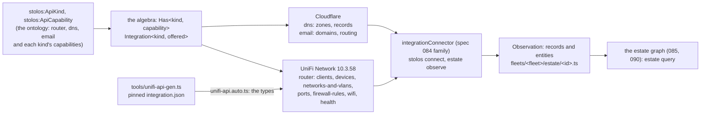

# 109: Integrations: one typed layer over routers, DNS and email, and UniFi as the first router

Issue intellectual-frontiers/stolos#41 (specs 109, 110 and 111 live under it; this is 109, the layer and its first implementations: the
network page is 110 and is not built here).

## Why

Spec 084 made every outside account a connector: a read-only credential, observations in Git, posture policies. A router, a DNS
provider and an email provider are accounts too, but they have something the clouds and the SaaS do not: **a kind**. Every router has
clients, devices, networks, ports and firewall rules; every DNS provider has zones and records; every email provider has domains,
routing and sending. People want to ask a question of "the router" or "the DNS" and not of one product, and the next product (another
router, another DNS host) must not mean new code everywhere a router is asked.

The owner's decisions, final: **one algebraic, type-safe integration layer with many implementations**. Each integration declares its
**kind** and its **capabilities** as types; a function that needs a capability accepts only an integration whose declared
capabilities include it, so asking for what an integration does not offer is a compile error. Results are typed entities that join the
estate graph (spec 085). It is read-only, with a read-only credential in the vault exactly as connectors have it. Cloudflare is
generalized to the DNS and email kinds, and **UniFi Network** is the first router, over the newest documented API Ubiquiti publishes
on its official CDN (v10.3.58), with its TypeScript types generated from that pinned OpenAPI document.

## Ontology

The terms this spec uses, defined in `ontology/stolos/` with this spec as their source: the classes `stolos:ApiIntegration`,
`stolos:NetworkClient`, `stolos:NetworkDevice`, `stolos:Vlan`, `stolos:SwitchPort`, `stolos:Lease`, `stolos:PortForward`,
`stolos:FirewallRule`, `stolos:WifiNetwork`, `stolos:Route`, `stolos:RouterHealth`, `stolos:DnsZone`, `stolos:DnsRecord`,
`stolos:EmailDomain`, `stolos:EmailRoute` and `stolos:EmailSender`, and the code lists `stolos:ApiKind` (`stolos:api-kind-router`,
`stolos:api-kind-dns`, `stolos:api-kind-email`) and `stolos:ApiCapability` (one code for each capability of each kind, written
`<kind>-<capability>`: `stolos:api-capability-router-clients`, `stolos:api-capability-dns-zones`, and so on). `bun run gen` writes the
code lists as `ApiKind` and `ApiCapability` (and their arrays `API_KINDS` and `API_CAPABILITIES`) in `src/archon/ontology.auto.ts`;
the code derives the capability set of each kind from that union, so the kinds and capabilities are written once. `stolos:IntegrationKind` is spec 069's (how a machine is joined to the fleet) and is a different thing from `stolos:ApiKind`
(what an account's API is a kind of).

## Requirements

Requirement words follow RFC 2119 as RFC 8174 clarifies it: they are requirements only where written in capitals.

**Standards considered.** RFC 2119 and RFC 8174 (requirement words); the OpenAPI Specification 3.1.0 (the pinned UniFi document is an
OpenAPI 3.1.0 description, the generator reads it as such); RFC 9110 (HTTP semantics: safe methods, `X-API-KEY` as an application
header); RFC 8259 (JSON); RFC 5280 and RFC 6125 (X.509 certificates and server identity, for the pinned fingerprint and the explicit
CA set) and RFC 8446 (TLS 1.3); RFC 1034 and RFC 1035 (DNS zones and records); RFC 7208 (SPF), RFC 6376 (DKIM) and RFC 7489 (DMARC);
RFC 2131 and RFC 8415 (DHCP leases); IEEE 802.1Q (VLANs); OCSF 1.9.0 and MITRE D3FEND (the labels and their terms, as the connectors' labels use them); NIST SP 800-53 Rev 5 CM-8 (component inventory), SC-7 (boundary protection), SC-8 (transmission confidentiality and integrity)
and SC-20 (secure name resolution), NIST SP 800-41 Rev 1 (firewalls), NIST SP 800-153 (wireless local area networks) and NIST
SP 800-177 Rev 1 (trustworthy email); the SCF controls named in FR-016 and FR-008, whose ids and names `tests/integrations109.test.ts`
checks against the pinned SCF workbook; W3C SKOS (the two code lists are concept schemes) and schema.org `WebAPI` (an integration is a
web API an account offers). `ontology/stolos/audit.ts` records the basis of each term; the six terms no standard names
(`stolos:Lease`, `stolos:PortForward`, `stolos:Route`, `stolos:WifiNetwork`, `stolos:RouterHealth`, `stolos:EmailSender`) are listed
there with the candidates examined.

### The layer

- **FR-001** An integration MUST declare its **kind** (`stolos:ApiKind`: `router`, `dns` or `email`) and the **capabilities** it
  offers as TypeScript types, and each kind MUST have a typed capability set derived from `stolos:ApiCapability`: for `router`
  `dhcp-leases`, `clients`, `devices`, `networks-and-vlans`, `ports`, `port-forwards`, `firewall-rules`, `wifi`, `routes` and
  `health`; for `dns` `zones` and `records`; for `email` `domains`, `sending` and `routing`. Each capability MUST have a typed result
  (`Lease`, `Client`, `NetworkDevice`, `Vlan`, `SwitchPort`, `PortForward`, `FirewallRule`, `WifiNetwork`, `Route`, `RouterHealth`,
  `DnsZone`, `DnsRecord`, `EmailDomain`, `EmailSender`, `EmailRoute`), and the code MUST fail to compile where a kind's capability has
  no result type or a result type has no capability.
- **FR-002** A function that needs a capability MUST accept only an integration whose declared capabilities include it
  (`Has<kind, capability>`), so that asking an integration for a capability it does not offer, and asking an integration of another
  kind, MUST be a compile error. `defineIntegration` MUST require, for every capability of its kind that it does not offer, the
  reason (`notOffered`), so that a capability is either read or explained, never forgotten, at compile time.
- **FR-003** What an integration reads MUST be typed entities, and MUST join the estate graph (spec 085, 090) through the observation
  a connector writes: as records, each with a label named from OCSF or D3FEND and its OCSF class (spec 089), and a network device as a
  device entity, so that it is a fixed asset beside the machines of the fleet. There MUST NOT be a second graph.
- **FR-004** An integration MUST only read: its requests MUST be safe methods (GET), enforced by the read-only guard of the
  transport, and its credential MUST be kept only in the vault (`connectors/<id>/credential.json`), never in the model, a spec, a
  commit, a log, an observation or a report. An entity MUST keep only what a control needs: no mail destination addresses, no pay or
  personal fields.
- **FR-005** A capability that cannot be read (a denied call, an endpoint this version of the product does not have, a capability the
  integration does not offer) MUST be reported as a gap with its reason in the observation and MUST NOT fail it; only a failure to
  reach the account, to authenticate or to trust its certificate MUST fail it, saying why.
- **FR-006** The layer MUST be a family of spec 084's connectors, built on it: `integrationConnector` MUST make a `Connector` of an
  integration (the same observation, policies, vault credential, `stolos connect <id>`, `stolos disconnect <id>`, `stolos estate
observe | check | assets` and the Connected accounts page), and the connectors of specs 084 to 091 MUST work unchanged.

### Cloudflare, generalized

- **FR-007** Cloudflare MUST be an implementation of the `dns` kind (`zones`, `records`) behind the layer, reading the same API with the
  same credential, and its connector MUST keep its behaviour: its observation, its assets, its records and its policies for an
  existing account MUST NOT change, and the layer MUST NOT send a request the connector sent already (the reads are shared). The code
  of the web front door (spec 032), which uses Cloudflare for the server's own certificates and records, MUST NOT change.
- **FR-008** Cloudflare MUST be an implementation of the `email` kind: `domains` (the domains' email DNS records it manages: MX, SPF,
  DKIM, DMARC, and whether Email Routing is on) and `routing` (the Email Routing rules, without their destination addresses). It MUST
  say `sending` is not offered, with the reason. The observation MUST add the posture facts for these and, only when they were read,
  the policies `cf-email-spf`, `cf-email-dmarc` and `cf-email-dkim`, each with its fix and SCF control NET-39.

### UniFi Network, the first router

- **FR-009** UniFi Network MUST be an implementation of the `router` kind over the most recent stable documented API of the UniFi
  Network application: the official OpenAPI 3.1 description Ubiquiti publishes at
  `https://apidoc-cdn.ui.com/network/<version>/integration.json`, version 10.3.58, kept in the repository
  (`vendor/unifi-network/10.3.58/`) with its source URL and SHA-256 and a note of its origin, and MUST NOT read an unofficial
  endpoint, the community mirror, or a path the document does not offer.
- **FR-010** The types of the document's schemas and of its GET operations MUST be generated by `tools/unifi-api-gen.ts` into
  `src/archon/connect/unifi-api.auto.ts` (a `.auto.` file with its header, Article 26), the tool MUST check the document's SHA-256
  before it reads it and MUST offer `--check`, and the client MUST be written in TypeScript on the runtime's `http`: no
  client library MAY be added without the owner's approval, and nothing is built from source.
- **FR-011** The local API MUST be read from `https://<controller>` and a **base path** that is a setting of the connector (default
  `/proxy/network/integration`, as a controller running the Network application on UniFi OS serves it; `/integration` for a
  standalone Network application), with the header `X-API-KEY` and the key the owner creates in the Network application
  (Settings, Control Plane, Integrations). The connect steps MUST say that UniFi does not scope that key and that Stolos sends GET
  only.
- **FR-012** The controller's certificate MUST be verified by a **pinned SHA-256 fingerprint** or by an **explicit CA set** given in the
  connector's settings, or, where neither is given, by the system's roots; TLS verification MUST NOT be disabled for the process or
  for any host without one of these. `stolos connect unifi` MUST, where the controller's certificate is not trusted by the system's
  roots and no CA is given, show the person the certificate's fingerprint, subject and expiry, and pin it only when the person says
  yes (trust on first use, as SSH host keys); the pinned fingerprint MUST be written to the fleet record (the observation, in Git), and
  a certificate that later differs MUST fail the observation, saying the expected and the actual fingerprint and that `stolos connect
unifi` pins the new one.
- **FR-013** UniFi MUST implement the capabilities its document offers: `devices` (adopted devices: id, name, model, MAC, IP, state,
  firmware and whether it can be updated), `clients` (connected clients: id, name, type, MAC, IP, uplink device, guest or not),
  `networks-and-vlans` (networks with their VLAN ids), `ports` (the switch ports of each device that has ports: state, speed, PoE),
  `firewall-rules` (firewall policies with their zones' names), `wifi` (Wi-Fi broadcasts and their security) and `health` (the
  application's version and the devices' states), each for every site, paged with `offset` and `limit`.
- **FR-014** What the document does not offer MUST be a reported gap: `dhcp-leases` (the document describes the DHCP server settings of
  a network, never its leases), `port-forwards` and `routes` (the document has no operation for them). Each MUST be in
  `notOffered` with its reason, MUST be listed in the observation's gaps, and MUST never be guessed or read from another endpoint; a
  test MUST check against the pinned document that it has no such operation.
- **FR-015** The entities of UniFi MUST be written as records with the labels of FR-003 (`network_endpoint`, `local_area_network`,
  `computer_network_node`, `network_interface`, `firewall_rule` and `network`), and the adopted devices as device entities with the
  source `unifi`, which the estate graph keeps as network devices.
- **FR-016** UniFi MUST have posture policies, each with a fix and SCF controls: `unifi-devices-online` (every adopted device is
  online: AST-04, MON-02), `unifi-firmware-current` (no adopted device has a firmware update waiting: VPM-08), `unifi-wifi-no-open`
  (no enabled Wi-Fi network is open: NET-24), `unifi-vlan-segmentation` (the network has more than the default network: NET-10),
  `unifi-tls-verified` (the controller's certificate was verified, pinned or by a CA: CRY-05, CRY-09), and the freshness policy every
  connector has.
- **FR-017** The tests of UniFi MUST run the connector against **recorded responses** served by a real local HTTPS server in the test,
  shaped by the pinned document (the fixtures are built from the document's schemas and examples), including the pinned
  fingerprint accepted, a different certificate refused, a denied call as a gap, and only GET requests sent.

### The commands, the console, the guide

- **FR-018** `stolos connect unifi` MUST ask for the controller's address, the key (without echo), and, optionally, the base path, a CA file
  and a fingerprint; `stolos estate observe unifi` and the Connected accounts page MUST show the account as they show any connector's;
  no new page is built here (the Network page is spec 110). A tag rule over network facts is a hook left in `tasks.md` (specs 108, 113).
- **FR-019** The guide in `src/archon/connect/mod.ts` MUST say what is true now (the layer, the kinds and capabilities, how to write an
  integration, how UniFi is trusted, the gaps) with a Mermaid diagram, and the guides' list (`stolos docs integrations`) MUST include it.

### Everywhere

- **FR-020** Windows and macOS MUST NOT be diminished: paths are built with `path.join`, the TLS code uses `node:tls` (which Bun and Node
  share), every network call and probe has a time limit, and the tests MUST pass on Bun and on Node, as a user who is not root, and
  without depending on being alone on the machine (a server on an ephemeral port, a temporary folder); every test that starts a
  process or takes a long time on Windows MUST carry an explicit `{ timeout: 180_000 }`.
- **FR-021** `bun run check:ontology`, `check:trace`, `check:layers` and `check:mizan` MUST pass with baselines that grow only by
  the pending decisions of the terms no standard names (FR-001's six), recorded in `ontology/stolos/audit.ts` with their candidates.

## Success criteria

- **SC-001** `tests/integrations109.test.ts`: the capability sets of each kind and their results are the ontology's (and a missing
  or extra one does not compile), the algebra's compile-time checks (a capability an integration does not offer, a wrong kind, a
  missing reason: `@ts-expect-error`), entities as records and device entities, Cloudflare's DNS and email integrations with no
  request beyond the connector's, the email policies, and the SCF ids named in this spec.
- **SC-002** `tests/unifi109.test.ts`: the pinned document's SHA-256 and the generated file's freshness, the endpoints the document
  does and does not offer, the connector against a real local HTTPS server with recorded responses shaped by the document
  (every offered capability, paging, a denied call, the gaps, GET only, the policies), and the TLS trust (a pinned fingerprint, a
  wrong one, an explicit CA, no way to trust a self-signed certificate by default, trust on first use at `stolos connect`).
- **SC-003** `bun run check:ontology`, `check:trace`, `check:layers` and `check:mizan` pass (FR-021).

## Decisions

- **Newest stable documented version: 10.3.58.** The community mirror (`opastorello.github.io/unifi-api-docs`) lists 10.0.162, 10.1.84
  and 10.3.58; the official CDN answers for 10.1.68, 10.1.84 and 10.3.58 and was refused for every other version tried (10.2.x,
  10.3.0 to 10.3.75 but 10.3.58, 10.4.x, 10.5.0, 11.0.0), so 10.3.58 is the newest on it that exists. The document's SHA-256 is
  `c6824fe526b0a0030153b52e117348ab651af3fc6540d8c9de73e4fab57ca0d7`. The version is a constant of the generator: a newer document is a
  new vendored folder, a regenerated file and a change of that constant, in the spec loop.
- **The capability algebra is structural.** `Has<K, C>` is `{ kind: K; read: { [N in C]: Reader<K, N> } }`: an integration that offers
  `clients` and `devices` is assignable to `Has<"router", "clients">` and not to `Has<"router", "ports">`, and a function over a
  capability never names an integration. The capability names are the ontology's union, so a new one is one code of a code list.
- **A reason for every capability not offered.** `defineIntegration` takes `notOffered` for exactly the capabilities of the kind that
  `read` lacks (a mapped type over `Exclude`), so the reports of gaps are not written by hand and cannot be forgotten.
- **Pinning by fingerprint on a verified socket.** The fingerprint is compared on the TLS socket before any byte of the request is
  written, so the key never reaches a server that is not the pinned one; the certificate chain is not checked in that mode (a
  self-signed controller has none), only the exact certificate; the explicit CA mode keeps Node's full verification, host name
  included. The request is written by the client itself over that socket (HTTP/1.1, `Connection: close`) because `fetch` takes no
  per-host certificate options on both runtimes.
- **The fleet record is the observation.** The pinned fingerprint is public: it is written into the observation's posture
  (`tlsFingerprint`, `tlsTrust`), which Git holds, so `git log -p` on `fleets/<fleet>/estate/unifi.ts` is the history of the
  certificates the person approved. The vault holds the key and the settings.
- **Cloudflare reads are shared, not repeated.** The integration and the connector read the same URLs; a one-observation memo of GETs
  (`memoGets`) answers the second from the first, so the connector's observation is the same and its request count is unchanged.
- **The key's rights are the owner's.** UniFi does not scope an integration key (the document defines no scopes), so the connect steps
  say so, and the guard, not the key, is what makes Stolos read-only.
