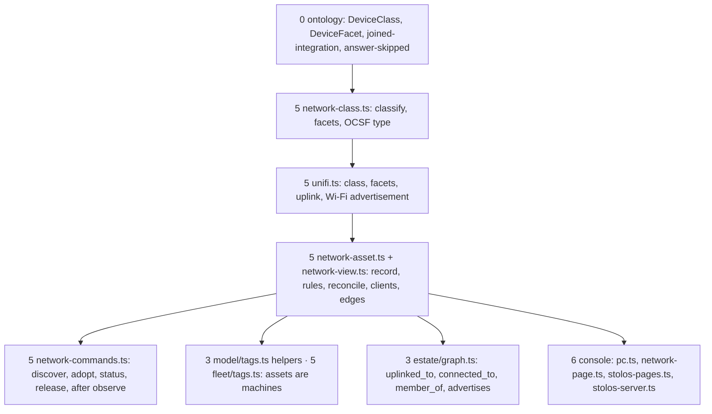

# Implementation Plan: Network assets: what a router's controller manages, adopted as machines of the fleet

**Branch**: `110-network-assets` (committed directly to main) | **Date**: 2026-11-18 | **Spec**: [spec.md](spec.md)

**Input**: Feature specification from `specs/110-network-assets/spec.md`

## Summary

Spec 109 reads UniFi Network read-only into an observation. This spec makes the devices in that observation **assets of the fleet**:
two ontology code lists say what a device is (`stolos:DeviceClass`, `stolos:DeviceFacet`), a new way of joining (`integration`) says how it
came in, a record beside the adopted machines (`adopted/<name>/network.ts`) says who it is, and everything else (firmware, address, state,
uplink) is read from the observation at every use. A pure view (`network-view.ts`) joins the observation, the records and the fleet's
machines (clients matched by MAC) and feeds the commands, the tags, the estate graph edges and the console's Network page.



## Technical Context

**Language/Version**: TypeScript 7, run by Bun, Node 26 as the backup (spec 096-bun-runtime). **Primary Dependencies**: none new (no graph
library: the topology is a typed layout function and server-side SVG; AG Grid is the console's vendored one). **Storage**: Git only
(`fleets/<fleet>/adopted/<name>/network.ts`, `network.ts`, `network-released.ts`, the observation); no secret is added. **Testing**:
`tests/network110.test.ts` (data), `tests/network110-unifi.test.ts` (the connector against a real local HTTPS server, and the commands in a
sandbox fleet with a signing key), `tests/network110-console.test.ts`, through `proves([...])`, on Bun and Node 26. **Project Type**:
command line first (headless), then the Stolos Console.

## Constitution Check

- Article 0 (the ladder): terms in `ontology/stolos/` (rung 0) before this spec names them; the specification (rung 1); `estate/` and
  `model/tags.ts` (rung 3: the edges, the helpers); `connect/`, `adopt/`, `fleet/`, `build.ts` (rung 5: classes, records, commands);
  `commands/`, `console/` (rung 6); tests and the guide (rung 7). The headless operation and its test came before the page.
- Article 4 (code over config): the rules are TypeScript (`defineNetwork`), the record is a typed literal; no JSON. Article 5: nothing
  built from source, no library. Article 13: no secret is read or written; the controller's address is in the observation already.
- Article 21 / spec 109 FR-004: the router is the authority and Stolos never changes it: every read is a GET, and release changes only the record.
- Article 26: no generated file is edited; `network-released.ts` says it is generated.
- The model seam of spec 115 is unchanged (`src/archon/model/types.ts` and `site.ts` are not touched): `bun run compat:digest --check` holds.

## Project Structure

```text
specs/110-network-assets/  spec.md, plan.md, tasks.md, reviewed.tsv
ontology/stolos/           DeviceClass, DeviceFacet (SKOS), joined-integration, answer-skipped
src/archon/connect/        network-class.ts, network-asset.ts, network-view.ts, network-topology.ts, network-commands.ts, unifi.ts
src/archon/adopt/          joining.ts, query.ts, commands.ts (release, macs, skipped rows)
src/archon/fleet/tags.ts   assets as machines; writing an asset's tags
src/archon/model/tags.ts   ofClass, withFacet, inVlan, onSsid, uplinkedTo
src/archon/estate/         the edge verbs and their edges
src/archon/console/        network-page.ts, pc.ts, stolos-pages.ts, stolos-server.ts, table.ts
tests/                     network110*.test.ts
```

## Standards considered

RFC 2119 and RFC 8174 (requirement words); NIST SP 800-53 Rev 5 CM-8 (component inventory) and CM-2; the OCSF 1.9.0 device object (the
class's `type_id`, `OCSF_DEVICE_TYPE`); IEEE 802.1AB (LLDP: the neighbour as a concept of the uplink edge); IEEE 802.1Q and 802.11; RFC 1034
and RFC 1035 (the machine name as a label); W3C SKOS (the two code lists, mapped in `audit.ts`); W3C Organization Ontology and schema.org
`Product` (a site, a device's identity) as the vocabulary the record's fields follow. No term is left unaligned.

## Decisions of the plan

- A record of its own, not a field of `AdoptedDef`: `loadAdopted` (SSH, host keys, probe) never meets it; the fleet model's seam is untouched.
- `kind: device` is the machine kind of an asset (SNMP devices share it); the badge, not the kind, tells them apart.
- The observation is the one source of facts; `reconcile` is pure and never says "gone" for a devices read that failed.
- The estate edges are made from record properties (`uplink`, `broadcast_by`, `network`), so any router integration that writes them gets the edges.
- `inVlan` follows the Wi-Fi networks a device broadcasts, because the document gives no VLAN to a client or a port.
