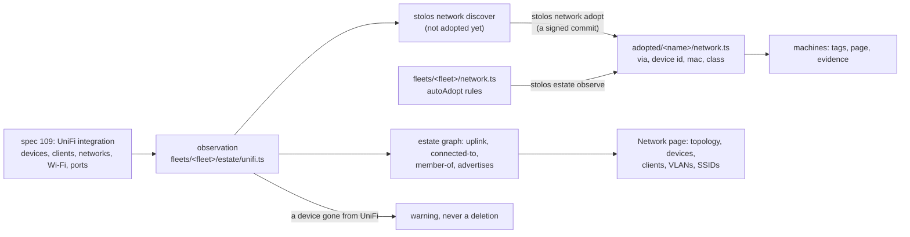

# 110: Network assets: what a router's controller manages, adopted as machines of the fleet

Issue intellectual-frontiers/stolos#41 (specs 109, 110 and 111 live under it; this is 110: the network equipment as assets and the Network page;
the layer under it is 109, and the network posture is 111, not built here).

## Why

Spec 109 reads a router's controller (UniFi Network) read-only and writes what it finds into the estate graph. The gateway, the switches and
the access points it manages are still only rows of an observation: they have no name in the fleet, no tags, no page, no place among the
machines, and nobody is told when one disappears. A fleet's network equipment is part of what an auditor asks about (NIST SP 800-53 Rev 5 CM-8,
system component inventory) and part of what a person asks about when something is wrong.

The owner's decisions, final: **network equipment that UniFi manages becomes an adopted asset (a machine) of the fleet, adopted through the
integration**, with the same behaviour as any machine: tags (specs 108 and 112), the machines list and page, evidence, the estate graph.
**Stolos never replaces the network management layer**: it reads, and it links out to the native console.

## Ontology

The terms this spec uses, defined in `ontology/stolos/` with this spec as their source: the classes `stolos:DeviceClass` and `stolos:DeviceFacet` and
their code lists (`stolos:device-class-gateway`, `stolos:device-class-switch`, `stolos:device-class-access-point`, `stolos:device-class-camera`,
`stolos:device-class-recorder`, `stolos:device-class-door-controller`, `stolos:device-class-phone`, `stolos:device-class-other`;
`stolos:device-facet-routing`, `stolos:device-facet-switching`, `stolos:device-facet-wireless`, `stolos:device-facet-surveillance`,
`stolos:device-facet-access-control`); the new code `stolos:joined-integration` of `stolos:WayOfJoining` (spec 107's); the new code
`stolos:answer-skipped` of `stolos:AnswerState` (spec 107's); and, from spec 109, `stolos:NetworkDevice`, `stolos:NetworkClient`, `stolos:Vlan`,
`stolos:SwitchPort`, `stolos:WifiNetwork`, `stolos:ApiKind` and `stolos:ApiCapability`; and, from earlier specs, `stolos:MachineKind`
(`stolos:kind-device`), `stolos:AdoptedMachine` and `stolos:TagRule`. `bun run gen` writes the code lists as `DeviceClass` and
`DeviceFacet` (and their arrays `DEVICE_CLASSES` and `DEVICE_FACETS`) in `src/archon/ontology.auto.ts`; the code imports the unions.
`ontology/stolos/audit.ts` maps both new classes to W3C SKOS (a code list is a concept scheme); no new unaligned term is added.

## Requirements

Requirement words follow RFC 2119 as RFC 8174 clarifies it: they are requirements only where written in capitals.

**Standards considered.** RFC 2119 and RFC 8174 (requirement words); NIST SP 800-53 Rev 5 CM-8 (system component inventory: the network
equipment is a component with an identity, a state and an owner) and CM-2 (baseline configuration, for the firmware fact); the OCSF 1.9.0
device object, whose `type_id` has Firewall, Switch, IOT and Other (the code's table `OCSF_DEVICE_TYPE` in `network-class.ts` says which class
reports as which type, Access Point having none and reporting as Other); IEEE 802.1AB (LLDP: the concept of a device's neighbours, which the
uplink edge states without reading LLDP itself); IEEE 802.1Q (VLANs and the switching facet); IEEE 802.11 (an SSID, and the wireless facet);
RFC 1034 and RFC 1035 (the label of a machine's name); IANA's registry of IEEE 802 MAC addresses is not read: a MAC is an identifier, kept as
the controller says it; W3C SKOS (the two new code lists are concept schemes); W3C Organization Ontology (`org:Site`: a controller's site is a
place the equipment belongs to, kept as a word); schema.org `Product` with `serialNumber` and `model` for the identity of a device. `ontology/stolos/audit.ts`
records the basis of each new term.

### Classes and facets

- **FR-001** A network device MUST have a **class** (`stolos:DeviceClass`: `gateway`, `switch`, `access-point`, `camera`, `recorder`,
  `door-controller`, `phone`, `other`) and **facets** (`stolos:DeviceFacet`: `routing`, `switching`, `wireless`, `surveillance`,
  `access-control`), typed from the ontology's code lists, so that a feature asks for a facet and gets the devices of any vendor that
  have it. UniFi's devices MUST be classified from what the official API gives: the document's `features` (`gateway`, `switching`,
  `accessPoint`) first, and, where it gives none, the model code against a typed table of model families (camera, recorder, door
  controller, phone); a model that matches nothing MUST be `other`, never guessed. The facets of a device are those of its class and those
  of its features (a gateway with switch ports has `routing` and `switching`). Each class MUST report as one OCSF device type in a typed table.

### How it joined

- **FR-002** `stolos:WayOfJoining` MUST have the code `integration`: a machine adopted through an integration. A network asset's record
  MUST say `joined: "integration"`, and MAY say `auto: true` where a fleet rule adopted it. The console MUST show the badge **Adopted via
  UniFi** (the connector's title, naming the connected account in its title text) or **Auto-adopted via UniFi**, in the machines table and on the
  machine's page; the "How it joined" column and filter MUST handle the code (the filter lists every way of joining), and the CSV and
  evidence carry it. **Release** of an integration-adopted asset MUST be allowed only as the release of a host is: it removes the
  asset's record from the model, it needs an explicit request, it MUST NOT change anything at the controller, and the destructive marker
  rules of the governing spec are unchanged.

### Adoption from the integration

- **FR-003** `stolos network discover` MUST list what the connected UniFi account manages that is not adopted yet ("discovered via UniFi"), each
  with its class, model, firmware, address and state, from the last observation (`stolos estate observe unifi`), and MUST need no SSH and
  no probe. `stolos network adopt <device...>` and `stolos network adopt --all [--class <class>]` MUST each record the devices as one signed
  commit through the same path as `stolos tag add` (`stolos apply`; `--no-apply` leaves it written). A device is named by its name, its MAC
  or its id at the controller. The record, `fleets/<fleet>/adopted/<name>/network.ts`, MUST carry `via` (the connector's id), `account` (what
  the connector calls the account), the device's `id`, its `mac`, its `serial` where the API gives one, its `class`, its `model`, and when it was
  adopted. The name MUST come from the device's name made into a DNS label (RFC 1034, the rule of machine names); a name already taken by a
  machine, a host or another asset MUST be refused with a plain message that says what to do, and nothing MUST be written for it. A device
  that is not in the last observation, or is already adopted, MUST be refused with its reason.
- **FR-004** A fleet MAY declare **auto-adopt rules** in `fleets/<fleet>/network.ts` (`autoAdopt: [{ class: "switch" }, { class:
"access-point" }]`, each optionally with `via` and `model`), typed (a class that is not one of the ontology's is a type error) and
  validated at build (`stolos build`). `stolos estate observe` MUST apply the rules to the devices it has just read: it writes the records
  of the devices the rules choose that are not adopted yet, each with `auto: true`, and says which, and the change is sent as every change
  is, by a signed commit through `stolos apply`; it MUST NOT write silently (the phase says what it adopted and how to send it) and MUST NOT
  adopt a device twice or a device a person released with the rule's help (a released asset is remembered in the generated
  `fleets/<fleet>/network-released.ts`, so that the rule does not take it again).

### Refresh and departure

- **FR-005** Each `stolos estate observe` MUST re-read the devices: the facts (firmware, address, state, model) are the observation, a
  generated file as every connector's, and the asset shows the latest. A device that is adopted and no longer in what the controller
  reports is **gone from the integration**: a WARNING with its fix (the device was removed at the controller, or the controller is
  unreachable: observe again, or release the asset), shown wherever the asset is shown. It MUST NEVER be deleted automatically, and a
  device the controller could not be asked about (its `devices` read is a gap) MUST be unread, not gone.

### Clients, observed and not adopted

- **FR-006** Clients MUST be observed, never adopted. A client MUST be matched to an adopted machine by MAC address (a machine records
  the MACs it checked in with; an address match is the fallback and is said so), and the machine's page and `stolos fleet status` MUST
  show what the official API gives for it: its address, the device it is connected through, whether it is a guest, and when it
  connected. The clients no machine matches MUST be listed as **unmanaged devices on the network** with a hint that reuses the guidance
  of `stolos pair`; there MUST NOT be a way to adopt a client.

### Topology and the estate graph

- **FR-007** The estate graph MUST gain edges from what the official API gives and only that: **uplink** (`uplinked_to`: a device to
  the device it connects through, from the device's details), **connected-to** (`connected_to`: a client to the device it is connected
  through), **member-of** (`member_of`: a Wi-Fi network to the network it carries, where the document names one) and **advertises**
  (`advertises`: an access point to each Wi-Fi network it broadcasts, from the broadcast's device filter, and every access point where the
  broadcast has no filter). Where the API gives no uplink for a device that is not a gateway, there MUST be no edge and a reported gap;
  there MUST be no edge from a client to a port, a client to a network or a client to a Wi-Fi network (the document gives none).

### The Network page

- **FR-008** The Stolos Console MUST have a **Network** page, in the menu and routed only when a router-kind integration is connected, with:
  (a) a **topology** drawn from the uplink edges, laid out by a typed function (the gateway at the top, then switches and access points, clients
  grouped under their device), as SVG generated by the server, with no graph library; (b) **tables** (the console's one table, AG Grid
  through `table.ts`) of devices, clients, VLANs and SSIDs; (c) a **device page** with its facts and an **Open in UniFi** link built from
  the connector's base URL; (d) tag chips. The page MUST say what the API did not give.
- **FR-009** The machines table MUST show a network asset with its class (icon and label) and the way-of-joining badge. The Overview and
  `stolos fleet status` MUST show a **Network** group: the assets by class, the devices discovered and not adopted, and the
  gone-from-integration warnings.

### Tags over network facts

- **FR-010** A fleet's tag rules (spec 108) MUST have helpers over network facts, typed: `ofClass(...classes)`, `withFacet(facet)`,
  `inVlan(name | id)`, `onSsid(name)` and `uplinkedTo(deviceName)`, usable in `tags.ts` over network assets and over the machines the
  clients match. `inVlan` is true for a device that broadcasts a Wi-Fi network of that VLAN (the document gives no VLAN for a client or a
  port), and says so in its documentation.

### Ask every machine

- **FR-011** `Ask every machine` and `stolos fleet query` MUST NOT fail on a network asset and MUST NOT send it anything: its row has the
  answer state `skipped` and the reason "no osquery on this device", it is not counted as unanswered, and the exit code ignores it.

### Gaps and the rest

- **FR-012** The official API (10.3.58) offers no DHCP leases, port forwards or routes; they MUST NOT be invented, and every observation
  MUST keep the gaps it reports (spec 109 FR-014), and add one for a device with no uplink. The client's own port, VLAN and Wi-Fi network are not given
  either; the Network page lists these as what the API does not give.
- **FR-013** Windows and macOS MUST NOT be diminished: paths are built with `path.join`, every network call and probe has a time limit, no
  command starts a process of its own, and the tests MUST pass on Bun and on Node, as a user who is not root, and without depending on
  being alone on the machine (a server on an ephemeral port, a temporary folder); every test that signs commits or starts a doctor MUST
  carry an explicit `{ timeout: 180_000 }`.
- **FR-014** `bun run check:ontology`, `check:trace`, `check:layers` and `check:mizan` MUST pass with baselines that do not grow; the two
  new classes are mapped to W3C SKOS in `ontology/stolos/audit.ts`. The model's seam (spec 115) MUST NOT change: network assets are a record of
  their own (`network.ts`), not a field of the fleet model's types.

## Success criteria

- **SC-001** `tests/network110.test.ts`: the classes and facets (classification from features and from model families, `other` for the
  unknown, the OCSF table), the record and its source, names and refusals, the rules and their build validation, the reconcile of an
  observation (present, gone, unread), client matching, the topology layout and its SVG, and the tag helpers.
- **SC-002** `tests/network110-unifi.test.ts`: the connector against the real local HTTPS server with recorded fixtures: devices with
  classes and uplinks, the Wi-Fi advertisement, the gaps (a device without an uplink, a denied read), GET only; `stolos network discover`
  and `adopt` in a sandbox fleet with a real Git repository and signing key, and `estate observe` with an auto-adopt rule.
- **SC-003** `tests/network110-console.test.ts`: the machines table, the machine page, the Network page and its tables, the Overview and
  the evidence, with the page absent when no router is connected; and the query's skipped row.
- **SC-004** `bun run check:ontology`, `check:trace`, `check:layers`, `check:mizan` and `compat:digest --check` pass (FR-014).

## Decisions

- **A network asset is a device, not an adopted machine.** It has `kind: device` (the machine kind of spec 107, with SNMP devices), way of
  joining `integration`, and a record of its own beside the adopted machines: `adopted/<name>/network.ts`, which `loadAdopted` (which
  needs `machine.ts`, an SSH address and host keys) does not read, so no probe, observation, release script or query touches it. The model
  seam of spec 115 is not changed (the record is not part of the fleet model's types).
- **The record is a declaration; the facts are the observation.** `network.ts` keeps who it is (via, id, MAC, class, name, tags); firmware,
  address and state are read from the connector's observation at every use, so they are never stale in two places.
- **Classes from the document, not from marketing.** The Network API lists only the devices of the Network application, whose `features`
  say gateway, switching or access point. Cameras, recorders, door controllers and phones belong to other UniFi applications that this
  API does not list; the model table exists so that an integration (or a UniFi version) that lists them classifies them, and a model that
  matches nothing is `other`.
- **No serial number from this API.** The document's device schemas have no serial number: `serial` is optional in the record and empty
  for UniFi; the MAC is the identity.
- **Auto-adopt is a rule and a commit.** `network.ts` is typed; `estate observe` writes records and the signed commit is `stolos apply`'s,
  as for the observation files themselves. A released device is remembered so that releasing is final until the person says otherwise.
- **`inVlan` is by Wi-Fi, because that is what the document gives.** The document gives a network its VLAN id and a Wi-Fi broadcast its
  network, and gives no client or port a VLAN: the helper is true for a device that broadcasts a Wi-Fi network of the VLAN. The subnets of the
  networks (the network details) would let a client's address say its VLAN: a later item (tasks.md L003).
