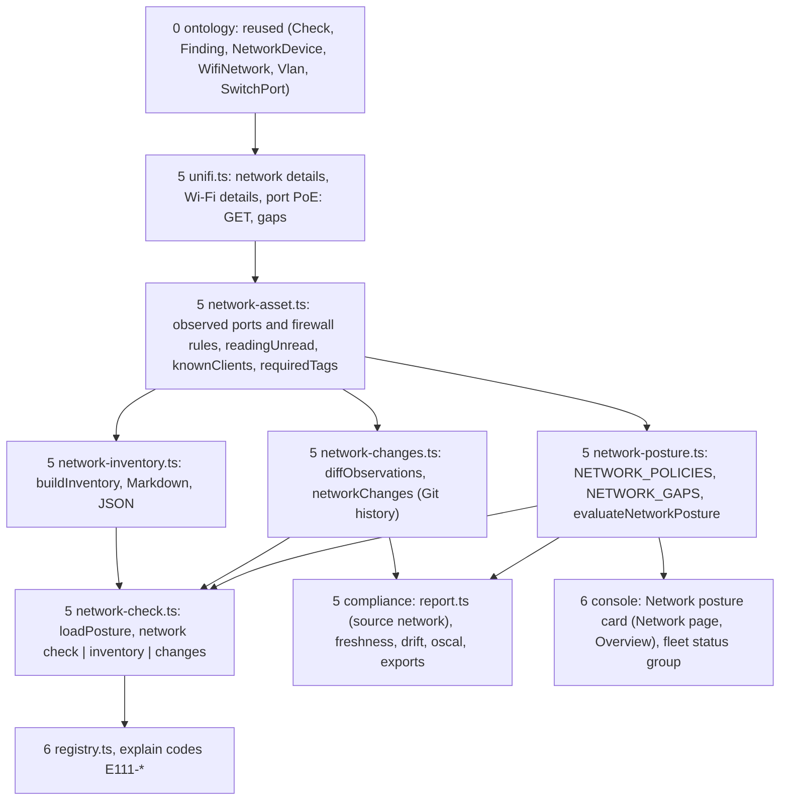

# Implementation Plan: Network posture: the network as an asset class, with policies, evidence, an inventory and change events

**Branch**: `111-network-posture` (committed directly to main) | **Date**: 2026-11-18 | **Spec**: [spec.md](spec.md)

**Input**: Feature specification from `specs/111-network-posture/spec.md`

## Summary

Specs 109 and 110 read a router's controller read-only into an observation in Git and make its devices assets of the fleet. This spec adds what a GRC engineer asks of that
network: a **pack of nine policies** over the observation (`network-posture.ts`, one pure function over data), the pack's results as **evidence** (a new source `network`
in the compliance view, so the evidence bundle, OSCAL, the CycloneDX attestation, the FedRAMP package and the Trust Center carry them), a deterministic **inventory**
(`network-inventory.ts`, CM-8), and **change events** from the Git history of the observation file (`network-changes.ts`, CM-3 and CM-6, also in `compliance drift`). The
reader gains three more GET operations of the pinned document (a network's details, a Wi-Fi broadcast's details, a port's PoE setting), each a reported gap where it fails.



## Technical Context

**Language/Version**: TypeScript 7, run by Bun, Node 26 as the backup (spec 096-bun-runtime). **Primary Dependencies**: none new. **Storage**: Git only: the observation
(`fleets/<fleet>/estate/<id>.ts`, spec 109), the assets (`adopted/<name>/network.ts`, spec 110), `network.ts` (the optional `knownClients` and `requiredTags`),
`controls/accepted.ts` (spec 078); the inventory is a file the person asks for. No secret is read or written. **Testing**: `tests/network111.test.ts` (the pack over data),
`tests/network111-unifi.test.ts` (the connector against a real local HTTPS server, the commands in a sandbox fleet with a real Git repository), and
`tests/network111-console.test.ts`, through `proves([...])`, on Bun and Node 26. **Project Type**: command line first (headless), then the Stolos Console.

## Constitution Check

- Article 0 (the ladder): no new ontology term (rung 0); this specification (rung 1); the pack, the inventory, the changes and the check in `connect/` and
  `compliance/` (rung 5); the registry, the explain codes and the console in `commands/`, `core/explain.ts` and `console/` (rung 6); tests and the guide (rung 7). The headless
  operation and its test came before the card.
- Article 4 (code over config): the pack is a typed table and a pure function; `knownClients` is typed in `network.ts` (`defineNetwork`). Article 5: nothing built from source.
  Article 13: no secret is read or written.
- Spec 109 FR-004 and spec 110: the router is the authority and Stolos never changes it: every read is a GET of the pinned document, the transport refuses the rest.
- Article 26: no generated file is edited by hand; the inventory is generated and says so.
- The model seam of spec 115 is unchanged (`src/archon/model/types.ts` and `site.ts` are not touched): `bun run compat:digest --check` holds.

## Project Structure

```text
specs/111-network-posture/  spec.md, plan.md, tasks.md, reviewed.tsv
src/archon/connect/         network-posture.ts, network-changes.ts, network-inventory.ts, network-check.ts, network-asset.ts, unifi.ts, labels.ts, integration-entities.ts
src/archon/compliance/      scf.ts (the SCF controls), report.ts (source network), freshness.ts, drift.ts, oscal.ts, commands.ts
src/archon/core/explain.ts  E111-* codes
src/archon/commands/        registry.ts (network check, inventory, changes)
src/archon/console/         network-page.ts (postureCard), stolos-pages.ts, pc.ts
tests/                      network111*.test.ts, network111-fixtures.ts
```

## Standards considered

RFC 2119 and RFC 8174 (requirement words); NIST SP 800-53 Rev 5: CM-6 (the network's settings are checked against what the fleet requires), CM-8 and CM-8(3) (the
inventory and unauthorized component detection), CM-3 (a change is recorded), CM-7 (least functionality: PoE on an idle port), SC-7 (guest networks isolated: boundary
protection), AC-18 (wireless access: an open network) and SI-2 (flaw remediation: a firmware update waiting); NIST SP 800-153 (WLAN security: authentication, encryption,
guest access); IEEE 802.11 and the Wi-Fi Alliance's WPA2 and WPA3 (the security types of the document); IEEE 802.1Q (a network's VLAN id); OSCAL 1.2.3 (the component
definition and the system security plan the network assets are exported into: the existing exporter is extended, no format is invented); the Secure Controls Framework
2026.3 (ids and names checked against the cached catalog by `tests/network111.test.ts`); spec 105-calm-output and spec 117-adopted-in-status (output and the wording of what is
not observed yet). No standard defines which findings a router API supports: the pinned document decides, and what it does not give is a reported gap, never a policy. No
ontology term is new, so `ontology/stolos/audit.ts` is unchanged.

## Decisions of the plan

- **One pure function over data.** `evaluateNetworkPosture` takes the observations, the assets, the view, `network.ts`, the tags, the accepted risks, a scope and the time,
  and returns the results. The command, the console, the compliance evidence and the history of Git (`compliance drift` evaluates the same pack at a past commit, from the files
  a commit holds) call it, so they cannot disagree.
- **Not applicable is not a result.** A policy with nothing to apply to is listed with its reason and gives no evidence: a pass would say more than was observed.
- **Not observed yet is spec 117's `unknown`.** A reading that failed (a reported gap) or an observation older than a field makes the policy `unknown`, shown as one waiting
  item with `P117-NO-EVIDENCE`; it is never a failure and never a pass.
- **The details are read in the connector.** `isolationEnabled`, `clientIsolationEnabled` and `poe.enabled` are in the document and not in the overviews: the connector
  reads them (at most 200 of each, GET) into the records, so the pack never asks the controller anything.
- **Evidence is the observation's.** The `network` rows carry the connector and the time the router was observed, so the cadence of the account applies (stale evidence fails, as
  for a cloud account) and the refresh command is `stolos estate observe <connector>`.
- **History without a log of its own.** `network changes` compares each commit of the observation file with the one before, with `gitReader` and the date resolution of
  `compliance drift`; the first version is a baseline.
- **Tags are not read from a commit.** Evidence computed at a past commit (drift) does not judge ownership, which needs `tags.ts` evaluated at that commit; both sides of a
  drift are computed the same way.
