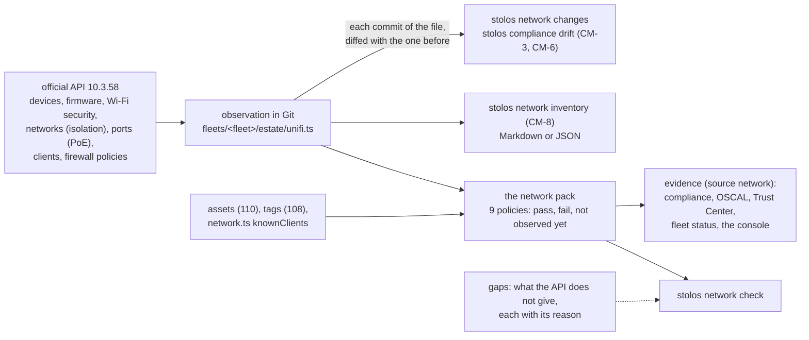

# 111: Network posture: the network as an asset class, with policies, evidence, an inventory and change events

Issue intellectual-frontiers/stolos#41 (specs 109, 110 and 111 live under it; this is 111, the last: what the network's assets and the integration's readings say about the
network's security posture). It builds on 109-integrations-api (what a router's controller offers, read-only), 110-network-assets (the equipment as assets of the fleet),
084-connectors (a connector's posture policies and their SCF controls), 078-control-sdk (results, accepted risks), 068-compliance (evidence for SCF controls), 073-freshness
(drift), 085-estate-graph (the observations in Git, `estate diff`), 105-calm-output (the output contract), 108-tags (choosing machines by tags) and 117-adopted-in-status
(a policy nothing was observed for is "not observed yet", never a failure).

## Why

A GRC engineer asked about the network wants four things Stolos already has the facts for and has not put together: **which posture rules the network meets** (is the
firmware current, is any Wi-Fi network open, is guest Wi-Fi kept apart, is something on the network that nobody knows), **the evidence of it** in the places evidence
goes (an SCF control, an OSCAL assessment, the Trust Center), **an inventory** an auditor can keep (NIST SP 800-53 Rev 5 CM-8), and **what changed and when** (CM-3, CM-6).
Everything is derived from what the official UniFi Network 10.3.58 API gives (`vendor/unifi-network/10.3.58/integration.json`) and from nothing else: no unofficial
endpoint, no guess. A policy the data cannot support is **not faked**: it is listed as a reported gap with the reason, and the person told what field is missing.

## Ontology

No term of `stolos:` is new: the spec reuses `stolos:Check` (a policy is a check of evidence against a control, spec 078), `stolos:Finding` (what a check found, with its SCF
controls and fix), `stolos:NetworkDevice`, `stolos:NetworkClient`, `stolos:Vlan`, `stolos:SwitchPort`, `stolos:WifiNetwork` (spec 109), `stolos:DeviceClass` (spec 110) and
`stolos:Tag` and `stolos:TagDimension` (spec 108). The policy ids, the explain codes and the names of change events are display and code words of this engine's own checks
(as spec 067's policy ids and spec 117's "not observed yet" are), not terms the ontology defines: `ontology/stolos/audit.ts` is unchanged and
`tools/mizan.baseline.txt` does not grow.

## Requirements

Requirement words follow RFC 2119 as RFC 8174 clarifies it: they are requirements only where written in capitals.

**Standards considered.** RFC 2119 and RFC 8174 (requirement words); NIST SP 800-53 Rev 5 CM-6 (configuration settings: the network's settings are checked against what the
fleet requires), CM-8 (system component inventory, with CM-8(3) automated unauthorized component detection for the unknown clients), CM-3 (configuration change control:
a recorded change) and CM-7 (least functionality: PoE on a port with nothing connected), SC-7 (boundary protection: guest networks isolated from the others), AC-18 (wireless
access: an open network, with AC-18(1) authentication and encryption), SI-2 (flaw remediation: a firmware update waiting) and AU-6 (a change is reviewable); NIST SP 800-153
(guidelines for securing wireless local area networks: authentication and encryption of a WLAN, guest access); IEEE 802.11 and the Wi-Fi Alliance's WPA2 and WPA3 (the
security types the document names); IEEE 802.1Q (a network's VLAN id); the OSCAL 1.2.3 component definition and system security plan (the models the inventory is exported
into, spec 071); the Secure Controls Framework (SCF) 2026.3 controls AST-04 (Asset Inventories), AST-05.1 (Criticality Ratings), AST-07.1 (Ownership Assignment), AST-11
(Automated Unauthorized Component Detection), CFG-02 (Configuration Management Program), CFG-03 (Least Functionality), CHG-03 (Configuration Change Control), MON-02
(Continuous Monitoring), NET-04 (Data Flow Enforcement, Access Control Lists), NET-06 (Network Segmentation), NET-22 (Guest Networks), NET-24 and NET-24.1 (Wireless Networking,
and its Authentication and Encryption), VPM-06 (Vulnerability Remediation Process) and VPM-08 (Software and Firmware Patching), whose ids and names
`tests/network111.test.ts` checks against the cached SCF catalog (read from the SCF Council's workbook); spec 105-calm-output (the output contract) and spec 117-adopted-in-status
(the wording of a policy nothing was observed for). No standard defines which findings a router's API supports: that is read from the pinned document, and what it does not
give is a gap, stated in the Decisions.

### The pack

- **FR-001** The network's posture MUST be checked by one **pack** of policies, defined in one table (`NETWORK_POLICIES` of `src/archon/connect/network-posture.ts`): each
  policy has an **id** (`network/<word>`), a plain **title**, its **SCF control ids** (each one an id of the SCF catalog and of `compliance/scf.ts`), an **explain code**
  (`E111-<WORD>`, known to `stolos explain`), the **fields of the document it rests on**, and a **FIX** line. A result MUST be one of `pass`, `fail`, `warn` (worth doing),
  `unknown` (**not observed yet**, never a failure: spec 117-adopted-in-status) or `accepted` (a failure the owner accepted until a date), carry what was found, the
  items it is about (a device, a Wi-Fi network, a client), and the FIX when it is not a pass. The pack MUST run over data only (the observations, the assets, the fleet's
  `network.ts`, its tags), so that the command, the console, the compliance view and the history of Git compute the same results.
- **FR-002** A policy MUST be `unknown` ("not observed yet": the wording and the one waiting item of spec 117-adopted-in-status, with the command `bun run stolos estate observe
<connector>`) where the reading it needs was not made: the router was never observed, its devices, clients, networks, Wi-Fi networks or ports were a reported gap, or the
  observation was written before this spec and has not the field. A policy for which nothing applies (no asset is adopted, no guest Wi-Fi network, no port with PoE) MUST
  NOT be a result: it is listed as **not applicable** with its reason, and gives no evidence.
- **FR-003** The owner MAY accept a failing or warning result in `fleets/<fleet>/controls/accepted.ts` (spec 078) as `{ policy: "network/<word>", reason, by, until }`: until the
  date the result is `accepted` (not passing, counted as partial by Compliance), after it it fails again and says the acceptance ended. Where no acceptance exists the fix
  line says how to make the policy pass.

### The policies, and the data each rests on

- **FR-004** `network/observed` (SCF AST-04, MON-02) MUST fail when the newest observation of a router connector is older than 7 days and be `unknown` when there is none.
  It rests on the observation's time.
- **FR-005** `network/devices-present` (AST-04) MUST warn for each adopted network asset that the controller no longer reports (spec 110 FR-005: gone from the integration,
  the document's `/v1/sites/{siteId}/devices`), and be `unknown`, never "gone", when the devices could not be read. `network/devices-online` (AST-04, MON-02) MUST fail for each
  device whose `state` is `OFFLINE`, `CONNECTION_INTERRUPTED` or `ISOLATED`, and warn for one in a transitional state (`UPDATING`, `GETTING_READY`, `ADOPTING`, `PENDING_ADOPTION`,
  `DELETING`, `U5G_INCORRECT_TOPOLOGY`).
- **FR-006** `network/firmware-current` (VPM-08, VPM-06) MUST warn for each device whose `firmwareUpdatable` is true (the device's own "update available" state: the document
  has no release date, no latest version and no vulnerability for a firmware, so how far behind a device is cannot be said, see FR-011).
- **FR-007** `network/wifi-no-open` (NET-24.1, NET-24) MUST fail for each enabled Wi-Fi network whose security `type` is `OPEN` and that is not a guest hotspot (a broadcast with
  a `hotspotConfiguration`: a captive portal or Passpoint, which is open by design). Every other type the document names (`WPA2_PERSONAL`, `WPA3_PERSONAL`,
  `WPA2_WPA3_PERSONAL` and the three enterprise types) MUST pass. WEP is not a type of the document, so it is not checked and the gap says so.
- **FR-008** `network/guest-isolated` (NET-22, NET-06) MUST fail for each enabled guest Wi-Fi network (a hotspot) whose network is not isolated: the network it carries
  (the broadcast's `network` reference: the default network, or one by id) has `isolationEnabled` false in the document's network details ("isolated from all other
  networks"). The same result MUST say whether the broadcast also has `clientIsolationEnabled`, which is not a substitute. The two flags come from the network details and
  the Wi-Fi broadcast details the connector reads for this (FR-014).
- **FR-009** `network/unknown-clients` (AST-11, AST-04) MUST list the clients (wired and wireless; a VPN or Teleport client has no MAC and is a remote session, not a device on the
  premises) that match no machine of the fleet (spec 110 FR-006), and MUST be **informational** (`warn`, never a failure) unless the fleet declares an allowlist: with
  `knownClients: [{ mac, name?, reason? }]` in `fleets/<fleet>/network.ts` (typed: a MAC is six pairs of hexadecimal digits, validated at build), a client that matches no machine
  and whose MAC is not in the list MUST fail. A client matched to a machine or listed MUST pass.
- **FR-010** `network/assets-classified` (AST-07.1, AST-05.1) MUST report each adopted network asset that holds no tag of the dimensions the fleet requires, where the fleet defines
  them: by default `owner` (an asset's `owner` field also counts) and `criticality` where `tags.ts` defines those dimensions (spec 108), or the dimensions `network.ts` names in
  `requiredTags: ["owner", ...]`. It MUST warn for the default dimensions and fail for the ones the fleet named, and MUST NOT apply (FR-002) where the fleet defines none of them.
  `network/unused-poe` (CFG-03) MUST warn for each port of a device whose link is `DOWN` and whose PoE is enabled (the document gives a port's `state` and `poe.enabled`),
  and apply only where a port was read with PoE.
- **FR-011** What the data cannot support MUST be listed as a **reported gap**, never as a policy and never as a pass, each with its reason and the field that is missing:
  a management interface reachable from guest networks (the document lists firewall policies by zone and filter, has no evaluation of reachability and does not say which
  address is a management interface); WEP and other legacy security (not a type of the document); a disabled port (a port's `state` is `UP`, `DOWN` or `UNKNOWN`: there is
  no administrative state); how far a firmware is behind (only the Boolean `firmwareUpdatable`); the effect of a firewall rule (its action and zones are read, the effect of its
  filters is not evaluated); DHCP leases, port forwards and routes (no operation, spec 110 FR-012); and a client's port, VLAN and Wi-Fi network (not given for a client).

### The reading

- **FR-012** The UniFi reader MUST read, in addition to spec 109's, only GET operations of the pinned document: each network's details (`/v1/sites/{siteId}/networks/{networkId}`:
  `isolationEnabled`), each Wi-Fi broadcast's details (`/v1/sites/{siteId}/wifi/broadcasts/{wifiBroadcastId}`: `clientIsolationEnabled`) and each port's `poe.enabled` (already in the
  device details). A read the key may not make or the controller does not answer MUST be a reported gap and the field absent (the policy is then `unknown`), never an error and
  never a guess. At most 200 details are read for each kind in one observation.

### The command, the evidence and the console

- **FR-013** `stolos network check [--tag <tag>] [--any-tag <tag>] [--select <expression>] [--json]` MUST be a report (spec 105-calm-output FR-001: verbose by default; `--quiet`
  gives the closing line only), MUST run the pack over the last observation and the fleet's records (it reads Git and this PC's files, it asks the controller nothing), MUST print each
  failing policy as a warning with its items, its fix, its SCF controls and its code, each warning policy and accepted risk as a note, the policies nothing was observed for as
  **one** waiting item (`not observed yet`, spec 117-adopted-in-status), the not-applicable policies and every reported gap with its reason, and MUST exit 1 when a policy fails
  and 0 otherwise (a policy that is only waiting, warning or accepted exits 0). `--json` MUST give the same as data, with nothing on the screen. `--tag`, `--any-tag` and `--select`
  (spec 108-tags FR-012, FR-013) MUST scope the pack to the chosen network assets: their devices, the Wi-Fi networks they broadcast, their ports and the clients connected through
  them; a choice that matches no network asset MUST say so and check nothing.
- **FR-014** The results MUST be **evidence**: `stolos compliance` and every export built from its evidence (the evidence bundle of spec 072, OSCAL assessment results of spec 071,
  the CycloneDX attestation, the FedRAMP package and the Trust Center of spec 081) MUST carry one row for each result with the source `network`, the SCF controls of the policy,
  the connector it was read through (so that the freshness cadence of its account applies and the refresh command is `stolos estate observe <connector>`) and the time the
  router was observed. `stolos compliance --tag/--any-tag/--select` MUST scope them as `network check` does. The compliance numbers of a fleet with no router connected MUST NOT change.
- **FR-015** `stolos fleet status` MUST show the failing policies of the network in its Network group, each as a warning with its fix and code, and one waiting item for what was not
  observed yet, and `stolos network status` the same. The Stolos Console MUST show a **Network posture** card on the Network page and on the Overview (when a router is connected):
  the counts (pass, fail, warn, not observed yet, accepted), the failing items each with its fix and its explain code (`stolos explain <code>`), and the gaps; it holds no logic, it draws the
  pack's results.

### The inventory and the change events

- **FR-016** `stolos network inventory [--format markdown|json] [--out <file>]` MUST write a **deterministic** listing of every network asset (NIST SP 800-53 Rev 5 CM-8): for each
  device its name, class, model, firmware, address, MAC, state, whether an update waits, its uplink, its tags, how it joined (adopted, auto-adopted, or discovered and not adopted),
  its place against the integration (present, gone, unread) and when it was last observed (the observation's time, never the time of the command), then the Wi-Fi networks (name,
  security, guest, enabled) and the networks (name, VLAN id, enabled), and the gaps. The same observation and records MUST give byte-identical output, in a stable order. With `--out` the
  file is written (its folder is made), otherwise the report is printed.
- **FR-017** `stolos compliance export` MUST describe the network assets in the OSCAL component definition (one `hardware` component per network asset, with its class, model, firmware,
  address, MAC and state as properties, the connector it came through and the controls its policies give evidence for) and in the system security plan's inventory items, extending
  the code that exports adopted machines and devices, and the network posture as a component of its own (the source `network`).
- **FR-018** `stolos network changes [--since <commit|date>] [--json]` MUST list the **change events** between a point of the fleet repository's history and now (default `7 days ago`),
  from the generated observation file `fleets/<fleet>/estate/<connector>.ts`: each commit that changed the file is compared with the version before it (the existing diff of
  `estate diff` and the history reader of `compliance drift`), and each difference is one event with its kind, subject, what changed (before and after), the commit and its time.
  The kinds MUST be: a device added, gone (removed from the controller's list), renamed, or with its firmware changed; a Wi-Fi network added, removed, or with its security changed; a
  network (VLAN) added, removed or changed (its VLAN id, whether it is enabled); and a firewall rule added, removed or changed (its action, whether it is enabled), the document having
  firewall policies. The first version of the file is the baseline and gives no event. An observation not yet committed is compared with the last commit and its events say
  `uncommitted`.
- **FR-019** `stolos compliance drift` MUST include the network's change events of the same period, as events (never as a status), each with its SCF controls (CHG-03, CFG-02 for a
  change; NET-04 for a firewall rule; NET-24.1 for a Wi-Fi security change; AST-04 for a device added or gone): shown after the controls that changed, in `--json` as `network`,
  and, in the message mailed to the fleet's mailbox, by kind and subject only (never what a value was).

### Everywhere

- **FR-020** Windows and macOS MUST NOT be diminished: paths are built with `path.join`, the only process the code starts is `git` (as `compliance drift` does), with a time limit,
  every network call is spec 109's (GET, a time limit each), and the tests MUST pass on Bun and on Node, as a user who is not root, and without a global Git identity; every test that
  signs commits, starts a doctor or takes about 20 seconds on Windows MUST carry an explicit `{ timeout: 180_000 }`.
- **FR-021** `bun run check:ontology`, `check:trace`, `check:layers` and `check:mizan` MUST pass with baselines that do not grow, and the model's seam (spec 115) MUST NOT change:
  `src/archon/model/types.ts` and `site.ts` are not touched, `knownClients` and `requiredTags` are fields of `network.ts` (the record of spec 110), not of the fleet model.

## Success criteria

- **SC-001** `tests/network111.test.ts`: every policy over data (pass, fail, warn, not observed, not applicable, accepted), the SCF ids against the catalog, the table's integrity, the
  scoping by tags, `knownClients` and its build validation, the change events over two observations, the inventory's determinism, and the evidence rows.
- **SC-002** `tests/network111-unifi.test.ts`: the connector against the real local HTTPS server (the new GET details, their gaps, GET only), and the commands for real in a sandbox fleet
  with a Git repository (check, its exit codes and JSON, inventory, changes over real commits, drift, the compliance evidence).
- **SC-003** `tests/network111-console.test.ts`: the card on the Network page and on the Overview, `fleet status`'s group, and the evidence in the compliance view and the OSCAL export.
- **SC-004** `bun run check:ontology`, `check:trace`, `check:layers`, `check:mizan` and `compat:digest --check` pass (FR-021).

## Decisions

- **Nine policies, from the fields the document has.** The set is what `integration.json` 10.3.58 supports: a device's `state`, `firmwareUpdatable` and `firmwareVersion`; a
  broadcast's `securityConfiguration.type`, `hotspotConfiguration`, `network` and (details) `clientIsolationEnabled`; a network's (details) `isolationEnabled`; a port's `state` and
  `poe.enabled`; a client's `type`, MAC and uplink. Each policy names them (`NETWORK_POLICIES`), and `tests/network111.test.ts` checks that each field exists in the document.
- **The connector's own policies stay.** `stolos estate check unifi` (spec 109) keeps its account-level policies (offline, firmware, open Wi-Fi, VLANs, TLS). This pack is the asset
  class's: it covers every device, the isolation of guests, the clients, the ownership and the ports, and gives its evidence under the source `network`. A check of the same SCF control by
  two sources is evidence twice and says the same; neither is removed.
- **Unknown clients are informational by default.** Most networks have clients the fleet does not manage (phones, TVs, guests): a failure by default would be noise a person learns to
  ignore. An allowlist turns the finding into a failure because then the person said what is known.
- **Acceptance is `controls/accepted.ts`.** There is one place where a fleet accepts a risk of a pack (spec 078); the network pack uses it (`network/<word>`) instead of a file of its own.
  A command that writes it is a later item (tasks.md, L001).
- **A change is a commit.** The observation file is generated and committed, so Git's history of it is the record of what changed and when; nothing here keeps a second log.
- **Firewall policies are in the document**, so a firewall rule's change is an event; the effect of a rule is not evaluated, and a policy over it is a gap (FR-011).
