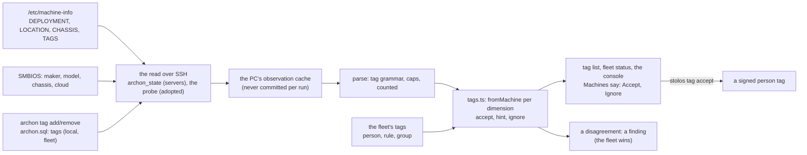

# 112: Machine-reported tags: what a machine says about itself, and what the fleet does with it

Issue intellectual-frontiers/stolos#42. It extends spec 108-tags (the fleet's tags, their origins and precedence), spec 048-observe-by-query
(a machine's own `archon.sql` and its osquery tables), spec 067-adopt and 069-integrate (the read-only probe) and spec 107-pairing-and-query
(asking every machine).

## Why

Spec 108 made the fleet say what each machine is. A machine knows things the fleet does not: that its owner set `DEPLOYMENT=production` in
`/etc/machine-info`, that a person on the machine added a tag of its own, what its firmware says it is (a Dell laptop, an Amazon EC2 instance).
Those are useful, and they are also the one thing in the inventory that the fleet did not decide: a machine can be wrong, stale, or lying. This
specification gives the machine a voice and keeps the decision with the fleet.

The owner's decisions, final: a tag a machine reports about itself is a **claim**, never the fleet's own tag. A claim has a **channel**:
**reported** (read over the authenticated channel: SSH to an adopted or managed machine whose host key is pinned in Git) or **announced**
(heard on the network without authentication; a hint only; no source yet, spec 113). A machine can never override what the fleet says: where a
reported tag disagrees with the fleet's tag in the same dimension, the fleet's wins and the disagreement is a finding (inventory accuracy,
NIST SP 800-53 CM-8). Each dimension of the fleet's `tags.ts` says what to do with what machines report: accept it, keep it as a hint, or
ignore it. `stolos tag accept` turns a claim into a signed person tag. The first sources are the machine's `/etc/machine-info`, its firmware
(SMBIOS) facts and its own **`archon tag` table** in its state database, which osquery reads like any other table.

## Ontology

The terms this spec uses, defined in `ontology/stolos/` with this spec as their source: `stolos:TagClaim` (a statement a machine makes about
itself), the code lists `stolos:TagTrust` (`stolos:trust-accept`, `stolos:trust-hint`, `stolos:trust-ignore`) and `stolos:TagSource`
(`stolos:source-machine-info`, `stolos:source-archon-local`, `stolos:source-archon-fleet`, `stolos:source-smbios`), and two new members of
the code list `stolos:TagOrigin`: `stolos:origin-reported` and `stolos:origin-announced`; and, from spec 108, `stolos:Tag`,
`stolos:TagDimension`, `stolos:TagRule`, `stolos:TagGroup`, `stolos:TagSelection`, `stolos:TagOrigin`, `stolos:AdoptedMachine`,
`stolos:Controller`. `bun run gen` writes the code lists as `TagTrust`, `TagSource` and `TagOrigin` (and their arrays `TAG_TRUSTS`,
`TAG_SOURCES`, `TAG_ORIGINS`) in `src/archon/ontology.auto.ts`; the code imports the unions. Each new class is mapped to a standard in
`ontology/stolos/audit.ts`: the code lists to W3C SKOS (`skos:ConceptScheme`), the claim to RDF 1.1 (`rdf:Statement`).

## Requirements

Requirement words follow RFC 2119 as RFC 8174 clarifies it: they are requirements only where written in capitals.

**Standards considered.** RFC 2119 and RFC 8174 (requirement words); NIST SP 800-53 Rev 5 CM-8 (system component inventory) and its
enhancements CM-8(1) (updates during installation and removal), CM-8(3) (automated unauthorized component detection) and CM-8(4)
(accountability information) for the accuracy of the inventory, and SP 800-128 (security-focused configuration management: the fleet, not the
component, decides the baseline); the systemd `machine-info(5)` manual (version 259, <https://www.freedesktop.org/software/systemd/man/259/machine-info.html>:
`DEPLOYMENT=`, `LOCATION=`, `CHASSIS=`, and `TAGS=` from systemd 261); DMTF DSP0134 SMBIOS Reference Specification (System Information and
System Enclosure structures, whose chassis types the firmware facts use); osquery's Automatic Table Construction (the `archon_tags` table,
and `path` as a reserved column, spec 093-osquery); W3C SKOS (tags, dimensions and code lists as concepts and concept schemes); RDF 1.1
Concepts (`rdf:Statement` for a claim); and the SCF control AST-04 (Asset Inventories), whose id and name `tests/tags112.test.ts` checks against the pinned
SCF workbook.

### Claims, origins and precedence

- **FR-001** A tag a machine reports about itself MUST be a **claim** and MUST NOT be the fleet's own tag: it MUST NOT be written to the
  fleet repository, to `decisions.ts` or to `machine.ts`, by any command except `stolos tag accept` (FR-012). A claim has a **channel**:
  `reported` (read over the authenticated channel: SSH to an adopted machine, or to a managed server, whose host key is pinned in Git) or
  `announced` (unauthenticated facts of the network, a hint only).
- **FR-002** The code list `stolos:TagOrigin` (spec 108: `person`, `rule`, `inherited`) MUST gain `reported` and `announced`. The precedence
  MUST be person, then rule, then group (`inherited`), then `reported`, then `announced`; a one-of dimension MUST keep the strongest origin
  and a tag from two origins MUST be shown once, with the strongest. A machine MUST NEVER override what the fleet says: where a reported
  tag is a different defined tag of a one-of dimension than the fleet's own, the fleet's tag MUST stay and the claim MUST be dropped as a
  **disagreement**. No source announces in this release: the `announced` origin exists so that a later specification (113) has a place for it.
- **FR-003** A dimension in the fleet's `tags.ts` MAY say `fromMachine: "accept" | "hint" | "ignore"` (`stolos:TagTrust`), and MUST be
  `hint` where it does not. `hint`: a reported tag is shown with the origin `reported`, and MUST NOT be used to choose machines or to scope
  policies. `accept`: a reported tag of a defined value is used like a rule's tag, below the fleet's own. `ignore`: a reported tag is dropped,
  counted, and shown only with `--verbose`. `defineTags` MUST refuse a value that is none of the three, with the fix. The starter kit
  (`STARTER_DIMENSIONS`) MUST say `accept` for `env` and `site`, `ignore` for `criticality` and `data`, and `hint` for `role` and `owner`; the
  example lab MUST use the starter kit unchanged.
- **FR-004** What a machine says is **untrusted input**. A claim MUST be read with the tag grammar of spec 108 (`<dimension>:<value>`, or a
  lowercase word), MUST be at most 64 characters, and a machine MUST be read for at most 64 claims; the raw text a machine sends MUST be
  bounded before it is kept. A claim MUST NOT be evaluated, MUST NOT be used to build a pattern, a path or a command, and MUST be escaped
  wherever it is drawn. A malformed or over-long claim MUST be dropped and counted, and MUST be reported as a **gap** (`tag list <machine>`,
  `fleet status` with `--verbose`), never as an error: a machine's words MUST NOT fail `stolos build`, `fleet status` or any other command.

### The sources

- **FR-005** The machine's `/etc/machine-info` (systemd `machine-info(5)`) MUST be a source, read through the authenticated read paths: on a
  managed server by `archon state` (the MCP tool `archon_state`, over SSH as `ops`), on an adopted POSIX machine by the read-only probe (a
  `reported` section of its `facts`, probe version 3). The file MUST be read as data (never sourced by a shell). `DEPLOYMENT=` MUST become
  a claim in the dimension `env` (`development`, `integration`, `staging`, `production`, `testing`, and any lowercase word of the
  grammar), through the fleet's optional typed `machineInfoMap.deployment` where it names the value; `LOCATION=` (free text) MUST become a
  claim `site:<slug>` that is a hint value only, and MUST NOT be mapped to a defined site except through `machineInfoMap.location`;
  `CHASSIS=` MUST become `kind:<chassis>` when it is one of `desktop`, `laptop`, `convertible`, `server`, `tablet`, `handset`, `watch`,
  `embedded`, `vm`, `container`; `TAGS=` (space separated; systemd 261 and later) MUST be read with the tag grammar. `machineInfoMap` MUST be
  typed by the fleet's own tag ids (a value it names that `tags.ts` does not define is a type error and a problem of `defineTags`).
- **FR-006** The SMBIOS facts a machine already gives (DMTF DSP0134: the maker and model, the chassis type, and a cloud provider's name such as
  "Amazon EC2") MUST become hint claims with the source `smbios`: `hardware:<maker>`, `hardware:<model>`, `hardware:cloud-<provider>` where a
  provider is recognized, and `kind:<chassis>` from the chassis type. A managed server's come from its recorded inventory (spec 051), an
  adopted POSIX machine's from its probe, an adopted Windows machine's from its PowerShell probe. A value that makes no tag of the grammar
  MUST be dropped and counted.
- **FR-007** `archon tag add <tag...>`, `archon tag remove <tag...>` and `archon tag list` MUST exist on every machine that runs `archon`.
  `add` and `remove` MUST be tier `mutate` and run as root; `list` MUST be tier `read`. They MUST write a **tags table** in the machine's own
  state database (`archon.sql`): one row per tag with `dimension`, `value`, `source` (`local`, written by a person on the machine, or
  `fleet`), `set_by` and `set_at`. Every change MUST go to the run log and to the journal, as other archon changes do. A tag MUST be read with
  the tag grammar and the caps of FR-004; a new value of a one-of dimension of the fleet's tags MUST replace the machine's own old one; a tag
  that the fleet's `tags.ts` does not define MAY be written and MUST be said to be one the PC cannot accept. `archon tag remove` MUST remove
  only rows with the source `local`.
- **FR-008** At each `archon apply` that changes the machine (and so at each reconcile), the machine MUST also compute the tags the fleet knows
  for it from the fleet repository it already holds (the rules and groups of `tags.ts`, and the machine's own `decisions.ts` tags) and write
  them with the source `fleet`, replacing its previous `fleet` rows and leaving its `local` rows alone. An `apply --check` MUST write nothing.
- **FR-009** The machine's osquery configuration MUST carry an automatic table `archon_tags` over the tags table, as it carries the other
  tables of its state database, so that `select * from archon_tags` works through `archon query`, the MCP tool `archon_query` and "Ask every
  machine" (`stolos fleet query`). No column of an automatic table MAY be named `path` (osquery reserves it): a test MUST hold that, and MUST
  read the table with the real `osqueryi` where it is installed.

### What the PC does with it

- **FR-010** The PC MUST collect each machine's report on the normal observe cycle (`stolos fleet status` for the managed servers, from
  `archon_state`; `stolos host observe` for the adopted machines and the controller, from the probe) and MUST keep it in its observation
  cache (its own `archon.sql`, never the fleet repository), so that no run makes a commit. A claim MUST be shown with its source
  (`machine-info`, `archon-local`, `archon-fleet`, `smbios`). A machine that cannot be reached MUST keep its last report, and MUST say so.
- **FR-011** `loadFleetTags` MUST resolve each machine's claims with `resolveTags` (FR-002, FR-003): a held claim is a tag with the origin
  `reported` (with its source and its trust); the disagreements, the dropped and the counted are part of the result. `fleet query --tag`,
  `--any-tag` and `--select`, `tag list --tag`, `--any-tag` and `--select`, the console's filters, facets and group-by, and the scope of
  `compliance` MUST use the fleet's own tags and the accepted claims only; `fleet query` and `tag list` MUST accept `--reported`, which adds
  the hints. Compliance MUST NOT use hints.
- **FR-012** `stolos tag accept <machine> <tag...>` MUST turn a claim into a signed person tag: it MUST refuse a tag the machine does not
  claim (and say what it claims), a claim that `tags.ts` does not define (and say how to define it), and, as `tag add` does, a machine that is
  not in the fleet; it MUST write the machine's own file and send the change through `stolos apply` (one signed commit, subject
  `112-machine-reported-tags: ...`), by the same code as `tag add`; `--no-apply` MUST write the change and leave the sending to
  `stolos apply`. No command MUST ignore a claim: the console's Ignore hides it for the session and keeps no state.
- **FR-013** A disagreement MUST be a finding of inventory accuracy (CM-8): `alpha reports env:prod; the fleet says env:lab`. It MUST be
  shown in `stolos fleet status`, in `stolos tag list` and `tag list <machine>` (and in their JSON), and on the console's machine page, and it
  MUST be a policy finding of the compliance evidence, "Reported tags agree with the fleet's", with the SCF control AST-04, passing
  where the machine reports no disagreement, failing where it reports one, and absent where the machine has not reported.

### The Stolos Console

- **FR-014** A machine's page MUST have a **Machines say** panel that lists its claims (the tag, its source, its trust, and whether it is held,
  agrees with the fleet, disagrees, is not defined, or is ignored) with **Accept** (a form that runs `tag accept` as a command of the one
  registry) and **Ignore** (hides the claim for the session; nothing is kept). A claim that `tags.ts` does not define MUST NOT offer Accept.
- **FR-015** A chip of a reported tag MUST carry a badge `reported`, and one of an announced tag a badge `announced`; both MUST be visually
  distinct from the person, rule and inherited chips and from a custom chip, in light and dark. The machines table, the machine page, the
  CSV and the evidence JSON MUST say where a reported tag came from (its source and its trust).

### Everywhere

- **FR-016** Windows and macOS MUST NOT be diminished: the probe stays POSIX shell and PowerShell; the PC's files are written with
  `path.join`; every child process, probe and network call has a time limit; and the tests MUST pass on Bun and on Node, as a user who is not
  root, and without depending on being alone on the machine.
- **FR-017** The constitution MUST say, in Article 25, that a machine MAY record facts and claims about itself with `archon`, in its own state
  database, and that none of it changes configuration; its version MUST become 6.3.0, with the row of the Amendments table.
- **FR-018** The guides (`src/archon/fleet/mod.ts`), the command help and the module documentation MUST say what is true now, and
  `bun run check:trace`, `check:layers`, `check:ontology` and `check:mizan` MUST pass with baselines no larger than before.

## Success criteria

- **SC-001** `tests/tags112.test.ts`: the ontology's new code lists, the claim grammar and its caps (with hostile strings), the sources
  (`machine-info`, SMBIOS), the typed `machineInfoMap`, resolution (precedence, disagreement, accept, hint, ignore, one-of), selection with and
  without `--reported`, the machine's tags table and `archon tag add|remove|list` run for real, the fleet computed at apply, `archon_tags`
  read by the real `osqueryi`, `stolos tag accept` through a real signed `stolos apply`, the probe's `reported` section run for real, the
  observe cycle's cache, the evidence finding with the SCF ids, the console's panel and badges, and the constitution.
- **SC-002** `bun run check:ontology`, `check:trace`, `check:layers` and `check:mizan` pass with baselines no larger than before.

## Decisions

- **A claim is not a tag of the fleet.** The fleet decides (Article 25, CM-8 and SP 800-128: the baseline is the fleet's). A machine's words
  are evidence about the machine, and a disagreement between the two is a finding, not an override in either direction.
- **The tags table is a record kind and a view.** The state database is one table of records and a view per kind (spec 048); `archon_tags`
  is the view of the kind `tag`, with the columns `host`, `dimension`, `value`, `source`, `set_by` and `set_at`, so that it joins the other
  tables in osquery and the writers keep one way to write. A free-form tag has an empty `dimension`.
- **`archon tag list` is a read.** It shows the machine's own table; it changes nothing, so it is tier `read` like `archon state`. `add` and
  `remove` change the state database and are tier `mutate` (root).
- **The machine's `fleet` rows are what its own checkout says.** They can lag the PC by the 15 minutes of a reconcile, and a stale one is
  a claim like any other: where it differs from the fleet's tag it is a finding.
- **An undefined claim is shown, not held.** A claim in a dimension or of a value that `tags.ts` does not define (`env:production` where the
  fleet says `env:prod`) is listed in Machines say as not defined, cannot be accepted, and is never a disagreement: the fleet's
  `machineInfoMap` says what `production` means, and the starter `tags.ts` maps `production`, `staging` and `development`.
- **`LOCATION=` is a hint value, not a site.** Free text is not a defined site; nothing here invents a mapping.
- **The probe is version 3.** A machine with the older probe still answers (it has no `reported` section: it reports nothing); the next
  `stolos host adopt` or integrate script refreshes it.
- **Disagreement is a failing finding.** An inventory that disagrees with a machine's own record is inaccurate in one of the two places; a
  person decides which, so the control does not pass until they do.
- **Ignore keeps no state.** The owner's decision: a claim the person does not want is hidden for the session; the fleet's dimension
  (`fromMachine: "ignore"`) is the lasting way.
