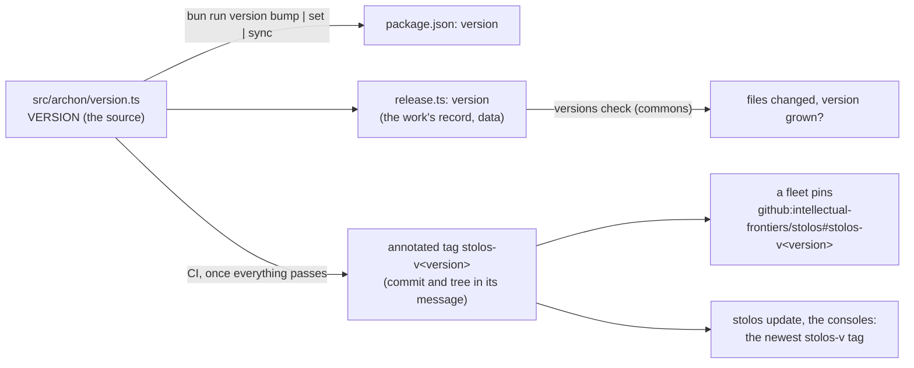

# 114: The release record: Stolos is one work, and a release is the tag `stolos-v<version>`

Issue intellectual-frontiers/stolos#44.

## Why

Stolos versioned itself its own way: a `VERSION` in `src/archon/version.ts`, a copy in `package.json`, and a plain tag `v<version>` that CI made.
Commons now says how every work of Intellectual Frontiers is versioned (commons 0026-works-versioning): a work has a typed record, `release.ts`;
its version has one scheme by its kind (Semantic Versioning for software); a release is an annotated Git tag named `<slug>-v<version>`;
and a check fails where the files of a work changed and its version did not grow. The engine adopts that, the same as the commons repository
does for its own works.

The owner's decision, final, with no backward compatibility and no history to keep: Stolos is **one work** (kind `Software`, slug `stolos`);
its record is `release.ts` at the root; its first version under the scheme is **0.150.0**; a release is the annotated tag
**`stolos-v<version>`**; and nothing reads or writes the old tag `v<version>` any more (the old tags are deleted, so a fleet re-pins once).
`src/archon/version.ts` stays the source of the version and `tools/version.ts` stays the tool that bumps it, now also into `release.ts`.

## Ontology

No term of `stolos:` is new. This spec uses `stolos:EngineRelease` (spec 099's), whose definition now says what a release is, and which
`ontology/stolos/audit.ts` maps to commons' `ifr:Release` (narrower: the release of the one work `stolos`). It uses commons' terms of
Intellectual Frontiers Releases by citing them, never by defining them again: `ifr:Work` (the identity of a work, its slug), `ifr:Release`
and `ifr:ReleaseTag` (a published version and its annotated tag `<slug>-v<version>`), the work kind `Software` of `ifr:WorkKind` and the
version scheme `SemVer` of `ifr:VersionScheme`.

## Requirements

Requirement words follow RFC 2119 as RFC 8174 clarifies it: they are requirements only where written in capitals.

**Standards considered.** RFC 2119 and RFC 8174 (requirement words); Semantic Versioning 2.0.0 (the scheme of the kind `Software`, and the
precedence by which a version is "newer"); Git's annotated tags (`git tag -a`, what a release is, with the commit and the tree hash in its
message; signing is Git's `tag -s`, a later item here because CI holds no signing key); commons 0026-works-versioning (the work, its record
`release.ts`, `versions check`, `versions tag`, the tag `<slug>-v<version>`), which in turn considered schema.org `version`, Dublin Core
Terms, PROV-O, OWL `versionInfo`, SPDX 3 `software_packageVersion`, SLSA and in-toto, and the Citation File Format 1.2.0, and which this
spec does not repeat; NIST SP 800-53 Rev 5 CM-3 (configuration change control) and CM-8 (system component inventory), SA-10 (developer
configuration management) and SI-7 (software integrity), for a release that is one exact, immutable set of files; and NIST SP 800-218
(SSDF) PS.3.2 (archive and protect each software release). `ontology/stolos/audit.ts` records the basis of `stolos:EngineRelease`.

### The work and its record

- **FR-001** Stolos MUST be one work (`ifr:Work`, kind `Software`, slug `stolos`) whose record is the file `release.ts` at the root of this
  repository, in the form of commons' 0026-works-versioning FR-008: its only export is `release`, an object literal of data that is read and
  never run, with `slug`, `kind`, `title`, `authors`, `version`, `repository` and `exclude` (the paths that change without being the work: `out`
  and `test-results`). Commons' decoder (`versions check`) MUST decode it without a finding, and a tool, never a hand edit, MUST write its
  `version`.
- **FR-002** The version MUST have one source, `VERSION` in `src/archon/version.ts`; `package.json`'s `version` and `release.ts`'s `version`
  MUST follow it, and only `bun run version` writes them: `bump` raises the minor number in the three files, `set <version>` writes the given
  `major.minor.patch` in the three, `sync` writes the source's version into the other two. `release.ts` MUST change in its `version` line and
  nowhere else. `bun run version check [base]` MUST fail unless the three agree and the version is newer than the one on `base` (`origin/main`
  where not given), and MUST print the tag the version makes.
- **FR-003** The first version under this scheme MUST be 0.150.0, written in the three files. Every push to `main` MUST still raise the
  version (the rule of spec 046-engine-instance FR-007).

### The tag

- **FR-004** A release MUST be the annotated Git tag `stolos-v<version>` (commons 0026-works-versioning FR-018), and the engine MUST name it
  in one place: `TAG_PREFIX`, `tagOf` and `TAG` of `src/archon/version.ts`. CI MUST make it, after everything else passed, with commons'
  `versions tag stolos`, so that its message holds the commit, the tree hash, the scheme and the tier; it MUST be annotated and, because CI
  holds no signing key, unsigned (the tool says so); a signed tag is a later item. CI MUST refuse a tag of that name that names another commit,
  and MUST never move or delete one.
- **FR-005** Every place that writes the tag MUST write `stolos-v<version>` and every place that reads it MUST accept only that spelling: the
  pin in a fleet's `package.json` (`github:intellectual-frontiers/stolos#stolos-v<version>`, `readPin`, `parseTag`, `engineDependency`), the
  reusable workflows' reference (`@stolos-v<version>`), `fleet init` and the scaffold, the bootstrap and integrate one-liners and the
  pairing scripts (`.../stolos/stolos-v<version>/bin/...`), the host launcher's `service.version`, the boot server's `service.version`, and the
  folder of this version's documentation on the site (`stolos-v<version>/`).

### Following the engine

- **FR-006** The newest release MUST be the greatest `refs/tags/stolos-v<major>.<minor>.<patch>` of `git ls-remote --tags` (`newestTag`);
  no other tag, `v0.145.0` included, is a release, and a cached answer in another spelling MUST be ignored. `stolos update` and both consoles
  MUST show and adopt it as before.
- **FR-007** `stolos fleet upgrade <tag>` MUST take only `stolos-v<major>.<minor>.<patch>`, move the pin and the reusable workflows to it,
  and make the signed commit `stolos: adopt the engine stolos-v<version>`. A fleet whose `package.json` pins in another spelling MUST get one
  message that names the one thing to do (`bun add github:intellectual-frontiers/stolos#stolos-v<version>`, then `bun run stolos update`),
  so that the new engine does the right thing from the first release on.

### The checks

- **FR-008** CI's `check` job MUST run commons' `versions check` (`bun node_modules/@intellectual-frontiers/commons/commons/ts/mizan/versions.ts
check`), offline and path-scoped, next to `bun run version check`: on a push to `main` against the commit before it, on a pull request
  against its base branch. `bun run ci` MUST run it too (`bun run versions:check`, against `origin/main`). It MUST pass on this repository
  as it is.
- **FR-009** The `release` job MUST tag the commit (FR-004) and then publish this version's documentation under the tag's name
  (`stolos-v<version>/`) and as `latest/`, keeping the newest 20 versions.

### Nothing of the old spelling

- **FR-010** No source, workflow, script, guide or test fixture MUST name or accept `v<version>` as a tag of the engine. A test that fakes a
  tag MUST use `stolos-v<version>` and run real Git. The specifications written before this one keep their prose of their day, and say
  so here.
- **FR-011** The guide "Changing and releasing the engine" (`src/releasing.ts`) and `AGENTS.md` MUST say what is true: one work, `release.ts`,
  the tag `stolos-v<version>`, the two checks, how to bump (`bun run version bump`) and that the first release is 0.150.0.
- **FR-012** The first release moves every fleet once. The commit that brings 0.150.0 MUST carry an `Operator action:` line (spec
  105-calm-output FR-016) that says: `bun add github:intellectual-frontiers/stolos#stolos-v0.150.0`, then `bun run stolos update`.

### One place, and one way to say the version

- **FR-013** The slug of the work (`stolos`) and the form of its tag (`<slug>-v<version>`) MUST be defined in one place, `WORK_SLUG`,
  `TAG_PREFIX` and `tagOf` of `src/archon/version.ts`; the tool, the lookups, the pin writers and readers, the tests and the CI steps MUST read
  or be checked against it (`bun tools/version.ts slug` and `tag` print them for the workflow, `bun run version check` fails where `release.ts`
  names another slug, and a test holds the workflows' spellings equal to it), so that adding another work later is additive. No second work
  is added: Stolos is one engine, one release train.
- **FR-014** `archon --version` and `stolos --version` MUST print the engine version the same way: `<version> (engine stolos-v<version>)`,
  for example `0.150.0 (engine stolos-v0.150.0)`; the release job's smoke run (`tools/smoke.ts`, Bun and Node, from a `git+file:` install)
  MUST check that exact line.

## Success criteria

- `bun run version check` and `bun run versions:check` pass, and `bun run ci` passes on a clean checkout.
- A fleet pinned at `#stolos-v0.150.0` follows the next `stolos-v` tag with `bun run stolos update`, with no other step.
- `git grep` finds the old spelling only in the prose of earlier specifications and in the licence statement about versions.

## Decisions

- **One work, not several.** Everything in this repository is released together (the engine, the consoles, the boot server, the bootstrap
  scripts), so it has one record at the root; `exclude` names what changes without being the work.
- **The tool stays.** `tools/version.ts` keeps the source of the version in TypeScript (Article 4; the code imports it), and writes the
  record; commons' `versions bump` is not used, because it would make `release.ts` the source.
- **Unsigned for now.** A signature needs a key, and CI holds none (Article 13): the tag is annotated, with the commit and the tree hash in its
  message, so that it can be checked; a signed tag comes with a key the owner holds.
- **The tag is shown whole.** The consoles and `stolos update` show `stolos-v0.150.0`, the thing a fleet pins, rather than a bare number.
- **Earlier specifications are history.** Specs 046, 058, 062, 096, 099 and 105 still say `v<version>` in places; their requirements are
  unchanged and this one says what is true now.
