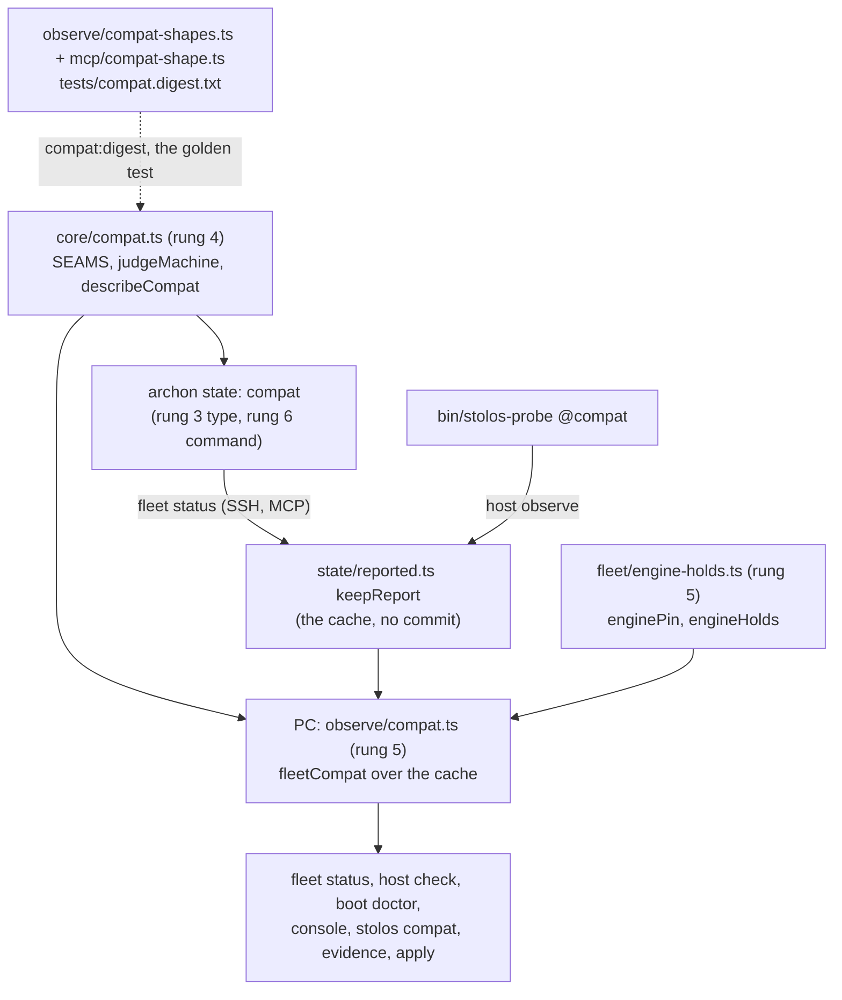

# Implementation Plan: Compatibility: one engine, one release train, and a contract between a PC and its machines

**Branch**: `115-compatibility` (committed directly to main) | **Date**: 2026-11-18 | **Spec**: [spec.md](spec.md)

**Input**: Feature specification from `specs/115-compatibility/spec.md`

## Summary

`archon` and `stolos` are one engine with one version (spec 114); what is versioned on its own is the contract between a PC and its machines, in five seams, each with a
Semantic Version and a minimum (`src/archon/core/compat.ts`). A golden test and `bun run compat:digest` fail when the shape of the model, the query views or the MCP tools
changes under an unchanged version. Every machine reports its engine and its seams in `archon state`, the probe reports its own facts' version, and the PC keeps both in its
observation cache (the record that already holds what machines say about their tags), judges each machine against its own contract, and says it in plain words wherever it lists
machines, with a failing finding and a warning before `stolos apply`. A host, or a group of hosts chosen by tags, can be held at an engine tag: this release types, validates,
shows and checks the hold, and records the design of the install side with its blocker.



## Technical Context

**Language/Version**: TypeScript 7, run by Bun, with Node 26 as the backup (Article 4, spec 096-bun-runtime)

**Primary Dependencies**: IFC TypeScript's kernel and runtime (`@intellectual-frontiers/commons`), `node:sqlite` (the state store), `node:crypto` (SHA-256 of a shape); nothing new

**Storage**: the PC's own `archon.sql` (the `reported` record, now with `compat`); `tests/compat.digest.txt` in the repository; nothing in the fleet repository changes per run

**Testing**: `tests/compat115.test.ts` (real `sh` runs the probe; real `archon state` in a host root; real `stolos fleet status`, `compat`, `build` and a signed `apply` of a
copy of the example lab, with a stand-in `ssh` as spec 048's and 112's tests have it; real Git repositories for `git ls-remote`; the real `tools/compat-digest.ts`), plus the
tests of specs 067, 069, 112 whose fixtures carry the probe's new section; the project's runner on Bun and Node 26

**Target Platform**: every machine that runs `archon` (Linux); the controller PC (Linux, macOS, Windows); adopted POSIX and Windows machines through their probe

**Project Type**: command line (headless first), then the Stolos Console

## Constitution Check

- Article 0 (the ladder): the terms are in the ontology (rung 0: `stolos:Seam`, `stolos:CompatStatus`) and cited in `spec.md` (rung 1); the shapes of the model's holds
  (`EngineHold`, `EngineHoldBy` in `model/types.ts`, rung 2) and the report's sanitizer (`model/reported.ts`) are governed data and data operations (rungs 2 and 3); the seams and
  the judgement (`core/compat.ts`) are an infrastructure rule every part reuses (rung 4); the PC's side, the holds, the digests and the policy (`observe/`, `fleet/`, `adopt/`,
  `compliance/`) are business rules (rung 5); the command, the probe, the MCP shape, the digest tool and the console are rung 6; the guide and the tests are rung 7. The command and
  its test are written before the console that draws it. A machine's `archon state` is filled by the registry (rung 6), never by the state store (rung 3), so no import climbs.
- Article 2 and 3 (Ubuntu decides; reuse): nothing is installed; Semantic Versioning is the scheme, commons' `ifr:VersionScheme` and `ifr:Impact` are cited, SKOS maps the code lists.
- Article 4 (code over config): the holds are TypeScript in `host.ts` and `fleet.ts`, typed by the engine's own tag form; the seams are constants.
- Article 5 and 12 (binaries only; the lock): the install side of a hold is not built, because it would need the lock relaxed or a build (see Design notes and `tasks.md`).
- Article 9 and 25: nothing a machine says changes configuration; the cache is the PC's own; a hold is a signed decision in Git like any other model change.
- Article 13: no secret is reported, kept or shown; a version is not one.
- Article 17: the read is `archon_state` over SSH as `ops`, the probe key's forced command; nothing new is served.
- Article 19 (calm output): `stolos compat` is a report (verbose); a compatible machine is silent in an action; every problem has a code that `explain` knows.
- Article 6 (one registry): `compat` is a registry command (place `pc`); `archon state` carries the report in the existing tool.

## Project Structure

### Documentation (this feature)

```text
specs/115-compatibility/
  spec.md          the requirements, the ontology terms they use, the standards considered, the decisions
  plan.md          this file
  tasks.md         the tasks, each with its files and requirements, and the later items (the install side of a hold)
  reviewed.tsv     the requirements proven by review
```

### Source Code (by rung of the ladder)

```text
rung 0: ontology/stolos/{vocabulary,codes,mod,audit}.ts (Seam, CompatStatus; both mapped to skos:ConceptScheme)
rung 2: src/archon/model/types.ts (EngineTag, EngineHold, EngineHoldBy; HostDef.enginePin, FleetDef.engineHolds)
rung 3: src/archon/model/reported.ts (ReportedCompat, sanitizeCompat, reportFromProbe), src/archon/state/state-command.ts (HostState.compat)
rung 4: src/archon/core/compat.ts (SEAMS, judgeMachine, describeCompat), src/archon/core/explain.ts (E115-TOO-OLD, E115-NEWER, P115-UNKNOWN)
rung 5: src/archon/observe/{compat,compat-command,compat-shapes,fleet-status}.ts, src/archon/fleet/{engine-holds,apply}.ts, src/archon/adopt/{adopt,policy}.ts,
        src/archon/compliance/report.ts, src/archon/build.ts, src/archon/guide/where.ts
rung 6: bin/stolos-probe.{sh,ps1}, src/archon/commands/registry.ts, src/archon/mcp/compat-shape.ts, src/archon-boot/doctor.ts, tools/compat-digest.ts,
        src/archon/console/{pc,stolos-pages}.ts
rung 7: tests/compat115.test.ts, tests/compat.digest.txt, src/archon/fleet/mod.ts
```

**Structure Decision**: the engine's existing folders. `core/compat.ts` is pure (two contracts in, a judgement and words out); `observe/compat.ts` is the only place that reads the PC's
cache for it, and every page, command and finding takes its judgement from `fleetCompat`; `fleet/engine-holds.ts` is the only place that reads a hold.

## Design notes

- **One judgement.** `judgeMachine(kind, report)` is a pure function of this PC's `SEAMS` and what a machine said; `describeCompat` is the only place that writes the sentences, so
  `fleet status`, `host check`, `boot doctor`, the console, `compat` and the evidence cannot disagree.
- **Where the report is filled.** `HostState.compat` is declared in the state module (rung 3) and filled by the registry's `state` command and `archon` with no arguments (rung 6,
  through `core/compat.ts`), so the state store imports nothing above it. The PC keeps it in the same `reported` record as a machine's tags (`sanitizeCompat`: only
  `major.minor.patch` and only the seams of the ontology survive).
- **The digest is derived.** The model's shape is the text of `model/types.ts` and `model/site.ts` without comments and layout; the query interface's is `VIEWS` sorted; the MCP
  surface's is each tool served at `mutate` with its tier and arguments. `reconcileDigests` is the one rule, used by `compat:digest`, by `--check` (in `bun run ci`) and by the test.
- **The probe.** Its own `version` (3) is the major of `probe-facts`; the new `@compat` section carries `probe_facts=3.1.0` and `probe_minimum`; a probe without the section is read as
  `<version>.0.0`. An adopted machine's `host check` reads the probe version of its committed observation, so no new field is committed per run.
- **Per-host engine hold: what a server really does.** A server's engine is one `node_modules` in `/srv/archon`, installed by `bun install --frozen-lockfile` from the checkout's
  `package.json` and `bun.lock` (`install/bun.ts`, `capabilities/cli.ts`: the launcher runs `/srv/archon/archon.ts`, whose imports and the fleet's own files resolve the engine by its
  package name from that one tree). `reconcile` re-installs only when those two files change, and refuses and resets when the install fails. Holding one host at another tag therefore needs:
  (1) a lock for that tag, which exists only if a signed commit once pinned it, or if the PC writes one (a non-frozen `bun install` at the tag, as `fleet upgrade` does) and signs it as a
  new file of the fleet repository; (2) a second install root on the host for that lock and a way for the fleet's files to resolve the engine from it instead of the checkout's tree;
  (3) a launcher that selects the root, rendered by the engine the host runs, which a host held at an older engine than this release cannot receive; and (4) tests that install
  two real engines from real tags. None of it can be done without relaxing `--frozen-lockfile` or building, except (1) and (2) with a new, signed lock per held tag, which is a design of
  its own (tasks L001). So this release builds the typed model, the validation, the display and the existence check, and says in every sentence that the hold is not enforced yet.

## Standards considered

The same ones as the specification (`spec.md`, Standards considered): RFC 2119 and RFC 8174 for the requirement words; Semantic Versioning 2.0.0 for a seam's version and its rule of
change; commons' 0026-works-versioning (`ifr:VersionScheme` `SemVer`, `ifr:Impact`, the engine as one work whose only release is `stolos-v<version>`); NIST SP 800-53 Rev 5 CM-2, CM-3,
CM-8 and SA-22 with SP 800-128 for a change sent to components that can read it and for unsupported components; the Secure Controls Framework's CHG-03 and CFG-04 for the finding;
W3C SKOS for the two code lists, as `ontology/stolos/audit.ts` maps them; the Model Context Protocol's version negotiation (the seam `mcp` is the tool surface served on top of it);
osquery's Automatic Table Construction for the query views. The five seams themselves have no standard to adopt: they are the engine's own decision.
