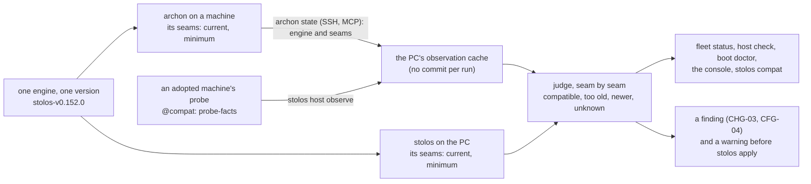

# 115: Compatibility: one engine, one release train, and a contract between a PC and its machines

Issue intellectual-frontiers/stolos#45. It builds on spec 114-release-record (one work, one version, the tag `stolos-v<version>`), spec 099-engine-update and
spec 058-operator-update (how a PC and a fleet follow the engine), spec 048-observe-by-query and spec 014-state (what a machine records and how the PC reads it),
spec 112-machine-reported-tags (what a machine says about itself, kept in the PC's observation cache, the probe at version 3), spec 015-reconcile (a server follows the
fleet repository within 15 minutes) and spec 059-stolos-and-archon (two commands, one engine).

## Why

`archon` (on each machine) and `stolos` (on the PC) are two entry points of **one engine**: one codebase, one version, one release train, the tag `stolos-v<version>`
(spec 114). A fleet pins the engine once, so a PC and its servers usually run the same release, but not always: a server follows the fleet repository only every
15 minutes, an adopted machine runs a probe that was installed once, a machine may be off for a month, and an owner may move the PC ahead and the machines later.
What matters then is not whether two engine versions are equal but whether **the PC and the machine still understand each other**.

What is versioned independently is therefore the **contract** between a PC and its machines, in parts: its **seams**. A seam is one interface (the fleet model's schema,
the signed record formats, the probe's facts, the machine query views, the MCP tool surface) with its own Semantic Version and the oldest version the other side may
have. A PC compares each machine with that contract and says it in plain words, with the fix; it never refuses to talk to a machine on its own.

## Ontology

The terms this spec uses, defined in `ontology/stolos/` with this spec as their source: the code list `stolos:Seam` (`stolos:seam-model`, `stolos:seam-signed-records`,
`stolos:seam-probe-facts`, `stolos:seam-query`, `stolos:seam-mcp`) and the code list `stolos:CompatStatus` (`stolos:compat-compatible`, `stolos:compat-too-old`,
`stolos:compat-newer`, `stolos:compat-unknown`). `bun run gen` writes them as the unions `Seam` and `CompatStatus` and the arrays `SEAM_IDS` and `COMPAT_STATUSES` in
`src/archon/ontology.auto.ts`; the code imports the unions. From earlier specs: `stolos:EngineRelease` (spec 114), `stolos:AdoptedMachine`, `stolos:Controller`,
`stolos:Host`, `stolos:Tag`, `stolos:TagSelection`, `stolos:CommandTier`. Both new classes are mapped to W3C SKOS (`skos:ConceptScheme`, as every code list is) in
`ontology/stolos/audit.ts`: no new term is left unaligned. The version of a seam is a Semantic Version, commons' `ifr:VersionScheme` `SemVer`, and the impact of a
change on it is commons' `ifr:Impact` (`Major`, `Minor`); this spec uses those by citing them and defines nothing of the kind again.

## Requirements

Requirement words follow RFC 2119 as RFC 8174 clarifies it: they are requirements only where written in capitals.

**Standards considered.** RFC 2119 and RFC 8174 (requirement words); Semantic Versioning 2.0.0 (the scheme of a seam's version: a change that breaks a reader raises the
major, an addition the minor, a fix the patch; precedence by number, item 11); commons 0026-works-versioning (FR-004 the code lists `ifr:VersionScheme` and `ifr:Impact`,
FR-010 a Semantic Version compared by its precedence; the engine is one work, so a seam is not a second work and carries no tag of its own, and `stolos-v<version>`
stays the only release); NIST SP 800-53 Rev 5 CM-2 (baseline configuration) and CM-3 (configuration change control: a change is sent knowing who can read it), CM-8
(system component inventory: the version of each component is part of it) and SA-22 (unsupported system components: a machine too old to be read is one); NIST SP 800-128
(the fleet, not the component, decides what is compatible); the Secure Controls Framework controls CHG-03 (Configuration Change Control) and CFG-04 (Secure Baseline
Configurations), whose ids and names `tests/compat115.test.ts` checks against the pinned SCF workbook; W3C SKOS (the two code lists are concept schemes); the
Model Context Protocol's own versioning (the protocol version a client and a server negotiate at `initialize`: this spec versions the tool surface served on top of it,
not the protocol); osquery's Automatic Table Construction (the query views); and spec 105-calm-output (the output contract). No standard defines a contract between a fleet's
controller and its machines; the five seams are this engine's own decision, stated in the Decisions below.

### The seams and their versions

- **FR-001** The seams, and each seam's version, MUST be defined in one place, `SEAMS` of `src/archon/core/compat.ts` (rung 4), keyed by the code list `stolos:Seam`; nothing
  else MUST write a seam's number. The five seams MUST be: `model` (the fleet model's schema: the types of the fleet, its hosts and its site, which `stolos` renders and
  `archon` applies), `signed-records` (the signed commit and approval conventions, the pairing check-in `stolos1:` text, and the observation and verify records),
  `probe-facts` (the facts an adopted machine's probe answers), `query` (the views of a machine's state database that `archon state`, `archon query` and osquery read, and
  their columns) and `mcp` (the tools a machine's MCP server serves, their arguments and their tiers). Each MUST have a Semantic Version `current` and a `minimum`: the
  oldest version of that seam the other side may have, that is, the oldest this side still understands. The first versions MUST be as the table in the Decisions says.
- **FR-002** A change to a seam MUST raise its version by the rule of Semantic Versioning: a change that breaks a reader (a removed or renamed field, column, tool or
  argument, a changed meaning) raises the **major** and resets the minor; an addition a reader may ignore (a new optional field, column, tool or optional argument)
  raises the **minor**. `minimum` MUST NOT be above `current` and MUST be of the same or an older major; it MUST be raised only when this side stops understanding the
  other's older versions, and a test MUST hold both.
- **FR-003** A golden test MUST fail when the shape of a seam changes without its version changing. For `model`, `query` and `mcp` the shape MUST be a stable digest
  (SHA-256) of text derived from the code: the model's types and the site's types with comments and layout removed (`src/archon/model/types.ts`,
  `src/archon/model/site.ts`), the machine query views with their columns (`VIEWS` of the state store, sorted), and the MCP tools a machine serves at the tier `mutate`
  with their argument names, types, requirement and tiers (descriptions are not part of the shape). The digests MUST be committed with the version they belong to in
  `tests/compat.digest.txt`; `bun run compat:digest` MUST write that file and MUST refuse to write a changed digest under an unchanged version (it says which seam to
  raise, and by what rule); `bun run compat:digest --check` MUST fail where the file differs from the code, and `bun run ci` MUST run it. `signed-records` and
  `probe-facts` are versioned by hand and held by FR-004 and by their own tests.
- **FR-004** The read-only probe MUST report the version of its own facts (the seam `probe-facts`) in a section `@compat` of its `facts` answer, in the POSIX and the
  PowerShell script alike: `probe_facts=<current>` and `probe_minimum=<minimum>`, the oldest PC it still answers. The probe's own `version` (its integer, 3) MUST remain
  the major number of that seam, and a test MUST hold the two together. A probe that has no `@compat` section (probe 2 and 3.0) MUST be read as `<version>.0.0`.

### What each side reports and records

- **FR-005** A machine that runs `archon` MUST report its engine version (`VERSION` of `src/archon/version.ts`, the number that `versionLine` prints) and the `current` and
  `minimum` of every seam a machine has (`model`, `signed-records`, `query`, `mcp`) in `archon state` (text, `--json`, and the MCP tool `archon_state`), as the field
  `compat` of the state record the PC already collects over SSH. Reporting MUST read nothing but constants and change nothing.
- **FR-006** The PC MUST keep what a machine reported about its engine and seams in its observation cache, in the same record as the tags a machine reports about itself
  (spec 112-machine-reported-tags FR-010: the kind `reported` of the PC's own `archon.sql`), so that no run makes a commit. What a machine says MUST be read as untrusted
  input: only versions of the form `major.minor.patch` (each number at most five digits) and only the seams of `stolos:Seam` are kept, and anything else MUST be dropped
  and MUST NOT fail any command. `stolos fleet status` (managed servers, from `archon_state`) and `stolos host observe` (adopted machines and the controller, from the
  probe's `@compat`) MUST collect it on their normal cycle. A machine that cannot be reached MUST keep its last report.

### The check, and what it says

- **FR-007** The PC MUST judge each machine against its own contract, seam by seam, over the seams that kind of machine has (a managed server: `model`, `signed-records`,
  `query`, `mcp`; an adopted machine and the controller: `probe-facts`). A seam of a machine is **too old** where the machine's `current` is below the PC's `minimum`; it is
  **newer** where the machine's `minimum` is above the PC's `current`, or the machine's `current` is of a higher major than the PC's; otherwise it is **compatible**; a
  seam the machine did not report is **unknown**. The machine's status MUST be `too-old` where any seam is too old (it comes first, because the machine cannot be read or
  cannot read), else `newer` where any is newer, else `unknown` where any is unknown or the machine has not reported at all, else `compatible`
  (`stolos:CompatStatus`). The judgement MUST be one pure function of two contracts, `judgeMachine` of `src/archon/core/compat.ts`, and the engine versions MUST NOT take part
  in it: the engine may differ.
- **FR-008** The PC MUST say each status in plain words, with the fix as one command, from one function (`describeCompat`): `compatible`: `alpha runs engine 0.148.0,
compatible with this PC's 0.152.0` (or `runs engine 0.152.0, the same as this PC`); `too-old`: `too old for this PC: run archon update on alpha` with the command
  `ssh alpha archon update` (for an adopted machine: `bun run stolos host adopt <name>`, which installs the current probe); `newer`: `newer than this PC: run bun run stolos
update` (the command is the same for every machine); `unknown`: `unknown (not reported yet)` with the command `bun run stolos fleet status` (for an adopted machine:
  `bun run stolos host observe <name>`). The words MUST name the seams that decided (`model is 1.0.0, this PC needs 1.2.0`) and MUST NOT name a secret.
- **FR-009** The statement MUST be shown in `stolos fleet status` (on each machine's line), in `stolos host check` and in `boot doctor` where machines are listed, in the
  Stolos Console's machines table (a column), on a machine's page (a card with the engine and each seam), and on the Overview (the machines that are not compatible, with
  the fix); and it MUST be in the machines' CSV and the evidence JSON. A machine that is not compatible MUST be a problem with its fix and a code; a machine that is
  unknown MUST be a thing for the person to do, not a failure.
- **FR-010** A machine that is not compatible MUST be a finding of the compliance evidence: a failing policy "Speaks this PC's contract" with the fix of FR-008 and the SCF
  controls CHG-03 and CFG-04, passing where the machine is compatible, failing where it is too old or newer, and absent where it has not reported (as spec 112's finding
  is). For an adopted machine the policy MUST be one of the adopted pack (`stolos host check`), judged from the probe's version in its observation.
- **FR-011** `stolos apply` MUST warn, before it signs a change, for each machine that cannot read what the PC is about to send (a machine whose `model` or
  `signed-records` seam is too old or newer, or which is too old on any seam), naming the machine, why, and the fix. It MUST NOT block, change its exit code, or ask a
  question: the person decides. Where nothing is known (no machine has reported) it MUST say nothing.
- **FR-012** Output MUST follow spec 105-calm-output (Article 19): a status that is `compatible` MUST NOT be printed by an action, only by a report; a problem MUST carry a code that
  `stolos explain` knows (`E115-TOO-OLD`, `E115-NEWER`); a thing for the person to do MUST be ⚡ and carry a code (`P115-UNKNOWN`); marks, the ASCII fallbacks and the order
  MUST be the commons'.

### Staged rollouts: a host held at an engine tag

- **FR-013** A host MAY be held at an engine tag, and so may a group of hosts chosen by tags (spec 108-tags): `enginePin` of a host's model (`host.ts`) and `engineHolds` of
  the fleet's model (`fleet.ts`, each with a `select` expression of spec 108's grammar). A hold MUST be typed, with the engine tag in the form `stolos-v<major>.<minor>.<patch>`
  of `src/archon/version.ts` (a type error otherwise), a reason, and an `until` date (`YYYY-MM-DD`) at most 180 days after the day it is validated; `stolos build` MUST
  refuse a hold that is none of those, with the fix. A hold that has expired MUST be ignored and MUST be said (a warning), never silently kept.
- **FR-014** A host's own `enginePin` MUST win over a group's hold, and the first matching hold of `engineHolds` over the later ones. The PC MUST say a hold in plain
  words wherever it says a machine's engine, as `held at stolos-v0.150.0 (fleet pin stolos-v0.152.0)`, and where the machine reports an engine other than the hold's,
  MUST say so. `stolos compat` MUST check that each held tag exists with `git ls-remote --tags` of the engine's repository (with a time limit), and MUST say a hold on a
  tag that does not exist as a problem with its fix; an unreachable GitHub MUST be said as not checked, never as a missing tag.
- **FR-015** This release MUST NOT claim that a machine runs its held engine: the hold is recorded, validated, shown and checked, and the machine still follows the fleet's
  pin until the install side is built. The words MUST say so (`not enforced on the machine yet`), and `tasks.md` MUST hold the design of the install side with the exact
  blocker (it cannot be built without relaxing `--frozen-lockfile`, a second engine root and a launcher change that a held, older engine cannot receive).

### The command

- **FR-016** `stolos compat` MUST exist (the one registry, place `pc`, tier `read`, class `report`: verbose by default). It MUST list the seams with this PC's `current` and
  `minimum`, this PC's engine, each machine with its engine, status, the seams that decided and the fix, and each hold with its check; it MUST answer `--json` (the same
  data, nothing drawn), `--quiet` (one verdict line and the exit code) and `--verbose`; it MUST exit 1 where a machine is too old or newer and 0 otherwise.
- **FR-017** `archon --version` and `stolos --version` MUST keep their line (`<version> (engine stolos-v<version>)`, spec 114-release-record FR-014).

### Everywhere

- **FR-018** Windows and macOS MUST NOT be diminished: the probe stays POSIX shell and PowerShell; files are written with `path.join`; every child process, probe and network
  call has a time limit; and the tests MUST pass on Bun and on Node, as a user who is not root, and without depending on being alone on the machine.
- **FR-019** The guides (`src/archon/fleet/mod.ts`), the command help and the module documentation MUST say what is true now, and `bun run check:trace`,
  `check:layers`, `check:ontology` and `check:mizan` MUST pass with baselines no larger than before.

## Success criteria

- **SC-001** `tests/compat115.test.ts`: the code lists and their mapping, the seams and their rules, the judgement (every status, every edge of `minimum`), the plain words, the
  digests against `tests/compat.digest.txt` (and `bun run compat:digest` refusing a changed shape under an unchanged version, on a real copy of the files), the machine's
  `archon state` carrying `compat`, the PC's cache (sanitized, hostile input, no commit), the probe's `@compat` run for real by `sh`, the finding with its SCF ids, the apply
  warning (never blocking), the console's column, card and Overview, the holds (typed, validated, resolved, checked against a real Git repository with `git ls-remote`),
  and `stolos compat` run for real with `--json`.
- **SC-002** `bun run check:ontology`, `check:trace`, `check:layers` and `check:mizan` pass with baselines no larger than before.

## Decisions

- **One engine, two entry points; the contract is what is versioned.** `archon` and `stolos` are one codebase, one version and one release train. A seam is not a work, has no
  tag and no release record; it is a number inside the engine that says what a reader must understand. Raising a seam is part of the change that needs it (the spec loop).
- **The first seams are all 1.0.0, but the probe's.** Nothing reported a version before this spec, so what exists is the baseline; `probe-facts` is 3.1.0 because the
  probe has been at version 3 and this spec adds a section to it (a minor), with a `minimum` of 1.0.0 (every probe ever released still answers and is read: an older one only lacks sections such as `reported`).

  | Seam             | current | minimum | Held by                                                      |
  | ---------------- | ------- | ------- | ------------------------------------------------------------ |
  | `model`          | 1.0.0   | 1.0.0   | the digest of the model's and the site's types               |
  | `signed-records` | 1.0.0   | 1.0.0   | by hand, with the tests of the check-in text and the records |
  | `probe-facts`    | 3.1.0   | 1.0.0   | by hand, equal in major to the probe's own version           |
  | `query`          | 1.0.0   | 1.0.0   | the digest of the views and their columns                    |
  | `mcp`            | 1.0.0   | 1.0.0   | the digest of the tools served at the tier `mutate`          |

- **Mutual, by `minimum`.** A PC understands a machine whose seam is at least the PC's `minimum` and no more than its own major; a machine understands a PC whose seam is at
  least the machine's `minimum`. That is why a machine reports its `minimum` too: "newer than this PC" is the machine saying it no longer reads what the PC sends.
- **Too old comes before newer.** A machine that is too old on one seam and newer on another cannot be fixed from one side only; the person starts with the machine (`archon
update`), which is the command that changes the most seams at once, and the words name both.
- **The engine version is shown, never judged.** Two machines on different engines may be compatible, and two on the same engine always are; the engine's number is for
  people, the seams for the rule.
- **A machine that never reported is unknown, not too old.** A machine whose engine predates this spec cannot say anything; the PC does not guess from the engine it
  pinned for it. The next `archon update` and `stolos fleet status` make it known.
- **A warning, never a block.** Spec 060's `stolos apply` is how a change leaves the PC, and the person decides (the owner's decision, final): the warning names the machine
  that cannot read the change and the command that fixes it.
- **The digest is derived, never typed.** A hand-written list of fields would drift from the code; a digest of the code's own shape cannot, and `compat:digest` refuses to
  hide a change under an unchanged version. The text of the types is compared without comments, so documentation changes do not move the model's version.
- **The per-host hold is recorded and not yet enforced.** Holding a host at an engine tag needs a second, locked install of that tag on the machine and a launcher that
  runs it; neither can be built without relaxing `--frozen-lockfile` or building from source, which the constitution forbids (Articles 5 and 12). The model, the validation,
  the display and the check are built now so that a hold is a decision the fleet can already state and see; the plan and `tasks.md` hold the design of the install side.
